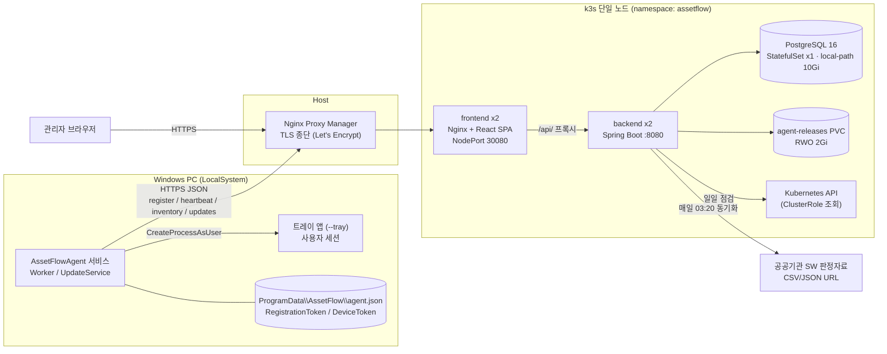
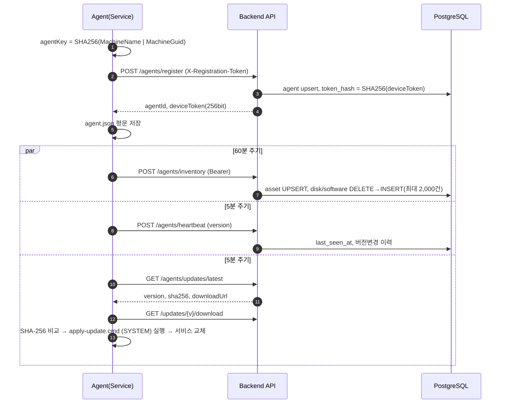
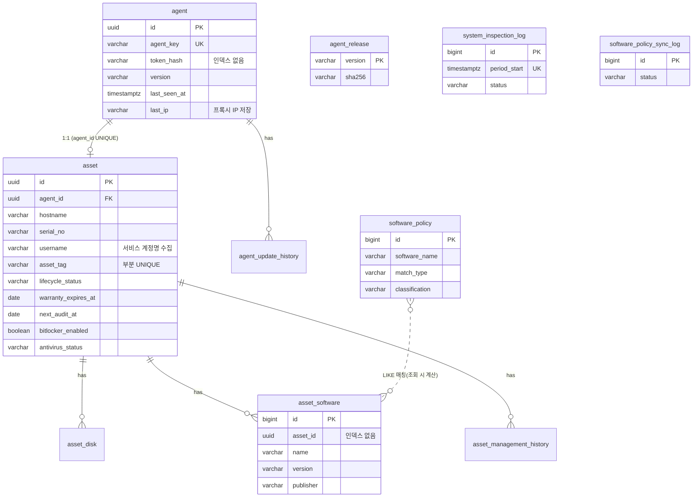

# 01. AssetFlow 소스 현황 분석

> 분석 대상: `assets/` (AssetFlow, Agent 0.2.9 / Backend 0.1.0 / Frontend 0.2.0)
> 분석일: 2026-10-23 · 분석 방식: 전체 소스 정적 분석(빌드·실행 없음)

## 1. 시스템 개요

AssetFlow는 Windows PC에 설치된 .NET 8 Agent가 하드웨어·OS·네트워크·소프트웨어·보안 상태를 수집해 Spring Boot API로 전송하고, React 관리 콘솔에서 조회·관리하는 **에이전트 기반 IT 자산관리(ITAM) 시스템**이다. 운영 환경은 단일 노드 k3s(Backend 2, Frontend 2, PostgreSQL 1)이며 GitHub Actions + GHCR + Self-hosted Runner로 배포한다.

| 영역 | 기술 | 규모(LOC) | 주요 파일 |
|---|---|---|---|
| Windows Agent | C# / .NET 8 Worker Service + WinForms 트레이 | 약 600 | `agent/Worker.cs`, `InventoryCollector.cs`, `UpdateService.cs`, `TraySessionService.cs` |
| Backend | Java 21 / Spring Boot 3.4.5 / JdbcTemplate | 약 550 | `api/*Controller.java`, `service/*.java` |
| DB | PostgreSQL 16, `schema.sql` 자동 실행 | 69 | `backend/src/main/resources/schema.sql` |
| Frontend | React(latest) + Vite + AG Grid 36 + Mermaid 11 | 1,771 (단일 파일) | `frontend/src.jsx` |
| 배포 | Docker Compose / k3s Kustomize / GitHub Actions | - | `deploy/k3s/*.yaml`, `.github/workflows/deploy-k3s.yml` |

## 2. 전체 아키텍처

## 3. Agent 동작 흐름

## 4. 데이터 모델 (현행)

## 5. API 목록 (실제 소스 기준)

| Method | Path | 인증(실제) | 비고 |
|---|---|---|---|
| POST | `/api/v1/agents/register` | 등록 토큰 | 같은 `agentKey`면 **기존 토큰 덮어쓰기** |
| POST | `/api/v1/agents/heartbeat` | 장치 Bearer | 5분 |
| POST | `/api/v1/agents/inventory` | 장치 Bearer | 60분, 전체 치환 |
| GET | `/api/v1/agents/updates/latest`, `/{v}/download` | 장치 Bearer | |
| POST | `/api/v1/admin/agent-releases` | **X-Update-Token만 (permitAll)** | 관리자 세션 불필요 |
| GET | `/api/v1/admin/agent-releases`, `/agent-update-history` | 관리자 세션 | |
| GET | `/api/v1/dashboard`, `/assets`, `/assets/{id}` | 관리자 세션 | `/assets` LIMIT 500 고정 |
| PATCH | `/api/v1/assets/{id}/management` | 관리자 세션 | 관리정보 + 이력 |
| GET | `/api/v1/assets-export.csv` | 관리자 세션 | README 미기재 |
| GET/POST/PUT/DELETE | `/api/v1/admin/software-compliance/**` | 관리자 세션 | PUT/DELETE README 미기재 |
| GET/POST | `/api/v1/admin/system-inspections`, `/live` | 관리자 세션 | README 미기재 |
| POST | `/api/v1/auth/login`, `/logout`, GET `/me` | - | |

## 6. 기능 성숙도 평가

| 영역 | 현재 수준 | 평가 |
|---|---|---|
| PC 하드웨어/OS 인벤토리 | 단일 NIC·단일 CPU·C: BitLocker만 | ◐ 기본 충족 |
| 소프트웨어 인벤토리 | HKLM Uninstall만, 매회 전체 치환 | ◐ 사용자 설치/Store 앱 누락, 변경 이력 없음 |
| 자산 관리정보(태그·상태·보증·실사) | 단일 테이블 필드 | ◐ 마스터 데이터(부서·사용자·위치) 부재 |
| SW 컴플라이언스 | 이름 LIKE 매칭 | ◐ 라이선스 수량 관리 없음 |
| 보안 상태 | BitLocker·FW·Defender·TPM·SecureBoot | ◐ 판정 로직 부정확(4장 보안 검토) |
| 인증/권한 | 단일 InMemory 관리자, CSRF off | ✕ 운영 부적합 |
| 감사 로그 | 자산 관리정보 변경만 | ✕ 로그인·조회·다운로드·배포 기록 없음 |
| Agent 자동 업데이트 | 서버 제공 SHA-256 검증 | ✕ 코드서명 검증 없음 |
| 운영 모니터링 | 일일 점검 + live 조회 | ◐ 알림·메트릭·백업 없음 |
| 테스트 | 없음 | ✕ |

## 7. 코드 품질 관찰

- **가독성**: `AuthController.java`, `SecurityConfig.java`, `AgentAuth.java`, `Worker.cs`, `UpdateService.cs`가 1~3줄로 압축되어 리뷰·변경 추적이 어렵다. 포매터(google-java-format, dotnet format) 적용 필요.
- **프런트엔드 단일 파일**: `frontend/src.jsx` 1,771줄에 전 화면이 포함. 라우터 없음(탭 상태만), 빌드 분할 없음.
- **스키마 관리**: `schema.sql` + `ALTER ... IF NOT EXISTS` 누적 방식, `spring.sql.init.mode: always`. 릴리스 노트까지 `UPDATE`로 시드. 버전 관리형 마이그레이션(Flyway) 부재.
- **의존성 버전**: `frontend/package.json`에 `react`, `vite`, `@vitejs/plugin-react`가 `latest` — lock 파일이 있으나 재현성과 보안 검토 기준이 흔들린다.
- **테스트 부재**: `spring-boot-starter-test`만 선언, 테스트 코드 0건. Agent 테스트 프로젝트 없음.
- **문서와 소스 불일치**: README API 표에 `assets-export.csv`, `system-inspections`, 정책 PUT/DELETE 누락. 로드맵 2~6단계 일부(감사 로그, 자산번호 등)는 부분 구현 상태.

## 8. 검토 문서 구성

| 문서 | 관점 |
|---|---|
| [02_IT자산관리_전문가_검토](02_IT자산관리_전문가_검토.md) | 자산 식별·생애주기·라이선스·실사·보고 |
| [03_보안전문가_검토](03_보안전문가_검토.md) | 공급망·인증·권한·개인정보·취약점 |
| [04_인프라유지보수_검토](04_인프라유지보수_검토.md) | 가용성·백업·모니터링·성능·배포 |
| [05_개선기획_로드맵](05_개선기획_로드맵.md) | 통합 백로그·우선순위·일정·목표 아키텍처 |
