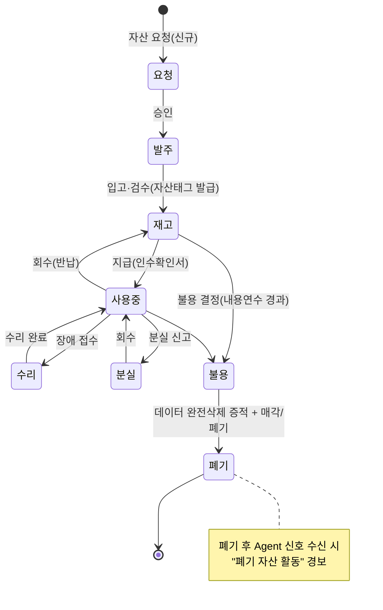
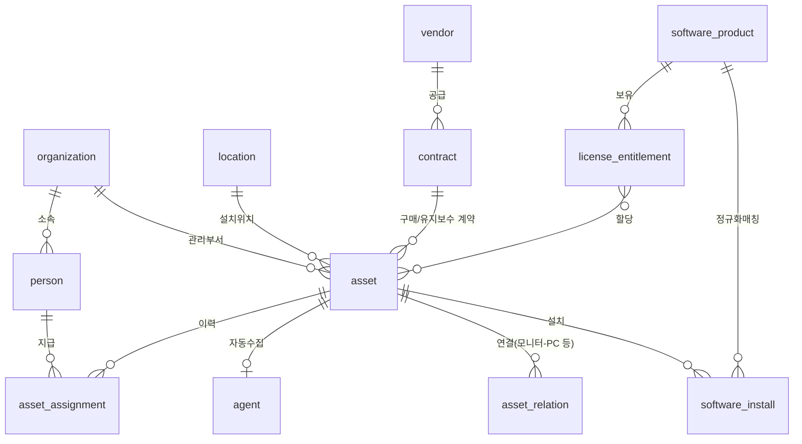
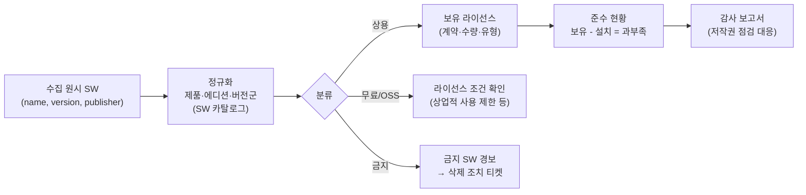

# 02. IT 자산관리 전문가 관점 검토

> 관점: ITAM/SAM 실무 (ISO/IEC 19770-1, ITIL 4 IT Asset Management, 공공기관 정보화자산 관리 지침)
> 핵심 질문: "이 시스템의 데이터로 **실사·감사·예산·폐기 의사결정**을 할 수 있는가?"

## 1. 총평

현재 AssetFlow는 **"Agent 기반 PC 인벤토리 수집기 + 관리 필드"** 수준이다. 수집 자동화와 대시보드는 양호하지만, ITAM의 핵심인 ① 자산의 고유 식별·중복 제거, ② 사람·조직·위치 마스터와의 연결, ③ 라이선스 보유량 대비 설치량(Entitlement vs Deployment), ④ 생애주기 워크플로(요청→입고→지급→회수→폐기)와 증적이 부족하다. 특히 **자산 식별 키 설계 결함**과 **사용자명 수집 오류**는 데이터 신뢰도를 직접 훼손하므로 즉시 수정이 필요하다.

## 2. 데이터 품질 결함 (즉시 수정)

| ID | 결함 | 근거 | 영향 | 수정안 |
|---|---|---|---|---|
| AM-01 | **사용자명이 항상 `SYSTEM`** | `agent/InventoryCollector.cs:25` `Environment.UserName` — 서비스는 LocalSystem으로 실행 | "담당자/사용자" 기준 검색·실사 불가 | `Win32_ComputerSystem.UserName` 또는 WTS 활성 세션 사용자(`WTSQuerySessionInformation`) + 최근 로그온 사용자 목록 수집 |
| AM-02 | **PC 이름 변경 시 신규 자산으로 중복 등록** | `agent/AgentClient.cs:29` agentKey = SHA256(MachineName\|MachineGuid) | 자산 수 부풀림, 이력 단절 | agentKey는 MachineGuid + SMBIOS UUID 기반으로, 서버에서 **serial_no/device_uuid 기반 중복 후보 탐지·병합** 기능 |
| AM-03 | **이미지 복제 PC의 토큰 충돌** | 동일 MachineGuid(미 Sysprep) → `AgentController.java:33`이 토큰 덮어쓰기 | 두 PC가 번갈아 401, Agent는 재등록 로직이 없어 영구 오프라인 | 등록 시 serial/UUID 불일치면 신규 Agent로 분리, 401 시 재등록 흐름 |
| AM-04 | 대표 NIC 1개만, 가상 어댑터 우선 가능 | `InventoryCollector.cs:16-19` | VPN/Hyper-V MAC 저장 → NAC·IP 대장 불일치 | 전 NIC 목록(물리 여부, MAC, IPv4/6, 게이트웨이, DHCP) 별도 테이블 |
| AM-05 | 메모리 수집 실패 시 0 바이트 | `InventoryCollector.cs:39`, `Models.java:13` `long memoryBytes` | 사양 통계 왜곡 | nullable 처리 |
| AM-06 | 소프트웨어 2,000건 초과 시 **무경고 절삭** | `AgentController.java:76` `.limit(2000)` | 컴플라이언스 누락 | 절삭 플래그 기록 또는 상한 상향 + 경고 |
| AM-07 | 사용자 단위 설치·Store 앱 누락 | `InventoryCollector.cs:48-63` HKLM만 | Zoom·Chrome 사용자 설치 등 비인가 SW 미탐지 | HKU\\*\\Uninstall, AppX(`Get-AppxPackage` 등가 API) 추가, `SystemComponent=1` 제외 |
| AM-08 | `department` 항상 null | `InventoryCollector.cs:25` | 부서별 통계 불가 | AD 속성(department) 또는 HR/조직 마스터 연동 |

## 3. 자산 생애주기 모델

현재 `lifecycle_status`는 6개 값의 자유 전환(`AssetController.java:70`)이다. 상태 전이 규칙, 승인, 증적이 없다.

**보완 요구사항**

1. 상태 전이 매트릭스를 서버에서 강제하고, 전이마다 `asset_management_history`에 사유·승인자·첨부(인수확인서, 폐기증명서) 기록.
2. `RETIRED/DISPOSED` 자산이 heartbeat를 보내면 경보(도난·미회수 의심). 현재는 무조건 갱신(`AgentController.java:41-43`).
3. 지급/회수 시 담당자 확인(전자서명 또는 확인 메일) — 공공기관 물품관리 감사 대응.
4. 내용연수·감가상각: `purchase_date`, `purchase_cost`는 있으나 내용연수(예: PC 5년)·잔존가 계산 없음 → `useful_life_months`, 감가상각 뷰 추가.

## 4. 마스터 데이터 및 CMDB 확장

| 추가 엔터티 | 목적 | 현재 대체 |
|---|---|---|
| `organization`, `person` | 부서·사용자 마스터(AD/HR 동기화) | `assigned_to`, `department` 자유 텍스트 |
| `location` | 건물/층/실 계층, 실사 단위 | `location` 자유 텍스트 |
| `asset_assignment` | 지급·회수 이력, 현재 사용자 | 없음 |
| `contract`, `vendor` | 구매·유지보수 계약, 만료 알림 | `vendor` 텍스트, `warranty_expires_at` |
| `asset_category` 확장 | 모니터·프린터·네트워크장비·서버·모바일 등 **비Agent 자산** 수동/엑셀 등록 | `category` 기본 `COMPUTER`만 사용 |
| `asset_relation` | PC-모니터, 서버-VM 등 관계(CMDB) | 없음 |

## 5. 소프트웨어 자산관리(SAM)

현재 `software_policy`는 금지/라이선스필요/검토필요 분류의 **이름 LIKE 매칭**으로, 라이선스 준수(Compliance Position) 산출이 불가하다.

| ID | 개선 항목 | 상세 |
|---|---|---|
| SAM-01 | SW 카탈로그(정규화) | 원시 이름 → 제품 매핑 테이블, 자동 규칙 + 수동 확정 |
| SAM-02 | 라이선스 보유 관리 | 제품·유형(디바이스/사용자/동시/구독)·수량·계약·만료일 |
| SAM-03 | 준수 포지션 | 제품별 보유 vs 설치 과부족, 부서별 배분 |
| SAM-04 | 설치/삭제 이력 | 매회 DELETE→INSERT(`AgentController.java:75-76`) 대신 diff 저장 → "언제 설치됐나" 증적 |
| SAM-05 | 정책 매칭 성능·정확도 | 현재 매 조회 시 전체 조인 LIKE(`SoftwareComplianceController.java:18-24`) → 수집 시점 사전 매칭 결과 테이블로 materialize |
| SAM-06 | 조치 워크플로 | 탐지 → 담당자 통보 → 삭제 확인(다음 수집에서 자동 종결) → 예외 승인(기간 한정) |
| SAM-07 | 구독형 SW | M365/Adobe 등 SaaS 계정 수 연동(향후) |

## 6. 실사(Audit) 및 보고

- **실사 기능 부재**: `last_audit_at`, `next_audit_at` 날짜만 존재. 실사 계획 → 위치별 대상 목록 → QR/바코드 스캔(모바일 웹) → 미확인 자산 → 결과 보고 흐름 필요.
- **자산태그 라벨 출력**: QR(자산 ID URL) 라벨 PDF 출력.
- **Agent 미설치 자산 탐지**: AD 컴퓨터 계정 / DHCP 임대 / NAC 목록과 대조하여 "Agent 미설치 PC" 산출 → 커버리지 KPI.
- **표준 보고서**: 자산 대장(물품관리대장 서식), 부서별 보유 현황, 내용연수 경과 목록, 보증 만료 예정, 금지 SW 탐지, OS EOL(Windows 10 2025-10-14 지원 종료 — 현재 시점 이미 경과) 장비 목록.
- **CSV 내보내기**: 현재 고정 컬럼(`AssetController.java:82-88`). 화면 필터 조건 반영 내보내기, XLSX, 그리고 **일괄 업로드(엑셀 → 관리필드 갱신)** 필요.

## 7. ITAM KPI (대시보드 추가 제안)

| KPI | 정의 | 목표(예) |
|---|---|---|
| Agent 커버리지 | Agent 보고 PC / AD 등록 PC | ≥ 98% |
| 데이터 신선도 | 24h 내 인벤토리 수신 비율 | ≥ 95% |
| 관리정보 완결성 | 자산태그·사용자·위치 입력 완료 비율 | 100% |
| 실사 일치율 | 실사 확인 / 대장 자산 | ≥ 99% |
| 라이선스 준수율 | 과설치 0인 상용 제품 비율 | 100% |
| EOL OS 비율 | 지원 종료 OS 장비 / 전체 | 0% |
| 장기 미접속 | 7일 이상 미보고 / 전체 | ≤ 3% |

## 8. 우선순위 요약

| 우선순위 | 항목 |
|---|---|
| P0 (즉시) | AM-01 사용자명, AM-02/03 식별키·중복, AM-06 절삭 경고 |
| P1 (1분기) | 마스터 데이터(조직·사용자·위치), 지급/회수 이력, 상태 전이 강제, SW 설치 diff, NIC 다중 수집, 폐기 자산 활동 경보 |
| P2 (2분기) | SW 카탈로그·라이선스 보유·준수 포지션, 실사(QR) 모듈, 비Agent 자산 등록·엑셀 업로드 |
| P3 (하반기) | CMDB 관계, 계약/벤더, 감가상각, SaaS 라이선스 연동 |
