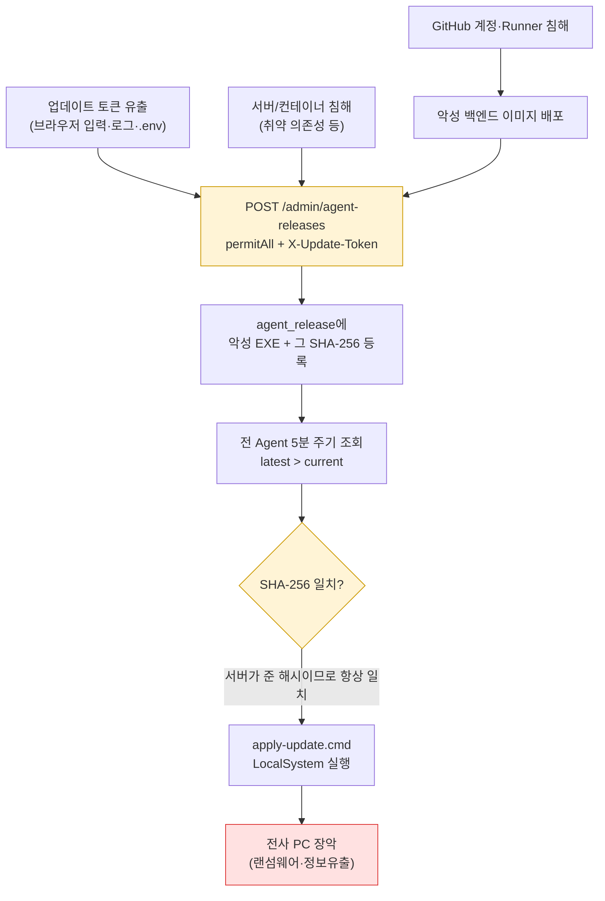
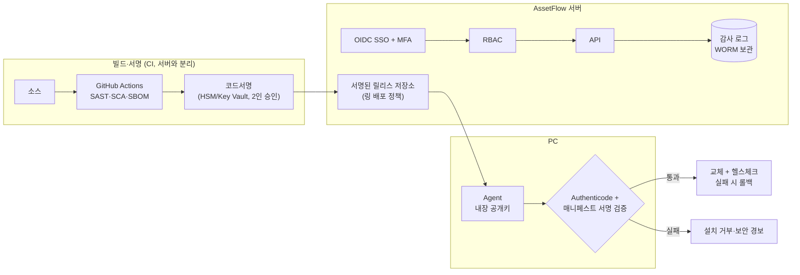

# 03. 보안 전문가 관점 검토

> 관점: 공급망 보안, 인증·인가, 엔드포인트 에이전트 보안, 개인정보 보호(PIPA·안전성 확보조치 기준), ISMS-P 운영 통제
> 핵심 질문: "이 시스템이 탈취되면 **전사 PC 전체가 위험해지는가?**"

## 1. 총평

AssetFlow Agent는 **모든 PC에서 LocalSystem 권한으로 실행되며 서버가 제공하는 실행파일로 자동 교체**된다. 따라서 이 시스템의 실질적 보안 등급은 "자산관리 도구"가 아니라 **"전사 원격 코드 실행 채널"**과 같다. 현재 업데이트 무결성은 같은 서버가 내려주는 SHA-256에만 의존하고, 릴리스 업로드는 관리자 로그인 없이 토큰 하나로 허용된다. **업데이트 토큰 또는 서버 하나가 유출되면 전 PC에 SYSTEM 권한 악성코드가 5분 안에 배포될 수 있다.** 이 위험(SEC-01~03)을 운영 확대 전에 반드시 해소해야 한다.

README의 보안 원칙(원격 명령 미제공, 개인 파일 미수집, 토큰 분리)은 방향이 올바르며, 토큰 해시 저장·상수시간 비교·경로 정규화(`AgentUpdateController.java:87-88`)·Mermaid `securityLevel: strict` 등 기본기는 갖춰져 있다.

## 2. 위협 시나리오: 업데이트 채널 탈취

**통제 설계(목표)**: 서명 키는 서버에 두지 않는다. 오프라인/HSM 서명 → Agent가 **내장된 공개키로 Authenticode + 별도 서명 매니페스트를 검증**해야만 교체한다. 서버가 침해돼도 서명키 없이 악성 배포 불가.

## 3. 취약점 상세

### 3.1 Critical / High

| ID | 등급 | 취약점 | 근거 | 조치 |
|---|---|---|---|---|
| SEC-01 | **Critical** | 업데이트 코드서명 검증 부재 — 무결성 해시가 같은 서버에서 제공됨 | `agent/UpdateService.cs:3`, `AgentClient.cs:44-61` | EXE Authenticode 서명(EV/조직 인증서) + Agent에서 `WinVerifyTrust` 및 **서명자 지문 고정(pinning)** 검증. 추가로 Ed25519 서명 매니페스트(version, sha256, minVersion, 만료) 검증 |
| SEC-02 | **Critical** | 릴리스 업로드 API가 관리자 세션 없이 토큰만으로 허용 | `service/SecurityConfig.java:6` `.requestMatchers(POST,"/api/v1/admin/agent-releases").permitAll()` | 관리자 세션 + `RELEASE_MANAGER` 역할 + MFA 재인증 + 2인 승인(작성/승인 분리). CI 업로드는 별도 내부망/mTLS 전용 엔드포인트 |
| SEC-03 | High | 단계적 배포·회수 불가 — 업로드 즉시 전 PC 대상 | `AgentUpdateController.java:73` 최신 1건 무조건 제공 | 배포 링(파일럿 5% → 30% → 100%), 릴리스 `enabled/revoked` 플래그, 최소 버전·롤백 버전 지정 |
| SEC-04 | High | 등록 토큰 하나로 **기존 장치 토큰 탈취/무력화** 가능 | `AgentController.java:25-33` 동일 agentKey면 토큰 재발급·덮어쓰기. agentKey=SHA256(호스트명\|MachineGuid)는 일반 사용자가 계산 가능 | 재등록은 기존 토큰 증명 또는 관리자 승인 필요. 등록 토큰은 1회용/만료형(배치 단위), 등록 시 serial/UUID 일치 검증 |
| SEC-05 | High | `agent.json`에 등록 토큰·장치 토큰 평문 저장, ProgramData 기본 ACL상 **일반 사용자 읽기 가능** | `agent/AgentState.cs:20-24`, `AgentClient.cs:38` (등록 후에도 등록 토큰 유지) | 등록 성공 후 RegistrationToken 삭제, 파일 ACL을 SYSTEM/Administrators 전용으로 설정, DPAPI(LocalMachine)+ACL 또는 TPM 기반 키 보관 |
| SEC-06 | High | 관리자 계정 1개(InMemory, 환경변수 평문), MFA·잠금·RBAC 없음 | `SecurityConfig.java:5` | OIDC SSO(Entra ID/Keycloak) + MFA, 역할: 조회자/자산담당/보안담당/릴리스관리자/시스템관리자 |
| SEC-07 | High | 기본 비밀값 fallback으로 기동 가능 | `application.yml:12-16` `change-me`, `change-me-now`; `docker-compose.yml` 기본값 | 기본값 제거, 미설정·약한 값이면 **기동 실패**(fail-closed) 검증 로직 |
| SEC-08 | High | 로그인 후 세션 ID 미변경(세션 고정) | `AuthController.java:4` 수동 인증 후 `changeSessionId()` 없음 | 로그인 성공 시 `request.changeSessionId()` 또는 Spring Security formLogin/SessionAuthenticationStrategy 사용 |
| SEC-09 | High | kubeconfig 644 — 호스트 일반 사용자에게 클러스터 관리자 권한 노출 | `deploy/k3s/README.md` `--write-kubeconfig-mode 644` | 600 유지, 운영자별 kubeconfig/RBAC 발급 |

### 3.2 Medium

| ID | 취약점 | 근거 | 조치 |
|---|---|---|---|
| SEC-10 | CSRF 비활성화 (SameSite=Strict로 일부 완화) | `SecurityConfig.java:6` `csrf.disable()` | `CookieCsrfTokenRepository` + SPA 헤더 전송, Agent 경로만 예외 |
| SEC-11 | 로그인 무차별 대입 방어·API rate limit 없음 | `AuthController.java` | 계정/IP별 지수 백오프·잠금, Nginx `limit_req`, Bucket4j |
| SEC-12 | CSV 수식 인젝션 — Agent가 보낸 hostname 등이 `=`,`+`,`-`,`@`로 시작 시 엑셀에서 수식 실행 | `AssetController.java:89` `csv()` | 선행 문자 앞에 `'` 추가(OWASP CSV Injection 대응) |
| SEC-13 | 감사 로그 부재 — 로그인 성공/실패, 자산 조회, CSV 다운로드, 정책 변경, 릴리스 업로드 기록 없음 | 전체 | `audit_log` 테이블(누가·언제·어디서·무엇을·결과), 위·변조 방지(해시 체인 또는 WORM 외부 저장) |
| SEC-14 | 보안 헤더 부재 (CSP, HSTS, X-Frame-Options, X-Content-Type-Options, Referrer-Policy) | `frontend/nginx.conf:1` | Nginx `add_header` 일괄 적용, CSP는 self + 허용 CDN만 |
| SEC-15 | 외부 CDN 비고정 리소스 로딩 — `@main` 브랜치 아이콘, SRI 없음 | `src.jsx:178-179` `cdn.statically.io/gh/...@main`, `index.html` Pretendard | 자산을 번들에 포함(self-host) 또는 커밋 해시 고정 + SRI. 관리자 콘솔의 외부 의존 제거 |
| SEC-16 | 클라이언트 IP가 프록시 IP로 기록 | `AgentController.java:28,33` `getRemoteAddr()`; Spring `forward-headers-strategy` 미설정 | `server.forward-headers-strategy: native` + 신뢰 프록시 대역 제한 |
| SEC-17 | Agent 보안상태 판정 오탐 — Defender 레지스트리 값 없으면 `Healthy`, 방화벽은 Standard 프로필·로컬 키만 확인 | `InventoryCollector.cs:87-96` | `root\Microsoft\Windows\Defender:MSFT_MpComputerStatus`(실시간보호·서명 업데이트일), `root\SecurityCenter2:AntiVirusProduct`(타사 백신), 방화벽 Domain/Private/Public 3개 프로필 + GPO 정책 키 |
| SEC-18 | 설치 스크립트가 토큰을 명령줄 인자로 받음 → 프로세스 목록·PowerShell 로그(4104)에 노출 | `agent/scripts/install-service.ps1:1` | 보안 문자열 입력/파일 전달, MSI 속성 + 등록 후 폐기 |
| SEC-19 | 서명되지 않은 바이너리를 저장소에 커밋 | `agent/release/AssetFlow.Agent.exe` | CI에서 재현 가능 빌드 → 서명 → 릴리스 아티팩트로만 배포, SBOM 첨부 |
| SEC-20 | ClusterRole로 클러스터 전체 Pod 조회 | `deploy/k3s/rbac.yaml` | Pod/Deployment는 namespace Role로 축소, nodes만 ClusterRole |
| SEC-21 | 컨테이너 하드닝 미적용 — frontend Nginx root 실행, securityContext·NetworkPolicy 없음 | `deploy/k3s/*.yaml` | `runAsNonRoot`, `readOnlyRootFilesystem`, `allowPrivilegeEscalation: false`, `capabilities.drop: [ALL]`, NetworkPolicy(postgres는 backend만 허용) |
| SEC-22 | `apply-update.cmd`가 `taskkill /F /IM AssetFlow.Agent.exe`로 사용자 세션 트레이까지 강제 종료, 실패 시 백업 복구만 수행 | `UpdateService.cs:3` | 서비스 내 업데이트 헬퍼(서명 검증된 별도 실행파일)로 교체, 기동 실패 감지 시 자동 롤백 |

### 3.3 Low / 권고

- 로그인 오류 응답의 일관성 유지(현재 양호), 서버 예외 메시지(`SoftwarePolicySyncService.java:30`)가 UI로 그대로 노출되지 않도록 공통 예외 처리기 도입.
- 장치 토큰 만료·회전 정책(예: 90일 회전), 관리자 화면에서 **장치 토큰 폐기(revoke)·장치 차단** 기능.
- `SOFTWARE_POLICY_SOURCE_URL`은 HTTPS만 허용하고 API 키를 HTTP로 전송하지 않도록 강제(`SoftwarePolicySyncService.java:32`는 http 허용).
- 의존성·이미지 취약점 스캔(Trivy, OWASP Dependency-Check, `npm audit`), CodeQL을 CI 게이트로.
- 이미지 서명(cosign)과 배포 시 서명 검증.

## 4. 개인정보 보호 검토

Agent가 수집하는 **사용자명, 호스트명, IP·MAC, 설치 SW 목록, 로그온 정보**는 특정 임직원과 결합되므로 개인정보(또는 개인정보와 결합 가능한 정보)로 취급해야 한다.

| 항목 | 현재 | 요구 수준 | 조치 |
|---|---|---|---|
| 수집 고지 | 없음 | 업무용 PC 모니터링 수집 항목·목적·보유기간 고지 | 사내 정보보호 규정·고지문, 트레이 "수집 항목 보기" 메뉴 |
| 최소 수집 | 원칙은 README에 명시 | 목적 외 수집 금지 | 수집 항목 정의서(필드별 목적) 관리, 변경 시 검토 |
| 접근 통제 | 단일 관리자 | 권한 최소화·차등 부여 | RBAC + 부서 범위 제한(Row-level) |
| 접속기록 | 없음 | 개인정보처리시스템 접속기록 보관·정기 점검(안전성 확보조치 기준) | SEC-13 감사 로그 1년 이상(규모에 따라 2년) 보관, 월 1회 이상 점검 |
| 다운로드 통제 | CSV 무제한 | 대량 다운로드 시 사유 기록 | 다운로드 사유 입력·로그, 필드 마스킹 옵션 |
| 보유기간 | 무기한 | 목적 달성 시 파기 | 폐기 자산·퇴사자 데이터 보존기간 경과 후 자동 파기 배치 |
| 전송 구간 암호화 | HTTPS(NPM) | TLS 1.2+ | Agent에서 `http://` ApiUrl 거부 |

## 5. 보안 아키텍처 목표

## 6. ISMS-P 관련 통제 매핑(요약)

| 통제 영역 | 관련 항목 | 대응 ID |
|---|---|---|
| 2.5 인증 및 권한관리 | 사용자 인증, 특수계정 관리, 권한 검토 | SEC-06, 08, 11 |
| 2.6 접근통제 | 네트워크·DB 접근 | SEC-20, 21 |
| 2.7 암호화 적용 | 키 관리, 저장·전송 암호화 | SEC-05, 01 |
| 2.8 정보시스템 도입 및 개발 보안 | 보안 요구사항, 시험, 소스 관리 | SEC-19, 3.3 권고 |
| 2.9 시스템 및 서비스 운영관리 | 변경관리, 로그 관리, 패치 | SEC-03, 13 |
| 2.10 시스템 및 서비스 보안관리 | 보안 시스템 운영, 엔드포인트 보안 | SEC-17, 22 |
| 3.x 개인정보 처리 단계별 요구사항 | 수집·보유·파기 | 4장 |

## 7. 조치 우선순위

| 단계 | 기한(제안) | 항목 |
|---|---|---|
| 긴급 | 2주 | SEC-02 업로드 경로 인증 강화, SEC-07 기본값 기동 차단, SEC-05 등록 토큰 삭제·ACL, SEC-08 세션 고정, SEC-09 kubeconfig, SEC-12 CSV |
| 단기 | 1~2개월 | SEC-01 코드서명 검증, SEC-03 링 배포, SEC-04 재등록 통제, SEC-06 SSO/RBAC, SEC-13 감사 로그, SEC-14/15 헤더·CDN |
| 중기 | 3~6개월 | SEC-17 보안상태 정밀화, SEC-20/21 클러스터 하드닝, 개인정보 보유기간·파기, CI 보안 게이트 |
