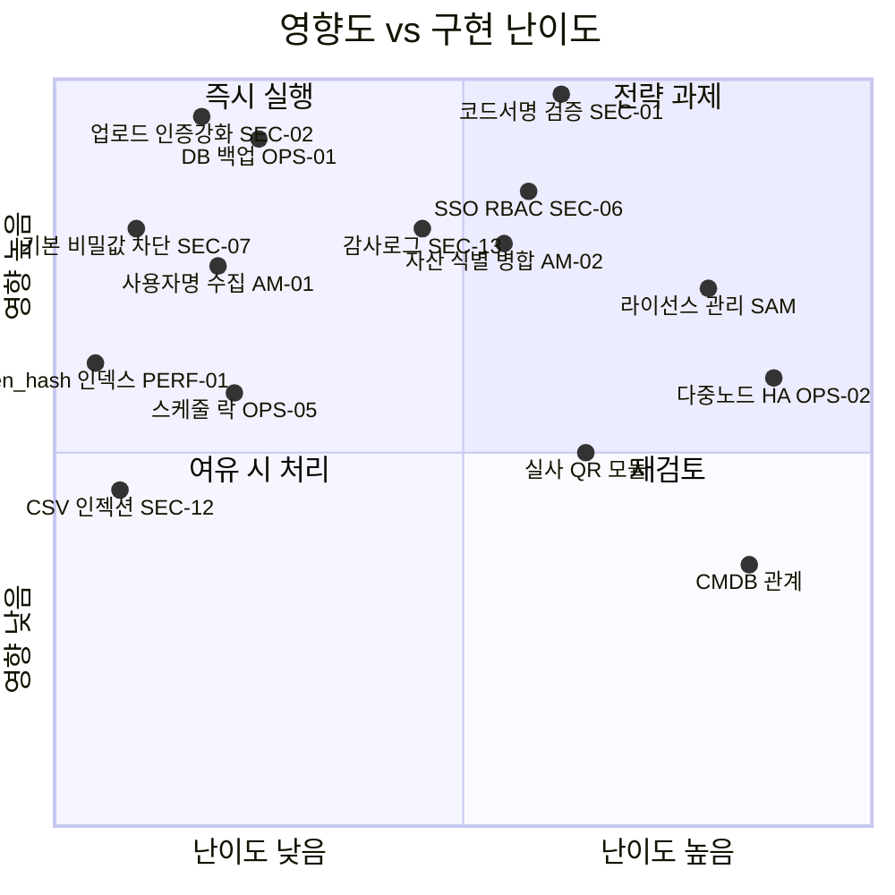
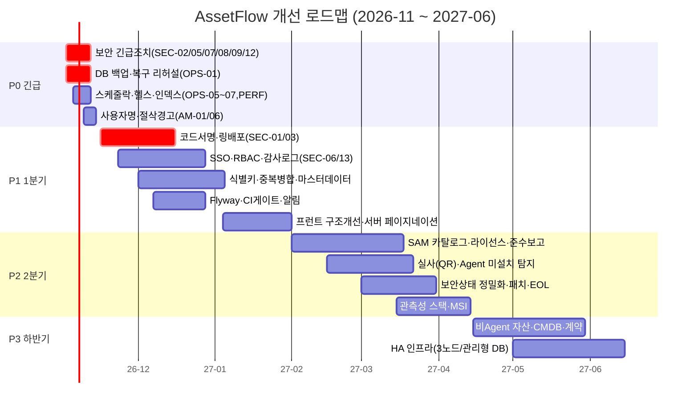
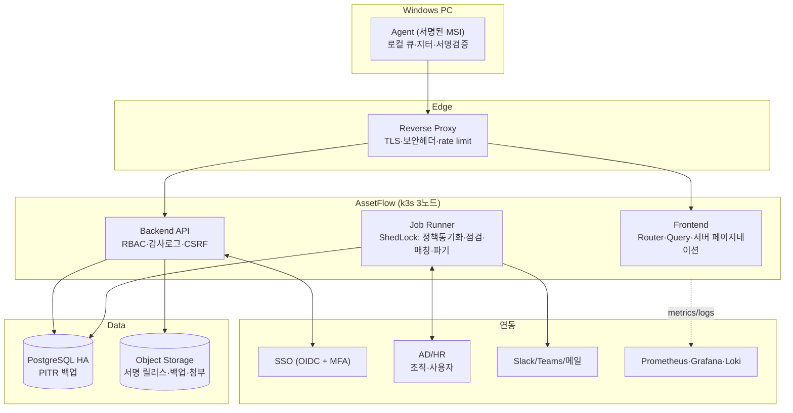
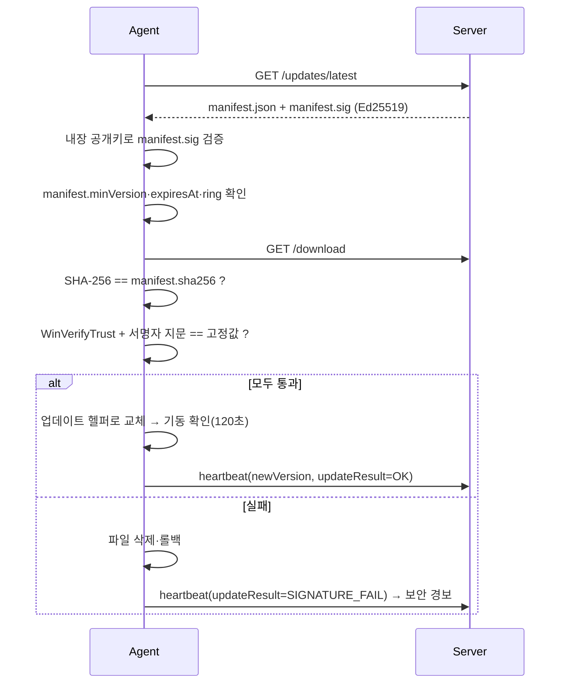

# 05. 통합 개선 기획 및 로드맵

> 02(IT자산관리)·03(보안)·04(인프라 유지보수) 검토 결과를 하나의 백로그와 일정으로 통합한 기획안

## 1. 기획 목표

| 목표 | 설명 | 성공 지표 |
|---|---|---|
| **G1. 신뢰할 수 있는 자산 데이터** | 중복 없는 고유 자산, 정확한 사용자·부서·위치 | 중복 자산 0건, 관리정보 완결성 100%, Agent 커버리지 ≥ 98% |
| **G2. 안전한 에이전트 채널** | 서버가 침해돼도 PC에 악성코드가 배포되지 않는 구조 | 서명 검증 없는 업데이트 0건, 업로드 2인 승인 100% |
| **G3. 감사 대응 가능한 운영** | 누가 무엇을 언제 했는지, 라이선스 준수 상태 즉시 제시 | 감사 로그 1년 보관, 라이선스 준수율 보고서 즉시 출력 |
| **G4. 복구 가능한 인프라** | 백업·알림·관측성으로 장애를 먼저 인지·복구 | RPO 1h / RTO 4h, 복구 리허설 분기 1회 |

## 2. 통합 백로그 (우선순위 매트릭스)



### 2.1 P0 — 즉시(2주 이내, 운영 확대 전 필수)

| No | ID | 분류 | 작업 | 수정 위치 |
|---|---|---|---|---|
| 1 | SEC-02 | 보안 | 릴리스 업로드 `permitAll` 제거, 관리자 세션 + 업데이트 토큰 동시 요구 | `service/SecurityConfig.java:6` |
| 2 | SEC-07 | 보안 | 기본/약한 비밀값이면 기동 실패 | `application.yml`, 신규 `SecretsValidator` |
| 3 | SEC-05 | 보안 | 등록 성공 후 RegistrationToken 삭제, `agent.json` ACL SYSTEM/Admins 전용 | `agent/AgentClient.cs:38`, `AgentState.cs:20-24` |
| 4 | SEC-08 | 보안 | 로그인 시 세션 ID 재발급 | `api/AuthController.java:4` |
| 5 | SEC-09 | 보안 | kubeconfig 권한 600 | `deploy/k3s/README.md` |
| 6 | SEC-12 | 보안 | CSV 수식 인젝션 방지 | `api/AssetController.java:89` |
| 7 | OPS-01 | 인프라 | `pg_dump` CronJob + 외부 저장 + 복구 테스트 | 신규 `deploy/k3s/backup.yaml` |
| 8 | OPS-05 | 인프라 | ShedLock으로 스케줄 단일 실행 | `SoftwarePolicySyncService.java`, `SystemInspectionController.java` |
| 9 | OPS-06/07 | 인프라 | Actuator 헬스(DB 포함), 점검 DB 상태 실측 | `AssetController.java:19`, `SystemInspectionController.java:37,51` |
| 10 | PERF-01/02 | 인프라 | `agent(token_hash)`, `asset_software(asset_id)`, `asset_disk(asset_id)` 인덱스 | `schema.sql` |
| 11 | AM-01 | 자산 | 실제 로그온 사용자 수집 | `agent/InventoryCollector.cs:25` |
| 12 | AM-06 | 자산 | SW 2,000건 절삭 시 경고 플래그 | `AgentController.java:76` |
| 13 | CD-01 | 인프라 | kustomize images로 단일 롤아웃 | workflow, `kustomization.yaml` |

### 2.2 P1 — 1분기(1~3개월)

| 분류 | 작업 |
|---|---|
| 보안 | **SEC-01 코드서명 + 매니페스트 서명 검증**, SEC-03 링 배포·릴리스 회수, SEC-04 재등록 통제(1회용 등록 토큰), SEC-06 OIDC SSO·MFA·RBAC, SEC-10 CSRF, SEC-11 rate limit, SEC-13 감사 로그, SEC-14 보안 헤더, SEC-15 CDN 자산 내재화 |
| 자산 | AM-02/03 식별키 재설계 + 중복 병합 화면, 조직·사용자·위치 마스터(AD 동기화), 지급/회수 이력, 상태 전이 강제, 폐기 자산 활동 경보, NIC 다중 수집, SW 설치 diff(SAM-04) |
| 인프라 | Flyway, 알림 웹훅, Agent 지터·오프라인 큐·401 재등록, heartbeat 상태 확장, CI 테스트·스캔 게이트, 서버 페이지네이션 |
| 품질 | 압축된 소스 포매팅, `src.jsx` 화면별 분리 + React Router + TanStack Query, 핵심 API 통합테스트(Testcontainers) |

### 2.3 P2 — 2분기(4~6개월)

- SAM: SW 카탈로그 정규화, 라이선스 보유·할당, 준수 포지션 보고서, 금지 SW 조치 워크플로
- 실사: 실사 계획·QR 라벨·모바일 스캔·결과 보고, Agent 미설치 PC 탐지(AD/DHCP 대조)
- 보안상태 정밀화(SEC-17): Defender/SecurityCenter2, 방화벽 3프로필, 패치 수준(최근 설치 KB·경과일), OS EOL 판정, 로컬 관리자 그룹 구성원
- 관측성 스택(Prometheus/Grafana/Loki/Alertmanager), MSI 배포 패키지
- 개인정보: 수집 고지, 보유기간 자동 파기, 다운로드 사유 기록

### 2.4 P3 — 하반기

- 비Agent 자산(모니터·프린터·네트워크·서버) 등록·엑셀 일괄 업로드, CMDB 관계, 계약·벤더·감가상각
- 3노드 k3s + 복제 스토리지 또는 관리형 DB(OPS-02), 릴리스 파일 오브젝트 스토리지
- SaaS 라이선스 연동, 취약 SW 버전(CVE) 매칭

## 3. 일정 (안)



## 4. 목표 아키텍처 (To-Be)



## 5. 즉시 적용 코드 예시

### 5.1 릴리스 업로드 인증 강화 (SEC-02, SEC-10)

```java
// service/SecurityConfig.java
http.csrf(c -> c.csrfTokenRepository(CookieCsrfTokenRepository.withHttpOnlyFalse())
        .ignoringRequestMatchers("/api/v1/agents/**"))
    .authorizeHttpRequests(a -> a
        .requestMatchers("/api/v1/auth/login", "/api/v1/health", "/api/v1/agents/**").permitAll()
        .requestMatchers(HttpMethod.POST, "/api/v1/admin/agent-releases").hasRole("RELEASE_MANAGER")
        .anyRequest().authenticated());
```

### 5.2 세션 고정 방지 (SEC-08)

```java
// AuthController.login() 인증 성공 직후
req.getSession(true);
req.changeSessionId();
```

### 5.3 CSV 수식 인젝션 방지 (SEC-12)

```java
private String csv(Object value) {
  String s = Objects.toString(value, "");
  if (!s.isEmpty() && "=+-@\t\r".indexOf(s.charAt(0)) >= 0) s = "'" + s;
  return "\"" + s.replace("\"", "\"\"") + "\"";
}
```

### 5.4 인덱스 (PERF-01/02)

```sql
CREATE UNIQUE INDEX IF NOT EXISTS idx_agent_token_hash ON agent(token_hash);
CREATE INDEX IF NOT EXISTS idx_asset_software_asset ON asset_software(asset_id);
CREATE INDEX IF NOT EXISTS idx_asset_disk_asset ON asset_disk(asset_id);
CREATE INDEX IF NOT EXISTS idx_agent_update_history_agent ON agent_update_history(agent_id, created_at DESC);
```

### 5.5 실제 로그온 사용자 (AM-01)

```csharp
// InventoryCollector: Environment.UserName 대신
var user = S(Wmi("Win32_ComputerSystem", "UserName"), "UserName"); // "DOMAIN\\user" 또는 null(미로그온)
```

### 5.6 스케줄 단일 실행 (OPS-05)

```java
// pom.xml: net.javacrumbs.shedlock:shedlock-spring, shedlock-provider-jdbc-template
@Scheduled(cron = "${assetflow.software-policy-sync-cron}", zone = "Asia/Seoul")
@SchedulerLock(name = "softwarePolicySync", lockAtMostFor = "PT30M")
public void scheduled() { if (!sourceUrl.isBlank()) synchronize(); }
```

### 5.7 Agent 업데이트 서명 검증 흐름 (SEC-01)



## 6. 리스크와 의존성

| 리스크 | 영향 | 대응 |
|---|---|---|
| 코드서명 인증서 조달 지연 | SEC-01 지연 | 조달 즉시 착수, 그 전까지 Ed25519 매니페스트 서명 선적용 |
| 기존 Agent(0.2.9)는 서명 검증 로직 없음 | 전환기 공격 창 | 서명 검증 포함 버전을 **마지막 비서명 업데이트**로 배포 후 업로드 경로 즉시 잠금 |
| 식별키 변경 시 기존 자산 재매핑 | 중복·이력 단절 | 서버 측 병합 도구 선행, 키 변경은 서버가 기존 agentId 유지 |
| AD/HR 연동 권한 확보 | 마스터 데이터 지연 | CSV 수동 업로드 경로를 먼저 제공 |
| 단일 운영자 의존 | 운영 지속성 | Runbook 문서화, 역할 분리(RBAC)와 함께 담당자 2인 체계 |

## 7. 검토 결론

1. **운영 확대(PC 추가 배포) 전 P0 13개 항목 완료를 선결 조건으로 한다.** 특히 SEC-02(업로드 경로)와 OPS-01(백업)은 1주 이내.
2. 1분기 핵심은 **코드서명 기반 업데이트 체계(SEC-01/03)**와 **자산 식별·마스터 데이터(AM-02, 조직/사용자)** — 이 두 가지가 각각 보안 신뢰와 데이터 신뢰의 기반이다.
3. 2분기부터 SAM·실사로 확장하면 AssetFlow는 "인벤토리 수집기"에서 **감사 대응 가능한 ITAM 플랫폼**으로 전환된다.
