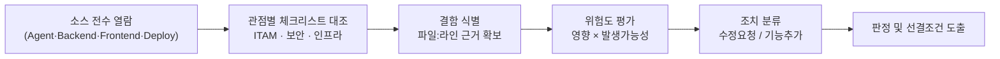
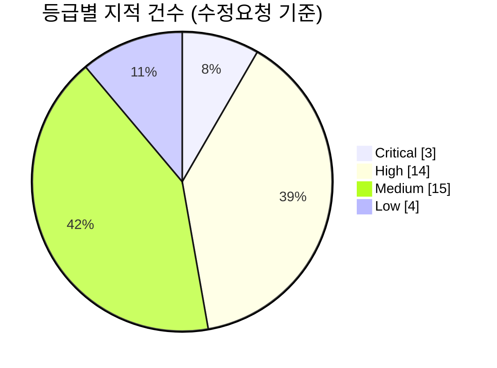
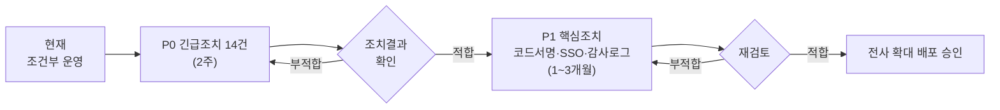

# 06. 기술검토서

| 항목 | 내용 |
|---|---|
| 문서번호 | AF-TR-2026-001 |
| 대상 시스템 | AssetFlow IT 자산관리 시스템 |
| 대상 버전 | Agent 0.2.9 / Backend 0.1.0 / Frontend 0.2.0 / k3s 배포 구성 (커밋 `836345a`) |
| 검토일 | 2026-10-23 |
| 검토 유형 | 소스 정적 분석 기반 기술검토 (빌드·실행·침투시험 미수행) |
| 검토 관점 | IT자산관리(ITAM/SAM), 정보보안, 인프라 유지보수 |
| 관련 문서 | [01 현황분석](01_현황분석.md), [02 ITAM 검토](02_IT자산관리_전문가_검토.md), [03 보안 검토](03_보안전문가_검토.md), [04 인프라 검토](04_인프라유지보수_검토.md), [07 수정요청서](07_수정요청서.md), [08 기능추가요청서](08_기능추가요청서.md) |

## 1. 검토 목적

AssetFlow를 전사 PC로 확대 배포하기 전에 ① 자산 데이터의 정확성, ② Agent 및 서버의 보안성, ③ 운영 안정성과 복구 가능성을 기술적으로 검증하고, 운영 전환 가능 여부와 선결 조건을 판정한다.

## 2. 검토 범위

| 구분 | 대상 | 포함 | 제외 |
|---|---|---|---|
| Windows Agent | `agent/*.cs`, 설치·제거 스크립트, `release/` | 수집 로직, 등록·인증, 자동 업데이트, 트레이 | 실제 PC 동작 시험 |
| Backend | `backend/src/**`, `schema.sql`, `application.yml` | API, 인증·인가, DB 스키마, 스케줄 작업 | 부하 시험 |
| Frontend | `frontend/src.jsx`, `nginx.conf`, `package.json` | API 호출, 외부 리소스, 보안 헤더 | UI/UX 사용성 평가 |
| 배포·운영 | `deploy/k3s/*`, `docker-compose.yml`, GitHub Actions | 가용성, 백업, CI/CD, RBAC | 실제 운영 서버 설정 확인 |

## 3. 검토 방법

**위험도 기준**

| 등급 | 정의 |
|---|---|
| Critical | 전사 PC 또는 전체 데이터에 영향, 즉시 악용·손실 가능 |
| High | 주요 기능·보안 통제 무력화, 데이터 신뢰도 중대 훼손 |
| Medium | 제한적 영향, 우회·보완 통제 존재 |
| Low | 개선 권고, 품질·유지보수성 |

## 4. 검토 결과 요약

### 4.1 영역별 평가

| 영역 | 평가 | 판정 근거 |
|---|---|---|
| 기능 적합성 (수집·조회) | **보통** | 하드웨어·OS·SW·보안 상태 수집 및 대시보드 동작 구조 양호. 사용자명·식별키 결함 존재 |
| 자산관리 적합성 (ITAM) | **미흡** | 생애주기·마스터 데이터·라이선스·실사 기능 부재 |
| 보안성 | **부적합** | 업데이트 채널 무결성·업로드 인증·관리자 인증 체계 결함 (Critical 2건) |
| 운영 안정성 | **미흡** | 무중단 배포는 우수하나 백업 부재, 스케줄 중복, 헬스체크 부정확 |
| 성능·확장성 | **보통** | 소규모(수백 대) 운영 가능, 인덱스 누락·전체 치환으로 확장 시 병목 |
| 유지보수성 | **미흡** | 압축된 코드, 단일 1,771줄 프런트 파일, 테스트 0건, 마이그레이션 도구 부재 |

### 4.2 결함 통계

| 관점 | Critical | High | Medium | Low | 계 |
|---|---|---|---|---|---|
| IT자산관리 | 0 | 3 | 4 | 0 | 7 |
| 보안 | 2 | 7 | 7 | 1 | 17 |
| 인프라 유지보수 | 1 | 4 | 4 | 3 | 12 |
| **합계** | **3** | **14** | **15** | **4** | **36** |

> 상세 항목은 [07 수정요청서](07_수정요청서.md)의 CR-001 ~ CR-036을 따른다. 신규 기능 요구는 [08 기능추가요청서](08_기능추가요청서.md)로 분리하였다.

### 4.3 주요 지적사항

| No | 등급 | 지적사항 | 근거 | 요청번호 |
|---|---|---|---|---|
| 1 | Critical | Agent 업데이트가 서버 제공 SHA-256만 검증 — 코드서명 검증 없음 | `agent/UpdateService.cs:3` | CR-001 |
| 2 | Critical | 릴리스 업로드 API가 관리자 세션 없이 토큰만으로 허용 | `service/SecurityConfig.java:6` | CR-002 |
| 3 | Critical | PostgreSQL 백업·복구 체계 없음 | `deploy/k3s/postgres.yaml` | CR-025 |
| 4 | High | 사용자명이 서비스 계정(`SYSTEM`)으로 수집 | `agent/InventoryCollector.cs:25` | CR-018 |
| 5 | High | PC 이름 변경 시 신규 자산 중복 생성, 복제 이미지 토큰 충돌 | `agent/AgentClient.cs:29`, `AgentController.java:25-33` | CR-019, CR-004 |
| 6 | High | 토큰 평문 저장·일반 사용자 읽기 가능 | `agent/AgentState.cs:20-24` | CR-005 |
| 7 | High | 스케줄 작업 2개 Pod 중복 실행 | `SoftwarePolicySyncService.java:20-21` | CR-027 |
| 8 | High | 인증 토큰·FK 인덱스 누락 | `schema.sql:1,32-33` | CR-030 |

## 5. 종합 판정

| 판정 | **조건부 운영 (현 규모 유지, 확대 배포 보류)** |
|---|---|

**판정 사유**: 수집·조회 기능과 무중단 배포 구조는 운영 가능한 수준이나, Critical 3건(업데이트 무결성, 업로드 인증, 백업 부재)은 사고 발생 시 전사 PC 장악 또는 전체 자산 데이터 손실로 이어질 수 있다.

**운영 확대 선결 조건**

1. 수정요청서 **P0 등급(긴급) 14건 조치 완료** 및 조치결과 확인
2. Agent 코드서명 체계(CR-001) 적용 버전 배포 완료
3. DB 백업 복구 리허설 1회 이상 성공 기록
4. 관리자 계정 개별화 및 감사 로그 운영 개시

## 6. 검토 의견

1. **보안**: 이 시스템은 전 PC에서 SYSTEM 권한으로 동작하므로 "원격 코드 배포 시스템"과 동일한 보안 등급으로 관리해야 한다. 서명 키는 서버와 분리하고, 릴리스는 2인 승인·단계적 배포를 원칙으로 한다.
2. **자산관리**: 수집 데이터의 정확성(사용자·식별키)을 먼저 확보한 후 생애주기·라이선스 기능을 확장해야 한다. 부정확한 데이터 위에 쌓은 기능은 감사 증적으로 사용할 수 없다.
3. **인프라**: 무중단 배포보다 백업·복구가 우선이다. 알림 체계와 실제 DB 상태 점검을 갖춰 장애를 사람보다 먼저 감지해야 한다.
4. **품질**: 압축 코드 포매팅, 테스트 도입, Flyway 마이그레이션은 이후 모든 수정의 회귀 위험을 낮추는 기반 작업으로 P1에 포함한다.

## 7. 검토의 한계

- 본 검토는 소스 정적 분석이며, 실제 PC·서버에서의 동작 검증, 부하 시험, 침투 시험은 수행하지 않았다. 지적사항 중 실행 결과에 의존하는 항목(예: CR-018 사용자명)은 조치 시 실환경 재현으로 확인한다.
- 운영 서버의 실제 설정(NPM, 방화벽, OS 계정, 백업 여부)은 저장소에 없는 범위로 확인하지 못했다.

## 8. 확인

| 구분 | 소속/역할 | 성명 | 일자 | 서명 |
|---|---|---|---|---|
| 검토자 | IT자산관리 | | 2026-10-23 | |
| 검토자 | 정보보안 | | 2026-10-23 | |
| 검토자 | 인프라 운영 | | 2026-10-23 | |
| 승인자 | | | | |
