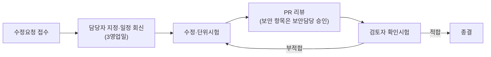

# 07. 수정요청서 (결함 시정 요청)

| 항목 | 내용 |
|---|---|
| 문서번호 | AF-CR-2026-001 |
| 근거 문서 | [06 기술검토서](06_기술검토서.md) (AF-TR-2026-001) |
| 대상 | AssetFlow 커밋 `836345a` |
| 요청일 | 2026-10-23 |
| 요청 범위 | **기존 기능의 결함·취약점 시정** (신규 기능은 [08 기능추가요청서](08_기능추가요청서.md)) |
| 회신 | 조치 후 [09 조치결과보고서](09_조치결과보고서_양식.md) 양식으로 회신 |

## 1. 처리 기준

| 우선순위 | 조치 기한 | 대상 |
|---|---|---|
| **P0 긴급** | 요청일로부터 2주 (2026-11-06) | Critical 전부 및 저비용 High |
| **P1 단기** | 3개월 (2027-01-29) | 나머지 High, 주요 Medium |
| **P2 중기** | 6개월 (2027-04-30) | Medium, Low |

## 2. 요청 목록

| 번호 | 등급 | 우선 | 관점 | 제목 | 대상 파일 |
|---|---|---|---|---|---|
| CR-001 | Critical | P1 | 보안 | Agent 업데이트 코드서명·서명 매니페스트 검증 | `agent/UpdateService.cs`, `AgentClient.cs` |
| CR-002 | Critical | **P0** | 보안 | 릴리스 업로드 API 인증 강화 | `service/SecurityConfig.java:6`, `AgentUpdateController.java:48` |
| CR-003 | High | P1 | 보안 | 릴리스 단계적 배포·회수 | `AgentUpdateController.java:68-78` |
| CR-004 | High | P1 | 보안 | 재등록 시 기존 장치 토큰 덮어쓰기 통제 | `AgentController.java:21-36` |
| CR-005 | High | **P0** | 보안 | `agent.json` 토큰 평문·ACL·등록 토큰 잔존 | `agent/AgentState.cs:20-24`, `AgentClient.cs:38` |
| CR-006 | High | P1 | 보안 | 단일 InMemory 관리자 → 개별 계정·MFA·RBAC | `service/SecurityConfig.java:5` |
| CR-007 | High | **P0** | 보안 | 기본 비밀값 사용 시 기동 차단 | `application.yml:12-16`, `docker-compose.yml` |
| CR-008 | High | **P0** | 보안 | 로그인 세션 고정 | `api/AuthController.java:4` |
| CR-009 | High | **P0** | 보안 | kubeconfig 644 권한 | `deploy/k3s/README.md` |
| CR-010 | Medium | P1 | 보안 | CSRF 보호 활성화 | `SecurityConfig.java:6` |
| CR-011 | Medium | P1 | 보안 | 로그인 무차별 대입·API rate limit | `AuthController.java`, `nginx.conf` |
| CR-012 | Medium | **P0** | 보안 | CSV 수식 인젝션 | `AssetController.java:89` |
| CR-013 | Medium | P1 | 보안 | 관리자 행위 감사 로그 | 전체 API |
| CR-014 | Medium | P1 | 보안 | 보안 응답 헤더 | `frontend/nginx.conf:1` |
| CR-015 | Medium | P1 | 보안 | 비고정 외부 CDN 리소스 | `frontend/src.jsx:178-179`, `index.html` |
| CR-016 | Medium | P1 | 보안 | 프록시 뒤 클라이언트 IP 오기록 | `AgentController.java:28,33`, `application.yml` |
| CR-017 | Low | P2 | 보안 | 설치 스크립트 토큰 명령줄 노출 | `agent/scripts/install-service.ps1:1` |
| CR-018 | High | **P0** | 자산 | 사용자명 `SYSTEM` 수집 | `agent/InventoryCollector.cs:25` |
| CR-019 | High | P1 | 자산 | 자산 식별키 설계(이름 변경 시 중복) | `agent/AgentClient.cs:29` |
| CR-020 | High | P1 | 자산 | 보안 상태(Defender·방화벽) 오판정 | `InventoryCollector.cs:87-96` |
| CR-021 | Medium | P1 | 자산 | 대표 NIC 1개만 수집 | `InventoryCollector.cs:16-19` |
| CR-022 | Medium | P2 | 자산 | 메모리 수집 실패 시 0 저장 | `InventoryCollector.cs:39`, `Models.java:13` |
| CR-023 | Medium | **P0** | 자산 | SW 2,000건 무경고 절삭 | `AgentController.java:76` |
| CR-024 | Medium | P1 | 자산 | 사용자 단위 설치·Store 앱 누락 | `InventoryCollector.cs:48-63` |
| CR-025 | Critical | **P0** | 인프라 | DB 백업·복구 체계 부재 | `deploy/k3s/postgres.yaml` |
| CR-026 | High | **P0** | 인프라 | 헬스체크가 DB 미확인 | `AssetController.java:19-20`, `backend.yaml` |
| CR-027 | High | **P0** | 인프라 | 스케줄 작업 다중 Pod 중복 실행 | `SoftwarePolicySyncService.java:20-21`, `SystemInspectionController.java:16` |
| CR-028 | High | **P0** | 인프라 | 점검 일지 DB 상태 하드코딩 | `SystemInspectionController.java:37,51` |
| CR-029 | Medium | **P0** | 인프라 | 배포 시 `latest` 경유 이중 롤아웃 | `.github/workflows/deploy-k3s.yml`, `deploy/k3s/kustomization.yaml` |
| CR-030 | High | **P0** | 인프라 | 인증 토큰·FK 인덱스 누락 | `schema.sql:1,32-33` |
| CR-031 | Medium | P1 | 인프라 | 인벤토리 SW 전체 DELETE→INSERT | `AgentController.java:73-76` |
| CR-032 | Medium | P1 | 인프라 | 보안 경고 집계 기준 불일치 | `AssetController.java:27-28`, `SystemInspectionController.java:44` |
| CR-033 | Medium | P1 | 인프라 | 스키마 버전 관리 부재 | `application.yml:6`, `schema.sql` |
| CR-034 | Low | P2 | 인프라 | Agent 로그 보존 정책 없음 | `agent/DailyFileLogger.cs:4` |
| CR-035 | Low | P2 | 인프라 | 프런트 의존성 `latest` 지정 | `frontend/package.json` |
| CR-036 | Low | P2 | 인프라 | 압축 코드 포매팅·테스트 부재 | `AuthController.java`, `SecurityConfig.java`, `Worker.cs`, `UpdateService.cs` 등 |

**집계**: Critical 3 · High 14 · Medium 15 · Low 4 = **36건** / P0 14건 · P1 17건 · P2 5건

## 3. 요청 상세

### 3.1 보안

#### CR-001 · Critical · Agent 업데이트 코드서명 검증
- **현상**: Agent는 서버가 내려준 `sha256`과 다운로드 파일 해시만 비교한다. 해시와 파일이 같은 서버에서 오므로 서버·토큰 유출 시 악성 EXE가 SYSTEM 권한으로 실행된다.
- **요청**: (1) EXE Authenticode 서명, Agent에서 `WinVerifyTrust` + 서명자 인증서 지문 고정 검증. (2) Ed25519 서명 매니페스트(version, sha256, size, minVersion, expiresAt, ring) — 공개키는 Agent 바이너리에 내장. (3) 검증 실패 시 설치 거부 및 heartbeat로 `SIGNATURE_FAIL` 보고.
- **완료 기준**: 미서명·타 서명자·변조 매니페스트 3개 시험 케이스에서 모두 설치 거부. 서명 키가 서버에 존재하지 않음.

#### CR-002 · Critical · 릴리스 업로드 API 인증 강화
- **현상**: `POST /api/v1/admin/agent-releases`가 `permitAll`이며 `X-Update-Token`만 검사.
- **요청**: `permitAll` 제거, 관리자 세션 + 릴리스 권한 + 업데이트 토큰 동시 요구. CI 자동 업로드가 필요하면 내부망 전용 별도 경로와 mTLS.
- **완료 기준**: 세션 없이 토큰만으로 업로드 시 401/403. 업로드 행위 감사 로그 기록(CR-013 연계).

#### CR-003 · High · 단계적 배포·회수
- **현상**: 등록 즉시 최신 버전이 전 Agent에 제공되며 회수 수단이 없다.
- **요청**: 릴리스에 `status(DRAFT/PILOT/GA/REVOKED)`, 링(파일럿 장비 그룹/비율) 지정, 회수 시 직전 GA로 고정.
- **완료 기준**: 파일럿 그룹 외 장비는 PILOT 버전을 받지 않음, REVOKED 버전은 latest 응답에서 제외.

#### CR-004 · High · 재등록 시 토큰 덮어쓰기 통제
- **현상**: 등록 토큰을 가진 누구나 동일 `agentKey`로 재등록해 기존 장치 토큰을 무효화·탈취할 수 있고, 복제 이미지 PC끼리 토큰을 번갈아 덮어쓴다.
- **요청**: 기존 Agent 재등록은 (a) 기존 장치 토큰 제시 또는 (b) serial/device UUID 일치 + 관리자 승인 대기 상태로 처리. 불일치 시 신규 Agent로 분리. 등록 토큰은 만료일·사용 횟수 제한.
- **완료 기준**: 다른 serial로 같은 agentKey 재등록 시 기존 토큰 유지, 신규 레코드는 승인 대기.

#### CR-005 · High · agent.json 토큰 보호
- **현상**: 등록 토큰·장치 토큰 평문 저장, 등록 후에도 등록 토큰 잔존, ProgramData 상속 ACL로 일반 사용자 읽기 가능.
- **요청**: 등록 성공 후 `RegistrationToken` 제거, 파일·폴더 ACL을 SYSTEM·Administrators 전용으로 명시 설정, 장치 토큰 DPAPI(LocalMachine) 보호.
- **완료 기준**: 표준 사용자 계정으로 `agent.json` 열람 시 접근 거부, 파일에 등록 토큰 미존재.

#### CR-006 · High · 관리자 인증 체계
- **현상**: 환경변수 기반 단일 관리자 계정, MFA·잠금·역할 구분 없음.
- **요청**: OIDC SSO(MFA) 또는 DB 계정 + TOTP. 역할: 조회자, 자산담당, 보안담당, 릴리스관리자, 시스템관리자. API별 권한 매핑표 작성.
- **완료 기준**: 권한 매핑표 기준 역할별 접근 시험 통과.

#### CR-007 · High · 기본 비밀값 기동 차단
- **현상**: `change-me`, `change-me-now` 등 기본값으로 정상 기동.
- **요청**: 기동 시 등록·업데이트 토큰, 관리자 비밀번호, DB 비밀번호가 기본값이거나 32자 미만이면 기동 실패. compose 기본값 제거.
- **완료 기준**: 기본값으로 기동 시 명확한 오류 메시지와 함께 종료.

#### CR-008 · High · 세션 고정
- **현상**: 수동 인증 후 세션 ID를 갱신하지 않는다.
- **요청**: 인증 성공 직후 `request.changeSessionId()` 또는 Spring Security 표준 로그인 필터 사용.
- **완료 기준**: 로그인 전후 `JSESSIONID`/`SESSION` 값이 다름.

#### CR-009 · High · kubeconfig 권한
- **현상**: 설치 가이드가 `--write-kubeconfig-mode 644` 사용 → 호스트 모든 사용자에게 cluster-admin.
- **요청**: 가이드 수정(600), 기존 서버 권한 변경, 운영자별 RBAC kubeconfig 발급.
- **완료 기준**: `/etc/rancher/k3s/k3s.yaml` 권한 600 확인.

#### CR-010 · Medium · CSRF
- **요청**: `CookieCsrfTokenRepository` 적용, 프런트 `api()`에서 `X-XSRF-TOKEN` 전송, `/api/v1/agents/**`만 제외.
- **완료 기준**: 토큰 없는 상태 변경 요청 403.

#### CR-011 · Medium · 무차별 대입 방어
- **요청**: 계정·IP별 실패 5회 시 지수 백오프 잠금, Nginx `limit_req`(로그인 5r/m, Agent API 장비당 제한).
- **완료 기준**: 연속 실패 시 429/잠금 응답 및 감사 로그 기록.

#### CR-012 · Medium · CSV 수식 인젝션
- **현상**: Agent가 보낸 값이 `=`, `+`, `-`, `@`로 시작하면 엑셀에서 수식으로 실행.
- **요청**: 해당 선행 문자(탭·CR 포함) 앞에 `'` 추가.
- **완료 기준**: hostname `=1+1` 자산 내보내기 시 엑셀에 문자열로 표시.

#### CR-013 · Medium · 감사 로그
- **요청**: `audit_log`(시각, 사용자, IP, 행위, 대상, 결과, 사유). 대상 행위: 로그인 성공·실패, 자산 상세 조회, CSV 내보내기, 관리정보 변경, 정책 변경·동기화, 릴리스 업로드, 점검 실행. 1년 이상 보관, 조회 화면.
- **완료 기준**: 대상 행위 전부 기록, 관리자도 삭제 불가.

#### CR-014 · Medium · 보안 헤더
- **요청**: `Strict-Transport-Security`, `Content-Security-Policy`, `X-Frame-Options: DENY`, `X-Content-Type-Options: nosniff`, `Referrer-Policy`, `Permissions-Policy`.
- **완료 기준**: 응답 헤더 확인, 보안 헤더 점검 도구 A 등급.

#### CR-015 · Medium · 외부 CDN
- **현상**: `cdn.statically.io/gh/...@main`(브랜치 고정 아님), SRI 없음.
- **요청**: 아이콘·폰트를 번들/self-host로 전환, 불가 시 커밋 해시 고정 + SRI.
- **완료 기준**: 관리 콘솔 로딩 시 외부 도메인 요청 0건(또는 허용 목록만).

#### CR-016 · Medium · 클라이언트 IP
- **요청**: `server.forward-headers-strategy: native`, Nginx `X-Forwarded-For` 설정, 신뢰 프록시 대역 지정.
- **완료 기준**: `agent.last_ip`에 실제 Agent 공인/사설 IP 기록.

#### CR-017 · Low · 설치 토큰 노출
- **요청**: 토큰을 대화형 SecureString 입력 또는 권한 제한 파일로 전달, 설치 후 즉시 폐기.
- **완료 기준**: 설치 중 프로세스 명령줄·PowerShell 로그에 토큰 미노출.

### 3.2 IT 자산관리

#### CR-018 · High · 사용자명 수집 오류
- **현상**: LocalSystem 서비스에서 `Environment.UserName` 사용 → `SYSTEM`.
- **요청**: `Win32_ComputerSystem.UserName` 또는 WTS 활성 세션 사용자, 미로그온 시 null + 최근 로그온 사용자 별도 필드.
- **완료 기준**: 실 PC에서 로그온 사용자의 `도메인\계정` 수집 확인.

#### CR-019 · High · 자산 식별키
- **현상**: agentKey에 호스트명 포함 → 이름 변경 시 신규 Agent·자산 생성.
- **요청**: agentKey에서 호스트명 제외(MachineGuid + SMBIOS UUID), 서버에서 serial/UUID 기준 중복 후보 탐지 및 병합 API·화면. 기존 데이터 마이그레이션 절차 제시.
- **완료 기준**: PC 이름 변경 후에도 동일 asset id 유지, 기존 중복 건 병합 가능.

#### CR-020 · High · 보안 상태 오판정
- **현상**: Defender 레지스트리 값 부재 시 `Healthy`, 방화벽은 StandardProfile 로컬 키만 확인.
- **요청**: `MSFT_MpComputerStatus`(실시간 보호, 서명 갱신일), `SecurityCenter2:AntiVirusProduct`(타사 백신), 방화벽 Domain/Private/Public + 정책 키. 확인 불가 시 `Unknown`.
- **완료 기준**: Defender 미설치·타사 백신·GPO 방화벽 환경 시험에서 정확히 판정.

#### CR-021 · Medium · NIC 다중 수집
- **요청**: 전체 NIC(이름, 물리 여부, MAC, IPv4/IPv6, 게이트웨이, DHCP) 별도 테이블 저장, 대표 NIC는 기본 게이트웨이 보유 물리 NIC.
- **완료 기준**: VPN·Hyper-V 환경에서 물리 MAC이 대표값.

#### CR-022 · Medium · 메모리 0 저장
- **요청**: 수집 실패 시 null, 서버 `memoryBytes`를 `Long`으로 변경.
- **완료 기준**: WMI 실패 시 화면에 "미확인" 표시.

#### CR-023 · Medium · SW 절삭 경고
- **요청**: 상한 초과 시 `software_truncated=true`, 수집 건수 저장, 화면 경고. 상한값 설정화.
- **완료 기준**: 2,001건 이상 PC에서 경고 표시.

#### CR-024 · Medium · SW 수집 범위
- **요청**: `HKEY_USERS\<SID>\...\Uninstall`, AppX 패키지 추가, `SystemComponent=1`·업데이트 항목 제외, 설치 범위(시스템/사용자) 필드.
- **완료 기준**: 사용자 설치 Zoom/Chrome 탐지.

### 3.3 인프라 유지보수

#### CR-025 · Critical · DB 백업
- **요청**: 일 1회 `pg_dump` CronJob + 외부 저장소(암호화, 30일 보관), WAL 아카이빙 기반 PITR, 복구 절차서, 백업 실패 알림.
- **완료 기준**: 별도 환경 복구 리허설 성공, RPO·RTO 실측 기록.

#### CR-026 · High · 헬스체크
- **요청**: Spring Boot Actuator, readiness에 DB 포함, liveness는 프로세스만. k8s probe 경로 변경.
- **완료 기준**: DB 중단 시 backend Ready=false, 복구 시 자동 Ready.

#### CR-027 · High · 스케줄 중복 실행
- **요청**: ShedLock(JDBC) 또는 advisory lock을 정책 동기화·일일 점검에 적용.
- **완료 기준**: 2 Replica 환경에서 동기화 로그가 1회만 생성.

#### CR-028 · High · 점검 DB 상태 하드코딩
- **요청**: `SELECT 1` 응답시간, 커넥션 풀 사용률, DB 크기, 최근 백업 시각을 실측해 `db_status` 판정.
- **완료 기준**: DB 지연·장애 시 `ATTENTION`.

#### CR-029 · Medium · 이중 롤아웃
- **요청**: `kustomize edit set image`로 sha 태그 주입 후 단일 `apply`, 매니페스트 기본 `latest` 제거.
- **완료 기준**: 1회 배포당 ReplicaSet 1개 생성.

#### CR-030 · High · 인덱스 누락
- **요청**: `agent(token_hash)` UNIQUE, `asset_software(asset_id)`, `asset_disk(asset_id)`, `agent_update_history(agent_id, created_at)`.
- **완료 기준**: Agent 인증 쿼리 `EXPLAIN`에 Index Scan.

#### CR-031 · Medium · SW 전체 치환
- **요청**: SW 목록 해시 비교로 변경 시에만 diff 반영(추가·삭제·버전변경), `batchUpdate` 사용, 변경 이력 저장.
- **완료 기준**: 변경 없는 인벤토리 수신 시 asset_software 쓰기 0건.

#### CR-032 · Medium · 보안 경고 기준 통일
- **요청**: 보안 판정 함수/뷰 1개로 통일, `Unknown` 별도 집계.
- **완료 기준**: 대시보드·점검 일지·상세 화면 수치 일치.

#### CR-033 · Medium · 스키마 마이그레이션
- **요청**: Flyway 도입, 현행 스키마를 V1 baseline, 릴리스 노트 시드 데이터 분리, 롤링 배포 호환 규칙 문서화.
- **완료 기준**: 신규 DB·기존 DB 모두 마이그레이션 성공.

#### CR-034 · Low · Agent 로그 보존
- **요청**: 14일 보관·총 용량 상한, 오래된 파일 자동 삭제.
- **완료 기준**: 15일 이전 로그 자동 삭제.

#### CR-035 · Low · 의존성 고정
- **요청**: `react`, `react-dom`, `vite`, `@vitejs/plugin-react` 정확한 버전 지정, Dependabot/Renovate.
- **완료 기준**: `package.json`에 `latest` 0건.

#### CR-036 · Low · 코드 포매팅·테스트
- **요청**: google-java-format/`dotnet format` 적용, 핵심 API 통합 테스트(Testcontainers), CI에서 실행.
- **완료 기준**: 포매터 검사 CI 통과, 인증·등록·인벤토리·업로드 테스트 존재.

## 4. 요청자 확인

| 구분 | 성명 | 일자 | 서명 |
|---|---|---|---|
| 요청자 | | 2026-10-23 | |
| 접수자(개발) | | | |
