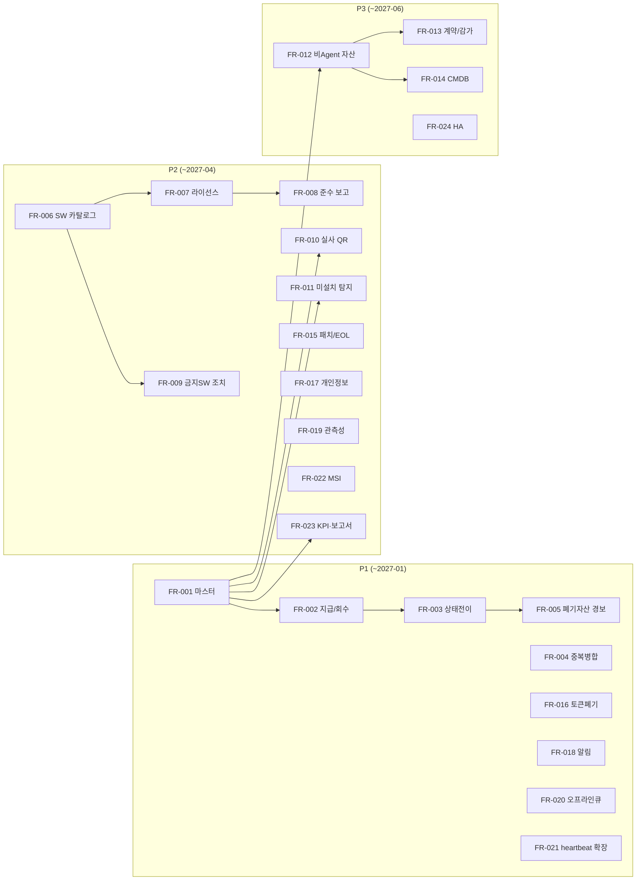

# 08. 기능추가요청서 (신규 기능 요구)

| 항목 | 내용 |
|---|---|
| 문서번호 | AF-FR-2026-001 |
| 근거 문서 | [06 기술검토서](06_기술검토서.md), [02 ITAM 검토](02_IT자산관리_전문가_검토.md), [04 인프라 검토](04_인프라유지보수_검토.md), [05 로드맵](05_개선기획_로드맵.md) |
| 요청일 | 2026-10-23 |
| 요청 범위 | **현재 없는 기능의 신규 개발** (결함 시정은 [07 수정요청서](07_수정요청서.md)) |

## 1. 요청 목록

| 번호 | 분류 | 기능명 | 우선 | 목표 시기 | 선행 |
|---|---|---|---|---|---|
| FR-001 | 자산 | 조직·사용자·위치 마스터 및 AD/HR 동기화 | P1 | 2027-01 | CR-018 |
| FR-002 | 자산 | 자산 지급·회수 이력 및 인수확인 | P1 | 2027-01 | FR-001 |
| FR-003 | 자산 | 생애주기 상태 전이 규칙·승인 워크플로 | P1 | 2027-01 | FR-002 |
| FR-004 | 자산 | 중복 자산 탐지·병합 화면 | P1 | 2026-12 | CR-019 |
| FR-005 | 자산 | 폐기/분실 자산 활동 경보 | P1 | 2026-12 | FR-003 |
| FR-006 | SAM | 소프트웨어 카탈로그(정규화) | P2 | 2027-03 | CR-031 |
| FR-007 | SAM | 라이선스 보유·할당 관리 | P2 | 2027-03 | FR-006 |
| FR-008 | SAM | 라이선스 준수 포지션 보고서 | P2 | 2027-03 | FR-007 |
| FR-009 | SAM | 금지 SW 조치 워크플로·예외 승인 | P2 | 2027-03 | FR-006 |
| FR-010 | 실사 | 실사 계획·QR 라벨·모바일 스캔 | P2 | 2027-04 | FR-001 |
| FR-011 | 실사 | Agent 미설치 PC 탐지(AD/DHCP 대조) | P2 | 2027-03 | FR-001 |
| FR-012 | 자산 | 비Agent 자산 등록 및 엑셀 일괄 업로드 | P3 | 2027-05 | FR-001 |
| FR-013 | 자산 | 계약·벤더·감가상각 관리 | P3 | 2027-06 | FR-012 |
| FR-014 | 자산 | CMDB 자산 관계 | P3 | 2027-06 | FR-012 |
| FR-015 | 보안 | 패치 수준·OS EOL·로컬 관리자 수집 | P2 | 2027-03 | CR-020 |
| FR-016 | 보안 | 장치 토큰 폐기·장치 차단 관리 화면 | P1 | 2026-12 | CR-004 |
| FR-017 | 보안 | 개인정보 수집 고지·보유기간 파기·다운로드 사유 | P2 | 2027-04 | CR-013 |
| FR-018 | 운영 | 알림 채널(Slack/Teams/메일) 및 알림 규칙 | P1 | 2026-12 | CR-028 |
| FR-019 | 운영 | 관측성 스택(메트릭·로그·대시보드) | P2 | 2027-04 | CR-026 |
| FR-020 | Agent | 오프라인 큐·재전송·지터·401 재등록 | P1 | 2027-01 | CR-004 |
| FR-021 | Agent | heartbeat 상태 확장(수집 결과·오류·업데이트 결과) | P1 | 2026-12 | - |
| FR-022 | Agent | 서명된 MSI 설치 패키지(SCCM/Intune/GPO) | P2 | 2027-04 | CR-001 |
| FR-023 | 보고 | ITAM KPI 대시보드·표준 보고서·필터 반영 내보내기 | P2 | 2027-04 | FR-001 |
| FR-024 | 인프라 | 다중 노드 HA·관리형/복제 DB·오브젝트 스토리지 | P3 | 2027-06 | CR-025 |

## 2. 요청 상세

### FR-001 · 조직·사용자·위치 마스터
- **배경**: `department`, `assigned_to`, `location`이 자유 텍스트라 집계·검색이 부정확하다.
- **요구사항**: `organization`(계층), `person`(사번, 이메일, 소속, 재직상태), `location`(건물/층/실) 테이블. AD(LDAP) 또는 HR CSV 일 1회 동기화, 퇴사자 자동 표시. 자산 화면에서 선택형 입력.
- **수용 기준**: 부서별 자산 수 집계가 마스터 기준으로 산출, 퇴사자 보유 자산 목록 조회.

### FR-002 · 지급·회수 이력
- **요구사항**: `asset_assignment`(자산, 사용자, 지급일, 회수일, 상태, 확인 방법). 지급 시 사용자 확인(메일 링크 또는 서명), 회수 시 상태 점검 체크리스트.
- **수용 기준**: 자산별 사용자 이력 타임라인, 사용자별 현재 보유 자산 조회.

### FR-003 · 생애주기 워크플로
- **요구사항**: 요청→발주→재고→사용중→수리/분실→불용→폐기 상태 전이 매트릭스 서버 강제. 불용·폐기는 승인자 지정, 폐기 시 데이터 완전삭제 증적 첨부 필수.
- **수용 기준**: 허용되지 않은 전이 400 응답, 전이마다 사유·승인자 이력.

### FR-004 · 중복 자산 병합
- **요구사항**: serial_no/device_uuid/MAC 일치 후보 목록, 병합 시 관리정보·이력 보존, 병합 감사 로그.
- **수용 기준**: 병합 후 자산 1건, 이전 Agent 레코드는 비활성.

### FR-005 · 폐기·분실 자산 활동 경보
- **요구사항**: `RETIRED/DISPOSED/LOST` 자산의 heartbeat·인벤토리 수신 시 보안 경보, 대시보드 표시, 알림 발송(FR-018).
- **수용 기준**: 시험 자산을 DISPOSED로 바꾼 뒤 heartbeat 시 경보 생성.

### FR-006 · SW 카탈로그
- **요구사항**: 원시 SW(name/publisher/version) → 제품·에디션·버전군 매핑. 자동 규칙(정규식) + 수동 확정, 미분류 목록 관리.
- **수용 기준**: 상위 100개 원시 SW 매핑률 95% 이상.

### FR-007 · 라이선스 보유·할당
- **요구사항**: 제품별 라이선스(유형: 디바이스/사용자/동시/구독, 수량, 계약, 만료일, 증빙 첨부), 자산·사용자 할당.
- **수용 기준**: 만료 60일 전 알림, 할당 수량이 보유 수량 초과 시 경고.

### FR-008 · 준수 포지션 보고서
- **요구사항**: 제품별 보유 − 설치 = 과부족, 부서별 배분, PDF/XLSX 출력. 저작권 점검 대응용 서식.
- **수용 기준**: 지정일 기준 스냅샷 보고서 재현 가능.

### FR-009 · 금지 SW 조치 워크플로
- **요구사항**: 탐지 → 사용자·부서 담당자 통보 → 다음 수집에서 삭제 확인 시 자동 종결, 미조치 에스컬레이션, 기간 한정 예외 승인.
- **수용 기준**: 탐지 건별 상태(신규/통보/조치완료/예외) 관리.

### FR-010 · 실사 모듈
- **요구사항**: 실사 계획(기간, 위치, 담당), 자산 QR 라벨 PDF 출력, 모바일 웹 스캔(카메라), 미확인·위치 불일치 목록, 결과 보고서. 완료 시 `last_audit_at` 자동 갱신.
- **수용 기준**: 위치 1곳 실사 시나리오 전체 수행 가능.

### FR-011 · Agent 미설치 PC 탐지
- **요구사항**: AD 컴퓨터 계정·DHCP 임대 목록 가져오기 → Agent 보고 자산과 대조 → 미설치 목록·커버리지 KPI.
- **수용 기준**: 커버리지 % 대시보드 표시.

### FR-012 · 비Agent 자산 및 일괄 업로드
- **요구사항**: 모니터·프린터·네트워크·서버·모바일 등 분류별 속성 템플릿, 수동 등록, XLSX 업로드(검증 결과 미리보기 후 반영).
- **수용 기준**: 100건 업로드 시 오류 행 안내 후 정상 행만 반영.

### FR-013 · 계약·벤더·감가상각
- **요구사항**: 벤더, 구매·유지보수 계약(기간, 금액, 대상 자산), 내용연수·정액법 감가상각 뷰, 계약 만료 알림.
- **수용 기준**: 자산별 잔존가 표시, 계약 만료 60일 전 알림.

### FR-014 · CMDB 관계
- **요구사항**: 자산 간 관계(연결, 설치, 의존) 정의, 관계 그래프 시각화.
- **수용 기준**: PC-모니터 연결 관계 등록·조회.

### FR-015 · 패치·EOL·로컬 관리자
- **요구사항**: 최근 설치 KB·최근 업데이트 일자, OS 빌드별 지원 종료일 테이블 대조(EOL 판정), 로컬 Administrators 그룹 구성원, 화면 잠금 정책 수집.
- **수용 기준**: 패치 30일 이상 미적용·EOL OS·비인가 로컬 관리자 목록 화면.

### FR-016 · 장치 토큰 폐기·차단
- **요구사항**: 자산 상세에서 토큰 폐기(재등록 필요), 장치 차단(모든 Agent 요청 403), 사유 감사 로그.
- **수용 기준**: 폐기 직후 해당 Agent 요청 401.

### FR-017 · 개인정보 관리
- **요구사항**: 수집 항목 고지문(트레이 메뉴·관리 화면), 폐기 자산·퇴사자 데이터 보존기간 경과 시 자동 파기 배치, CSV 대량 다운로드 사유 입력, 화면 마스킹 옵션.
- **수용 기준**: 파기 배치 실행 이력, 다운로드 사유가 감사 로그에 기록.

### FR-018 · 알림
- **요구사항**: 웹훅(Slack/Teams), SMTP 메일. 규칙: 점검 ATTENTION, 대량 오프라인, 보안 경고 신규, 동기화 실패, 백업 실패, 디스크 80%, 폐기 자산 활동. 규칙별 수신자·중복 억제.
- **수용 기준**: 시험 이벤트별 1회 발송, 동일 이벤트 1시간 내 재발송 억제.

### FR-019 · 관측성 스택
- **요구사항**: Actuator Prometheus 메트릭, JSON 구조화 로그, Prometheus·Grafana·Loki·Alertmanager, postgres-exporter, blackbox(외부 URL·TLS 만료).
- **수용 기준**: 운영 대시보드(요청량, 오류율, p95, DB, 노드, Agent 온라인 수).

### FR-020 · Agent 신뢰성
- **요구사항**: 전송 실패 시 로컬 큐(최대 N건, 암호화) 저장·지수 백오프 재전송, 주기 ±20% 지터, 401 연속 시 승인형 재등록 진입.
- **수용 기준**: 네트워크 1시간 차단 후 복구 시 누락 없이 반영.

### FR-021 · heartbeat 확장
- **요구사항**: `lastInventoryAt`, `lastError`, `collectMs`, 시스템 디스크 여유, 업데이트 결과(성공/실패/서명실패), 트레이 실행 여부.
- **수용 기준**: 관리 화면에서 Agent 건강 상태 목록 조회.

### FR-022 · MSI 패키지
- **요구사항**: WiX 기반 서명 MSI, 사일런트 설치 속성(`APIURL`, `ENROLLTOKEN`), 업그레이드·제거 지원, Intune/SCCM/GPO 배포 가이드.
- **수용 기준**: `msiexec /qn` 설치·업그레이드·제거 성공.

### FR-023 · KPI 대시보드·보고서
- **요구사항**: 02 문서 7장 KPI(커버리지, 신선도, 완결성, 실사 일치율, 라이선스 준수율, EOL 비율, 장기 미접속), 표준 보고서(자산대장, 부서별 현황, 내용연수 경과, 보증 만료 예정), 화면 필터 반영 XLSX 내보내기.
- **수용 기준**: KPI 7종 표시, 보고서 4종 출력.

### FR-024 · HA 인프라
- **요구사항**: 3노드 k3s 또는 관리형 Kubernetes, CloudNativePG/관리형 PostgreSQL 복제, 릴리스·백업·첨부를 오브젝트 스토리지로 이전.
- **수용 기준**: 노드 1대 중단 시 서비스 지속, DB 장애조치 5분 이내.

## 3. 요청자 확인

| 구분 | 성명 | 일자 | 서명 |
|---|---|---|---|
| 요청자 | | 2026-10-23 | |
| 접수자(기획/개발) | | | |
