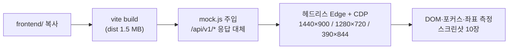
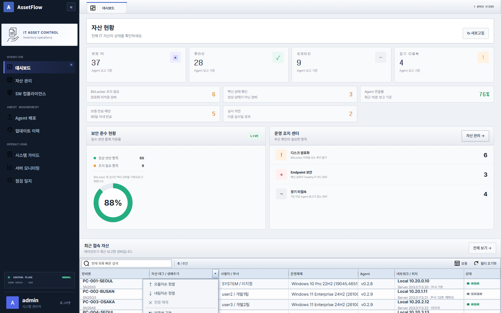
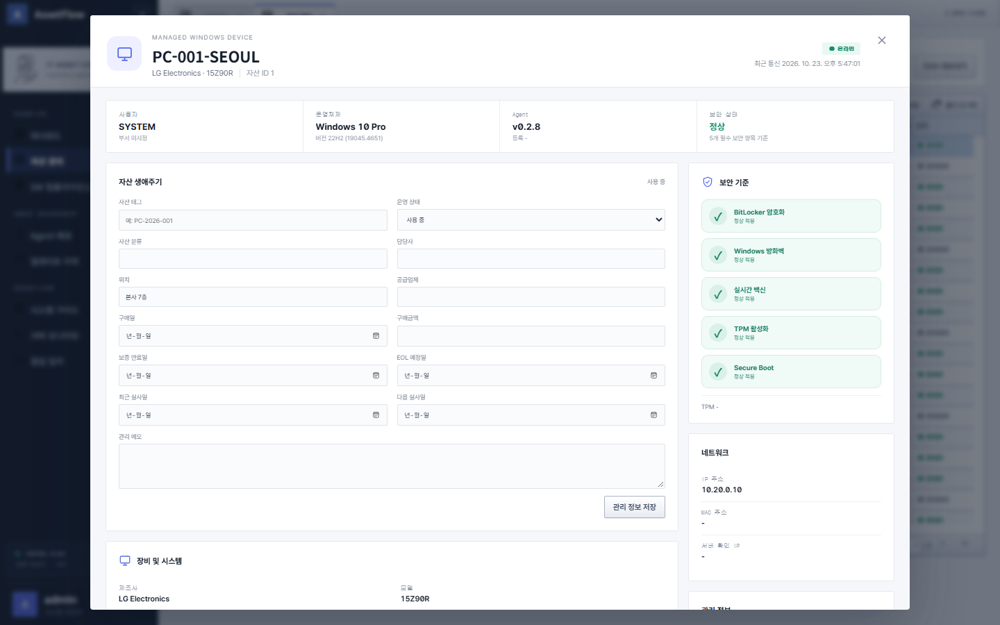

# 11. 웹 전문가 프런트엔드 검토 — AG Grid 컬럼 메뉴 기능 검증·접근성·성능

> 검토일 2026-10-23 · 대상 `frontend/src.jsx`(1,771줄), CSS 10파일, `index.html`, `package.json` · 실행 환경: Vite 8.2.2, React 19.2.8, ag-grid-community/react 36.1.0, mermaid 11.10.1 · 관련: [10 디자인 검토](10_디자인전문가_UI검토.md), [12 ITAM 화면 검토](12_IT자산관리전문가_화면검토.md), [13 UI 수정요청서](13_수정요청서_UI.md)

## 1. 검토 방법

소스를 격리 폴더에 복사해 `npm install` 후 `vite build`를 수행하고, 백엔드 없이 동작하도록 `fetch`를 가로채는 모의 API(자산 37건·릴리스 1건)를 주입했다. 헤드리스 Edge를 Chrome DevTools Protocol로 제어해 컬럼 메뉴 시나리오 16개를 실행하고 DOM 상태·포커스·좌표를 기록했다. 원본 저장소의 소스는 수정하지 않았다.



## 2. 컬럼 헤더 메뉴(▾) 기능 검증 결과

구현: `ExtColumnHeader`(`src.jsx:33-102`)가 AG Grid 기본 헤더를 대체(`headerComponent`, `suppressHeaderMenuButton:true`, `src.jsx:105`)하고, 메뉴를 `document.body`에 포털로 렌더링한다.

| # | 시나리오 | 기대 | 실측 | 판정 | 근거 |
|---|---|---|---|---|---|
| 1 | 트리거 클릭으로 메뉴 열기 | 열림 | 열림, `aria-expanded=true` | 정상 | |
| 2 | 열린 상태에서 트리거 재클릭 | 닫힘 | **열린 채 유지** | 결함 | window `pointerdown` 리스너가 먼저 닫고(`:51-57`) 이어지는 `click`이 `!value`로 다시 연다(`:79`) |
| 3 | 메뉴 외부 클릭 | 닫힘 | 닫힘 | 정상 | |
| 4 | Escape | 닫힘 + 트리거로 포커스 복귀 | 닫힘, **포커스는 `body`** | 결함 | 포커스 복귀 로직 없음 |
| 5 | 메뉴 열릴 때 포커스 이동 | 첫 항목으로 이동 | **이동 없음**(`activeElement` 빈값) | 결함 | WAI-ARIA menu 패턴 미준수 |
| 6 | 화살표 키 탐색 | ↑↓로 항목 이동 | 지원 없음 | 결함 | 키 핸들러는 Escape만(`:52`) |
| 7 | 메뉴 위치 | 뷰포트 안 | 대시보드 하단 그리드에서 **top 802 / 높이 428 → 1,230px(뷰포트 900)** | 결함 | `top: rect.bottom+2` 고정, 플립·max-height 없음(`:78`, `ag-grid-ext.css:43`) |
| 8 | 오름차순·내림차순·정렬 해제 | 적용/비활성 토글 | 정상. 정렬 전 "정렬 해제" 비활성 | 정상 | |
| 9 | Shift+클릭 다중 정렬 | 2개 컬럼 정렬 + 순서 표시 | 2개 정렬됨, **순서 배지 0개** | 미흡 | 커스텀 헤더가 `ag-sort-order`를 렌더링하지 않음 |
| 10 | 왼쪽/오른쪽 고정, 고정 해제 | 적용, 현재 상태 비활성 | 적용됨. **이미 왼쪽 고정인 "장비명"에서도 "왼쪽에 고정" 활성** | 미흡 | `disabled` 조건이 "고정 해제"에만 있음(`:86-88`) |
| 11 | 현재/전체 컬럼 자동 맞춤 | 적용 | 적용 | 정상 | |
| 12 | 컬럼 표시 체크박스 | 토글, 메뉴 유지, 마지막 1개 보호 | 모두 정상 | 정상 | |
| 13 | 메뉴를 연 컬럼 자신을 숨김 | 메뉴 유지 또는 안내 | **메뉴가 즉시 사라짐** | 미흡 | 헤더 컴포넌트 언마운트와 함께 포털 소멸 |
| 14 | "표시할 컬럼" 목록 내부 스크롤 | 메뉴 유지 | **메뉴가 닫힘**(목록 200px > 보기 179px) | 결함 | `window.addEventListener("scroll", close, true)` 캡처가 내부 스크롤도 수신(`:59`) |
| 15 | 컬럼 상태 보존(탭 전환 후 복귀) | 숨김·고정·폭 유지 | **초기화됨**(숨긴 "Agent" 재표시) | 결함 | `getColumnState`/`applyColumnState` 미사용, 컴포넌트 재마운트 |
| 16 | 컬럼 필터 진입 | 필터 패널 열림 | **진입점 없음**(`.ag-header-cell-filter-button`, 플로팅 필터 0개) | 결함 | `defaultColDef.filter:true`지만 기본 헤더를 대체해 필터 버튼이 사라졌고 메뉴에 `showFilter` 항목이 없음 |





보충 관찰
- 트리거는 `opacity:0`, 18×26px(`ag-grid-ext.css:31`)로 hover·focus 시에만 보인다. 키보드 포커스 시에는 표시(opacity 1)되어 Tab 접근은 가능하다.
- 툴바 "필터 초기화"(`src.jsx:117,125`)는 `setFilterModel(null)`을 호출하지만 UI에서 컬럼 필터를 설정할 방법이 없어 사실상 빠른 검색 초기화만 수행한다.
- `role="menu"` 하위에 `div.x-header-menu-label`, `div.x-header-columns`(label+checkbox)가 있어 ARIA 허용 자식(menuitem·menuitemcheckbox·menuitemradio·separator·group)을 위반한다. 트리거에 `aria-haspopup="menu"`도 없다.
- 메뉴 `z-index:3000`은 모달 백드롭 `1000`보다 높다. 현재는 메뉴가 스크롤·클릭에 닫히므로 겹침이 드물지만 레이어 토큰 정리가 필요하다.

### 2.1 즉시 적용 패치 (제안)

```jsx
// src.jsx ExtColumnHeader — 핵심 수정점만 발췌
function ExtColumnHeader({ displayName, column, api, enableSorting, progressSort, setSort, showFilter, enableFilterButton }) {
  const triggerRef = useRef(null), menuRef = useRef(null);
  const [menuOpen, setMenuOpen] = useState(false);
  const [menuPosition, setMenuPosition] = useState({});

  useEffect(() => {
    if (!menuOpen) return;
    const close = (e) => {
      if (e.type === "keydown" && e.key !== "Escape") return;
      if (e.type === "pointerdown" && (menuRef.current?.contains(e.target) || triggerRef.current?.contains(e.target))) return; // (2) 트리거 재클릭 토글 허용
      if (e.type === "scroll" && menuRef.current?.contains(e.target)) return;                                                 // (14) 내부 스크롤 무시
      setMenuOpen(false);
      if (e.type === "keydown") triggerRef.current?.focus();                                                                   // (4) 포커스 복귀
    };
    window.addEventListener("pointerdown", close); window.addEventListener("keydown", close);
    window.addEventListener("resize", close); window.addEventListener("scroll", close, true);
    menuRef.current?.querySelector("[role=menuitem]:not(:disabled)")?.focus();                                                 // (5) 초기 포커스
    return () => { /* remove listeners */ };
  }, [menuOpen]);

  const openMenu = () => {
    const r = triggerRef.current.getBoundingClientRect();
    const spaceBelow = window.innerHeight - r.bottom - 8, spaceAbove = r.top - 8;
    const openUp = spaceBelow < 320 && spaceAbove > spaceBelow;                                                                // (7) 위로 플립
    setMenuPosition({
      left: Math.max(4, Math.min(r.right - 232, window.innerWidth - 240)),
      ...(openUp ? { bottom: window.innerHeight - r.top + 2, maxHeight: spaceAbove } : { top: r.bottom + 2, maxHeight: spaceBelow }),
    });
    setMenuOpen((v) => !v);
  };

  const onMenuKeyDown = (e) => {                                                                                                // (6) 화살표 탐색
    const items = [...menuRef.current.querySelectorAll("[role=menuitem]:not(:disabled),[role=menuitemcheckbox]")];
    const i = items.indexOf(document.activeElement);
    if (e.key === "ArrowDown") { e.preventDefault(); items[(i + 1) % items.length]?.focus(); }
    if (e.key === "ArrowUp") { e.preventDefault(); items[(i - 1 + items.length) % items.length]?.focus(); }
  };
  const pinned = column.getPinned();
  return <div className="x-column-header">
    {/* ...제목 버튼... */}
    <button ref={triggerRef} className="x-column-trigger" aria-haspopup="menu" aria-expanded={menuOpen} onClick={openMenu}><span/></button>
    {menuOpen && createPortal(
      <div ref={menuRef} className="x-header-menu" style={menuPosition} role="menu" onKeyDown={onMenuKeyDown}>
        {enableFilterButton && <button role="menuitem" onClick={() => { showFilter(triggerRef.current); setMenuOpen(false); }}>필터…</button>}   {/* (16) */}
        <button role="menuitem" disabled={pinned === "left"} onClick={() => api.setColumnsPinned([column], "left")}>왼쪽에 고정</button>          {/* (10) */}
        {/* ... */}
        <button role="menuitem" onClick={() => { api.resetColumnState(); setMenuOpen(false); }}>컬럼 초기화</button>
        <div role="group" aria-label="표시할 컬럼">{/* label → role="menuitemcheckbox" aria-checked 로 교체 */}</div>
      </div>, document.body)}
  </div>;
}
```

```jsx
// DataGrid — (15) 컬럼 상태 보존: 그리드 식별자별 localStorage
const storageKey = `assetflow.grid.${className || "default"}`;
<AgGridReact
  onGridReady={({ api }) => { const s = localStorage.getItem(storageKey); if (s) api.applyColumnState({ state: JSON.parse(s), applyOrder: true }); }}
  onColumnVisible={save} onColumnPinned={save} onColumnResized={save} onSortChanged={save} onColumnMoved={save}
/>
// save = ({ api }) => localStorage.setItem(storageKey, JSON.stringify(api.getColumnState()))
```

```css
/* ag-grid-ext.css — 트리거 상시 표시·타깃 확대 */
.enterprise-grid .ag-header{height:32px}
.x-column-trigger{flex:0 0 24px;opacity:.55}
.x-column-header.is-sorted .x-column-trigger,.x-column-trigger:focus-visible,.x-column-trigger.is-open{opacity:1}
.x-header-menu{overflow:auto;font-size:12px}
```

대안: 커스텀 헤더를 유지할 필요가 없다면 `headerComponent`를 제거하고 AG Grid 기본 헤더(`suppressHeaderMenuButton:false`, `columnMenu:"new"`)에 `mainMenuItems`로 한국어 항목만 구성하는 편이 접근성·위치 계산·필터 연동을 모두 무상으로 얻는다. 기본 헤더의 메뉴는 플립·키보드 탐색·필터 탭을 내장한다.

## 3. 접근성(WCAG 2.1) 검토

| 항목 | 관찰 | 기준 | 판정 |
|---|---|---|---|
| 색 대비 | 보조 텍스트 13종 2.5~4.3:1 ([10장 4절](10_디자인전문가_UI검토.md)) | 1.4.3 | 미달 |
| 타깃 크기 | 헤더 트리거 18px, 탭 닫기 17px, 페이지 버튼 24px | 2.5.8(24px) | 미달 |
| 모달 포커스 | 열림 시 포커스가 모달 안으로 이동하지 않음, 첫 Tab이 **사이드바 접기 버튼**으로 이동(포커스 트랩 없음), 닫힘 후 복귀 없음(`src.jsx:1094-1142`) | 2.4.3, ARIA dialog | 미달 |
| 중첩 인터랙티브 | 탭 닫기 `<i role="button">`이 `<button>` 내부(`src.jsx:1558`) — 실측 2건 | HTML 유효성, 4.1.2 | 미달 |
| 제목 구조 | 앱 셸에 `h1` 없음(첫 제목 h2 "자산 목록"), 모달 내 h2가 페이지 h2와 동급 | 1.3.1, 2.4.6 | 미흡 |
| 랜드마크 | `aside`, `main`, `nav` 사용. 탭 `nav`에 aria-label 있음. 로그인 `form`에 제목 연결 없음 | 1.3.1 | 보통 |
| 이미지 | 아이콘 `img alt=""`, 픽토그램 `aria-hidden` | 1.1.1 | 적합 |
| 키보드 | 그리드 행 클릭 상세 열기는 Enter 미지원(`onRowClicked`만), 메뉴 화살표 미지원 | 2.1.1 | 미달 |
| 동작 | `prefers-reduced-motion` 미대응(스피너, 버튼 transform) | 2.3.3 | 미흡 |
| 언어 | `html lang="ko"` | 3.1.1 | 적합 |

## 4. 성능·번들

| 항목 | 측정 | 문제 | 제안 |
|---|---|---|---|
| 메인 청크 | **1,525 kB**(gzip 437 kB) 단일 파일 + cytoscape 428 kB 등 | 첫 로드에 전부 다운로드·파싱 | 라우트/탭 단위 `React.lazy` + `import()` |
| mermaid | 시스템 가이드 탭의 다이어그램 1종을 위해 전역 import(`src.jsx:6`) | 로그인 화면에서도 로드 | `const mermaid = await import("mermaid")`를 `Diagram` 안에서 |
| AG Grid 모듈 | `AllCommunityModule` 전체 등록(`src.jsx:17`) | 미사용 기능 포함 | `ClientSideRowModelModule, PaginationModule, TextFilterModule, QuickFilterModule, ColumnAutoSizeModule, …`만 등록 |
| 의존성 버전 | `react`, `react-dom`, `vite`, `@vitejs/plugin-react`가 `latest`(`package.json`) | 빌드 재현 불가, 메이저 업그레이드가 무심코 배포됨 | 정확한 버전 고정, lockfile CI 검증 |
| 클라이언트 검색 | 매 키 입력마다 자산 전체를 `JSON.stringify`로 직렬화해 비교(`src.jsx:1492-1498`) | 500건 기준 수 ms이나 필드 무관 매칭(id·좌표 등도 검색됨) | 서버 `q` 파라미터(`AssetController.java:38`)를 쓰거나 지정 필드만 비교, 디바운스 |
| 데이터 상한 | `/api/v1/assets`가 `LIMIT 500`(`AssetController.java:48`)인데 화면 건수는 수신 건수 기준 | 501대부터 **화면 총계가 틀림** | 서버 total 반환 + 서버 페이지네이션(AG Grid Infinite/Server-side Row Model) |
| 폴링 | 업데이트 이력 30초 폴링(`src.jsx:371`), 탭 비활성 시에도 지속 | 불필요 트래픽 | `document.visibilityState` 확인, 탭이 보일 때만 |
| 외부 글꼴 | Google Fonts(DM Sans·Noto Sans KR) + jsDelivr Pretendard 동시 로드, IBM Plex 3종 선언만 | 두 CDN 왕복, 미로드 글꼴 선언 | Pretendard 1종 셀프 호스팅(`font-display:swap`), 나머지 선언 제거 |

## 5. 외부 리소스·보안 관련

| 리소스 | 위치 | 문제 |
|---|---|---|
| `cdn.statically.io/gh/openplatform-labs/icons@main` | `src.jsx:178-179` | **변동 브랜치(@main)** 참조 — 업스트림 변경·삭제 시 아이콘 전부 깨짐, SRI 불가, 사용자 IP가 외부로 노출 |
| `cdn.jsdelivr.net/gh/orioncactus/pretendard@v1.3.9` | `index.html:15` | 버전 고정은 되었으나 SRI 없음, `crossorigin` CSS |
| `fonts.googleapis.com` | `style.css:1` `@import` | CSS 파싱을 막는 렌더 차단 import |
| 서버 헤더 | `nginx.conf` | CSP·`X-Frame-Options`·`Referrer-Policy` 없음([07 수정요청서](07_수정요청서.md) 보안 항목과 연계) |

내부망 운영 콘솔이므로 아이콘·글꼴은 `public/`에 포함해 자체 서빙하고 CSP `default-src 'self'`를 적용하는 것이 가장 단순한 해법이다.

## 6. CSS 구조

- 10개 파일이 import 순서로 서로를 덮어쓴다(`src.jsx:7-16`). `!important` 64회, 고유 색 499개.
- **미사용(사어) 규칙**: `.tablewrap`, `.asset-row`, `.asset-pagination`, `.sort-button`, `.header-environment`, `.info-button`, `.detail-col`, `.asset-name`, `.kit-*` 일부 — `src.jsx`에서 해당 클래스가 0회 등장. HTML 표 기반의 이전 자산 목록 구현 잔재다.
- `main>header` 스타일(`control-room.css:9`)이 있으나 앱 셸은 `<header>`를 렌더링하지 않는다(`src.jsx:1555-1561`).
- 제안: ① `tokens.css`(색·크기·간격·레이어 z-index) 1개, ② 컴포넌트별 파일(`grid.css`, `shell.css`, `modal.css`, `login.css`), ③ 사어 규칙 제거, ④ `!important` 0 목표. 전환 중에는 PurgeCSS 리포트로 미사용 규칙을 식별한다.

## 7. 컴포넌트·상태 구조

| 관찰 | 영향 | 제안 |
|---|---|---|
| 단일 파일 1,771줄, 일부 함수는 한 줄에 압축(`src.jsx:1419-1450`) | 리뷰·테스트 불가, 포매터 미적용 | Prettier 적용, `components/`, `pages/`, `lib/api.js` 분리 |
| 열린 탭·활성 화면·상세 모달이 URL과 무관(`useState`만) | 새로고침 시 초기화, 뒤로가기 불가, 상세 링크 공유 불가(감사 증적 링크 불가) | React Router 또는 `history.pushState`로 `/assets/:id` 등 반영 |
| 테스트 0건 | 컬럼 메뉴 결함 16건 중 다수는 단위 테스트로 잡힘 | Vitest + Testing Library, 본 검토의 CDP 시나리오를 Playwright로 이식 |
| 오류 처리 | `api()`가 401 외는 `Error(text)`로 던지고 화면은 `message`만 표시 | 네트워크 단절·5xx 시 재시도 안내 없음 | 공통 토스트 + 재시도 버튼 |
| 모달 `onClose` 의존성 | `useEffect([assetId, onClose])`에서 부모가 인라인 함수를 넘겨 매 렌더마다 리스너 재등록 | 미세 성능·중복 등록 위험 | `useCallback` 또는 ref |

## 8. 권고 요약

| 우선순위 | 항목 | 수정요청 |
|---|---|---|
| 즉시 | 컬럼 필터 진입점, 메뉴 플립·내부 스크롤 | CR-U01, U02 |
| 즉시 | 자산 500건 상한과 총계 불일치 | CR-U21 연계(ITAM) |
| 1개월 | 트리거 토글·포커스·키보드·ARIA·스크롤 닫힘 | CR-U03, U04, U08 |
| 1개월 | 컬럼 상태 보존·초기화, 고정 상태 반영 | CR-U06, U07 |
| 1개월 | 모달 포커스 트랩, 중첩 버튼, h1 | CR-U19 |
| 1개월 | 번들 분할(mermaid 지연 로드), 의존성 고정 | CR-U20 |
| 분기 | 외부 CDN 셀프 호스팅·CSP, CSS 토큰화·사어 제거, URL 라우팅, 테스트 | CR-U13, U20 외 |
