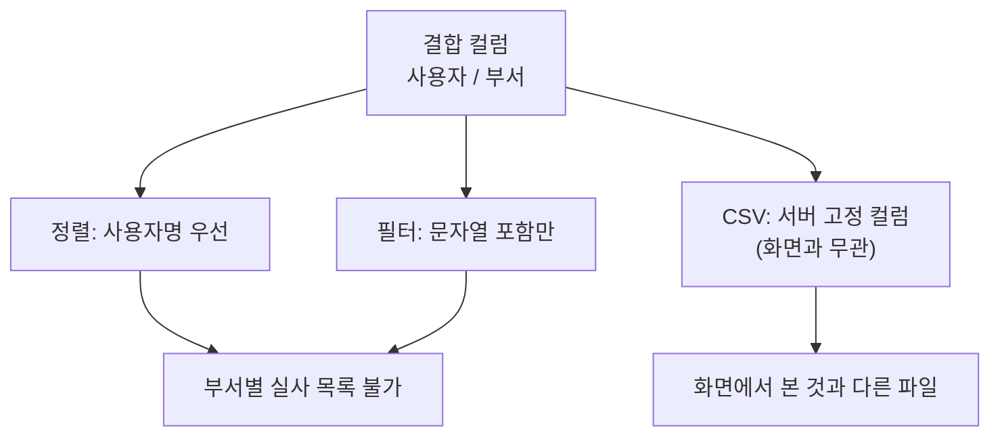
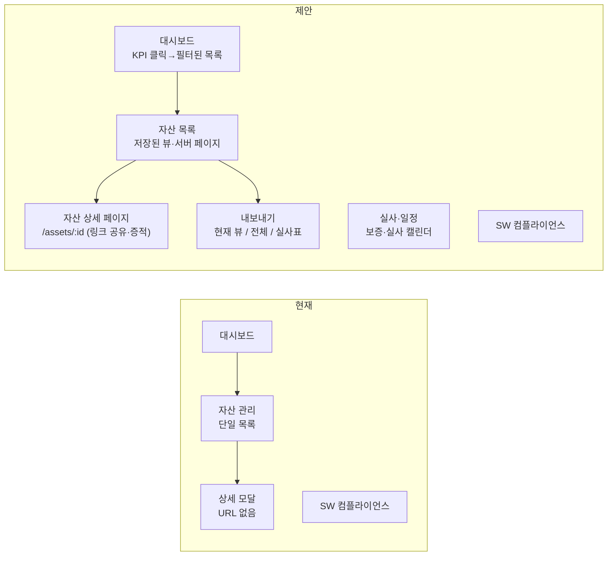

# 12. IT자산관리 전문가 화면 검토 — 자산 목록 그리드 구성·컬럼 옵션의 업무 적합성

> 검토일 2026-10-23 · 대상 자산 목록·대시보드·상세 모달·CSV 내보내기 화면 (`frontend/src.jsx`, `backend/.../AssetController.java`) · 관련: [02 ITAM 검토](02_IT자산관리_전문가_검토.md), [10 디자인 검토](10_디자인전문가_UI검토.md), [11 웹 검토](11_웹전문가_프런트엔드검토.md), [13 UI 수정요청서](13_수정요청서_UI.md)

## 1. 검토 관점

자산관리 담당자가 화면에서 수행해야 하는 핵심 작업을 기준으로, 현재 그리드와 컬럼 옵션(▾ 메뉴)이 그 작업을 지원하는지 확인했다.

| 업무 | 필요한 화면 조작 |
|---|---|
| 실사 대상 추출 | 부서·위치·생애주기(사용 중)로 필터 → 자산태그·시리얼 포함 목록 내보내기 |
| OS 수명종료(EOL) 대상 파악 | OS 이름·버전으로 필터·정렬 |
| 미할당·미태깅 자산 정리 | 자산태그 없음, 담당자 없음 필터 |
| 보증·실사 일정 관리 | 보증 만료일·다음 실사일 정렬, 90일 이내 필터 |
| 보안 미준수 장비 조치 | BitLocker·백신 상태 컬럼으로 필터, 담당자에게 전달 |
| 감사 대응 | 특정 자산의 상세 화면 링크·시점 데이터 증적 |

## 2. 자산 목록 그리드 컬럼 적정성

### 2.1 현재 컬럼 (`src.jsx:1406-1415`)

| 헤더 | 구성 방식 | 문제 |
|---|---|---|
| 장비명 | `hostname` + 시리얼 2줄 렌더러 | 시리얼은 정렬·필터·CSV 대상이 아님 |
| 자산 태그 / 생애주기 | `asset_tag` + `lifecycle_status` 2줄 | **생애주기로 필터·정렬 불가** — 실사 대상 추출의 1차 조건 |
| 사용자 / 부서 | `valueGetter`로 `"user / 부서"` 문자열 결합 | **부서 단독 정렬·그룹화 불가**, 결합 문자열 정렬은 사용자명 기준 |
| 운영체제 | `os_name + os_version` 결합 | 빌드 번호별 EOL 판별을 위한 버전 정렬 불가 |
| Agent | 버전 문자열 `v0.2.9` | 최신 버전 대비 구버전 표시 없음 |
| 네트워크 / 위치 | IP 2종 + 위치 2줄 | **위치 단독 필터 불가**, 위치는 실사 동선의 핵심 키 |
| 마지막 통신 | 날짜 | 적정(comparator 있음) |
| 상태 | 온라인/오프라인 배지(`filter:false`) | 오프라인만 보기 불가 |

API(`/api/v1/assets`, `AssetController.java:40-44`)는 이미 `manufacturer`, `model`, `category`, `assigned_to`, `warranty_expires_at`, `next_audit_at`를 반환하지만 **화면에 노출되지 않는다**. 반면 CSV 내보내기(`:84`)는 `purchase_date`, `purchase_cost`, `eol_at`, `last_audit_at` 등 화면에 없는 컬럼을 포함해 **화면·내보내기 컬럼 체계가 서로 다르다**.

### 2.2 결합 컬럼의 영향

컬럼 옵션 메뉴에 필터 진입점이 없는 문제([11장 2절 #16](11_웹전문가_프런트엔드검토.md))와 결합되어, 현재 UI에서 가능한 조건 추출은 "빠른 검색(전체 필드 문자열 포함)"뿐이다. 실사·EOL·미할당 추출은 모두 CSV를 내려받아 스프레드시트에서 처리해야 한다.

### 2.3 데이터 건수 상한

`/api/v1/assets`는 `LIMIT 500`(`AssetController.java:48`)이며, 화면의 "검색 결과 N", 그리드 "N / N건", 대시보드 "전체 PC"는 각각 다른 기준(수신 건수 / 수신 건수 / DB count)이다. 자산이 500대를 넘는 순간 목록 화면의 총계가 대시보드와 달라지고 담당자는 이를 알 수 없다. 서버 페이지네이션 또는 최소한 "500건까지만 표시" 안내가 필요하다.

## 3. 컬럼 옵션(▾) 메뉴의 업무 적합성

| 기능 | 자산관리 업무에서의 의미 | 현재 | 필요 수준 |
|---|---|---|---|
| 필터 | 조건 추출의 기본 | **없음** | 텍스트·집합(Set) 필터, 날짜 범위(보증·실사일), 불리언(온라인·태그 유무) |
| 정렬 | 일정·만료 관리 | 단일·다중 가능, 순서 표시 없음 | 다중 정렬 순서 표시 |
| 컬럼 표시/숨김 | 업무별 컬럼 세트 | 가능하나 **탭 전환 시 초기화** | 사용자별 저장, "저장된 뷰"(실사용·보안용·라이선스용) |
| 고정 | 좌측 식별자 유지 | 가능 | 적정 |
| 컬럼 폭 | 긴 모델명·OS | 자동 맞춤 가능 | 폭 저장 |
| 그룹화·집계 | 부서별 대수, OS별 분포 | 없음(Community 에디션 제한) | 서버 집계 API 또는 대시보드 차트로 대체 |
| 내보내기 | 실사표·보고서 | 서버 고정 컬럼 CSV | **현재 필터·표시 컬럼 그대로** 내보내기(`api.exportDataAsCsv`) + 전체 내보내기 구분 |
| 컬럼 초기화 | 실수 복구 | 없음 | 메뉴 항목 추가 |

## 4. 표기·상태 일관성

| 위치 | 관찰 | 문제 | 제안 |
|---|---|---|---|
| 사용자 | `SYSTEM`이 그대로 표시(`src.jsx:1409`, 모의 데이터에서도 재현) | 수집 결함([07 CR-018](07_수정요청서.md))이 화면에서 "사용자"로 읽힘 | 서비스 계정은 "미식별"로 표기하고 경고 아이콘, 담당자(`assigned_to`)와 로그온 사용자 컬럼 분리 |
| 빈 값 | "미지정", "-", "전체", "v-" 혼재(`:1408-1411`, `:1439`) | 필터·정렬 시 서로 다른 값으로 취급 | 빈 값 표기 규칙 1개("—")와 `valueFormatter` 공통화 |
| 온라인 기준 | 서버 15분(`AssetController.java:44`)과 상세 모달의 프런트 계산 15분(`src.jsx:1124`) 이중 정의 | 기준 변경 시 불일치 | 서버 값만 사용 |
| 날짜 | `toLocaleString("ko-KR")` 브라우저 시간대 | 해외 지점 PC·서버 시간대 혼선 | 표준 시간대 명시(KST) 및 ISO 툴팁 |
| 생애주기 라벨 | 재고·사용 중·수리·분실·퇴역·폐기(`:1070`) | 라벨은 적정하나 색·아이콘 구분 없음 | 상태 배지 색 토큰(분실·폐기는 경고색) |
| IP 표기 | "Local 10.x / Server 203.x" | 용어가 네트워크 담당자 외에는 모호 | "단말 IP / 접속 IP" |

## 5. 대시보드 KPI

| KPI | 산식·출처 | 문제 |
|---|---|---|
| 보안 준수율 % | (전체×2 − BitLocker 미적용 − 백신 비정상) / (전체×2) (`src.jsx:1626-1633`) | 상세 모달의 "보안 기준"은 BitLocker·방화벽·백신·TPM·Secure Boot **5항목**(`:1125-1131`)으로, 같은 자산이 대시보드에서는 준수·상세에서는 미준수로 보일 수 있음 |
| 보증 만료 예정·실사 지연 | 서버 count | 숫자만 있고 **클릭해도 해당 목록으로 이동하지 않음**(드릴다운 없음) |
| Agent 연결률 | 온라인/전체 | "최근 15분 보고 기준" 문구와 서버 기준 일치 — 적정 |
| 장기 미접속 | 7일 | 운영 조치 센터와 중복 표시 |
| 사이드바 "CONTROL PLANE NORMAL" | 고정 문자열(`:1543`) | 감사 시 "모니터링 결과"로 오인될 수 있음 — 제거 또는 점검 API 바인딩 |

## 6. 화면 구성(IA) 재검토

- 상세 모달은 URL이 없어 감사 증적·티켓에 링크를 남길 수 없다. 페이지 전환(또는 모달이라도 `/assets/:id` 반영)이 필요하다.
- "저장된 뷰"는 컬럼 세트+필터+정렬의 묶음으로, 최소 3종(실사용·보안 조치용·라이선스 대조용)을 기본 제공한다.
- 대시보드 KPI 카드는 해당 조건이 적용된 목록으로 이동해야 숫자가 행동으로 이어진다.

## 7. 권장 컬럼 명세 (자산 목록)

| 순서 | 컬럼 | 원천 필드 | 기본 표시 | 폭 | 필터 유형 | 비고 |
|---|---|---|---|---|---|---|
| 1 | 자산 태그 | `asset_tag` | 표시·좌측 고정 | 130 | 텍스트, 빈 값 | 식별자 1순위 |
| 2 | 장비명 | `hostname` | 표시·좌측 고정 | 160 | 텍스트 | |
| 3 | 시리얼 | `serial_no` | 숨김 | 140 | 텍스트 | |
| 4 | 생애주기 | `lifecycle_status` | 표시 | 100 | 집합 | 배지 |
| 5 | 담당자 | `assigned_to` | 표시 | 110 | 텍스트, 빈 값 | 자산 책임자 |
| 6 | 로그온 사용자 | `username` | 숨김 | 110 | 텍스트 | SYSTEM→"미식별" |
| 7 | 부서 | `department` | 표시 | 120 | 집합 | |
| 8 | 위치 | `location` | 표시 | 130 | 집합 | |
| 9 | 분류 | `category` | 숨김 | 100 | 집합 | 데스크톱/노트북 등 |
| 10 | 제조사 | `manufacturer` | 숨김 | 120 | 집합 | |
| 11 | 모델 | `model` | 표시 | 160 | 텍스트 | |
| 12 | OS | `os_name` | 표시 | 150 | 집합 | |
| 13 | OS 버전 | `os_version` | 숨김 | 140 | 텍스트 | EOL 판별 |
| 14 | Agent 버전 | `agent_version` | 숨김 | 100 | 집합 | 최신 아닐 때 경고색 |
| 15 | 단말 IP | `ip_address` | 숨김 | 120 | 텍스트 | |
| 16 | 접속 IP | `server_observed_ip` | 숨김 | 120 | 텍스트 | |
| 17 | 보증 만료 | `warranty_expires_at` | 표시 | 110 | 날짜 범위 | 90일 이내 경고색 |
| 18 | 다음 실사 | `next_audit_at` | 표시 | 110 | 날짜 범위 | 경과 시 경고색 |
| 19 | 마지막 통신 | `last_seen_at` | 표시 | 150 | 날짜 범위 | |
| 20 | 상태 | `online` | 표시·우측 고정 | 90 | 불리언 | |
| 21 | BitLocker / 백신 | 상세 API 필드를 목록 API에 추가 필요 | 숨김 | 120 | 집합 | 보안 조치용 뷰에서 표시 |

기본 표시 12개는 1440px 폭에서 가로 스크롤 없이 들어가도록 폭을 산정했다. 저장된 뷰 "실사용"은 1·2·3·4·5·7·8·18, "보안 조치용"은 1·2·5·7·12·13·14·21·20을 기본 표시로 한다.

## 8. 기능 제안 (기능추가요청 후보)

| 후보 | 내용 | 선행 |
|---|---|---|
| FR-U01 | 저장된 뷰(컬럼·필터·정렬) 사용자별 저장·공유 | CR-U06 |
| FR-U02 | 현재 뷰 CSV/XLSX 내보내기, 실사표 양식 내보내기 | CR-U23 |
| FR-U03 | 대시보드 KPI → 필터 적용 목록 드릴다운 | CR-U24 |
| FR-U04 | 자산 상세 URL(`/assets/:id`)·인쇄용 자산 카드 | CR-U19 |
| FR-U05 | 부서·OS·생애주기별 집계 패널(서버 집계 API) | — |
| FR-U06 | 보증·실사 캘린더 뷰 | — |

기존 [08 기능추가요청서](08_기능추가요청서.md)의 실사·라이선스 항목과 중복되는 부분은 그쪽 번호를 따른다.

## 9. 권고 요약

| 우선순위 | 항목 | 수정요청 |
|---|---|---|
| 즉시 | 결합 컬럼 분리·원자 컬럼화, 필터 진입점 | CR-U21, U01 |
| 즉시 | 500건 상한 안내 또는 서버 페이지네이션, 총계 기준 통일 | CR-U21 |
| 1개월 | API가 이미 주는 필드(제조사·모델·담당자·보증·실사) 컬럼 추가 | CR-U22 |
| 1개월 | 현재 뷰 기준 내보내기, 빈 값·SYSTEM·IP 표기 통일 | CR-U23, U24 |
| 1개월 | 보안 준수율 산식 통일, KPI 드릴다운, 고정 상태 문자열 제거 | CR-U24, U18 |
| 분기 | 저장된 뷰, 상세 URL, 집계 패널 | FR-U01~U06 |
