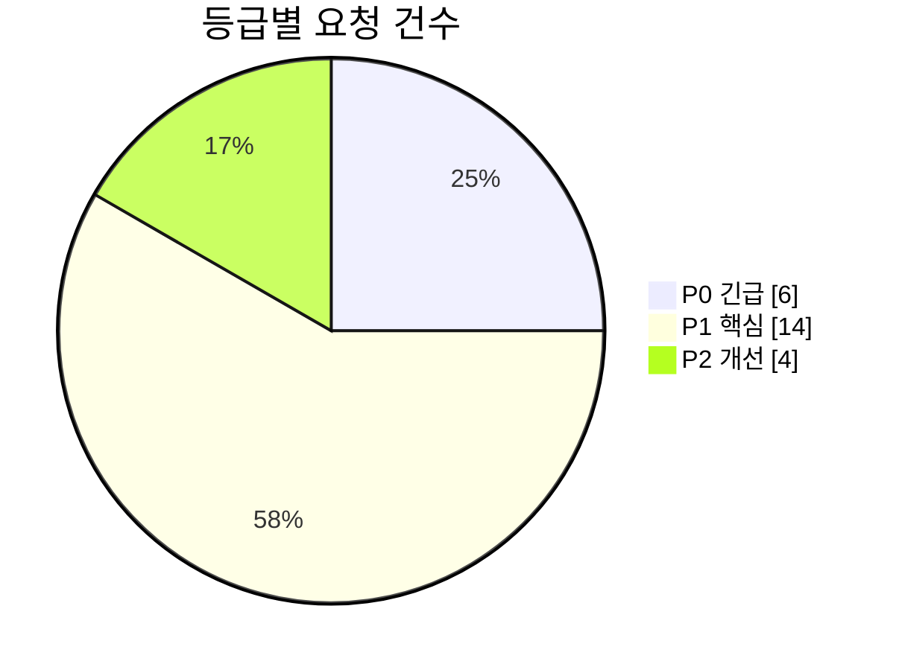
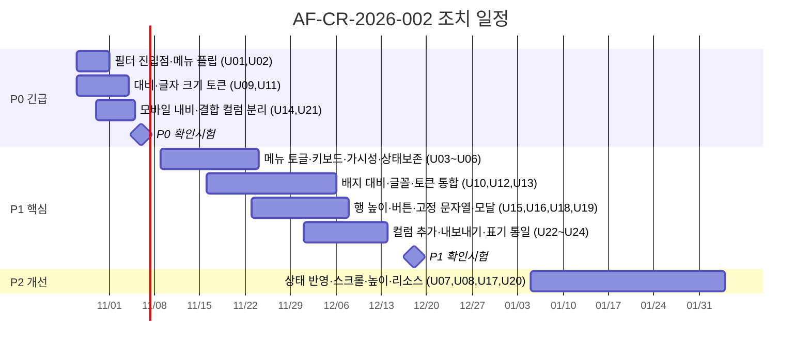

# 13. 수정요청서 (화면·UI)

| 항목 | 내용 |
|---|---|
| 문서번호 | AF-CR-2026-002 |
| 대상 시스템 | AssetFlow 관리자 웹 (Frontend 0.2.0, AG Grid 36.1.0) |
| 대상 버전 | 커밋 `836345a` 기준 `frontend/` |
| 요청일 | 2026-10-23 |
| 요청 근거 | [10 디자인 전문가 UI 검토](10_디자인전문가_UI검토.md), [11 웹 전문가 프런트엔드 검토](11_웹전문가_프런트엔드검토.md), [12 IT자산관리 전문가 화면 검토](12_IT자산관리전문가_화면검토.md) |
| 선행 문서 | [07 수정요청서 AF-CR-2026-001](07_수정요청서.md) (보안·자산관리·인프라 36건) — 본 문서는 화면·UI 영역을 분리해 추가 요청 |
| 회신 양식 | [09 조치결과보고서 양식](09_조치결과보고서_양식.md) |

## 1. 요청 개요

자산 목록·대시보드 그리드의 **컬럼 옵션(▾) 메뉴** 기능 검증과 **화면 색 대비·글자 크기·반응형 구성** 재검토 결과, 결함 24건을 시정 요청한다. 그리드 메뉴 결함은 소스를 빌드해 헤드리스 브라우저로 **실행 재현**했고, 대비·크기는 CSS 정적 분석과 렌더링 실측값을 근거로 한다. 소스 수정은 수행하지 않았다.

| 구분 | P0 | P1 | P2 | 계 |
|---|---|---|---|---|
| G. 그리드 컬럼 메뉴 | 2 | 4 | 2 | 8 |
| D. 색 대비·타이포그래피 | 2 | 3 | 0 | 5 |
| L. 레이아웃·반응형 | 1 | 2 | 1 | 4 |
| T. 접근성·신뢰성·리소스 | 0 | 2 | 1 | 3 |
| A. 자산관리 화면 | 1 | 3 | 0 | 4 |
| **계** | **6** | **14** | **4** | **24** |

## 2. 등급·기한 기준

| 등급 | 정의 | 조치 기한 |
|---|---|---|
| P0 긴급 | 핵심 업무 조작 불가 또는 접근성 법적 기준(WCAG AA) 광범위 미달 | 2026-11-06 (2주) |
| P1 핵심 | 기능 오동작·상태 불일치·접근성 개별 항목 미달 | 2026-12-18 (8주) |
| P2 개선 | 품질·일관성·유지보수성 | 2027-02-26 (분기) |

## 3. 요청 목록

### G. 그리드 컬럼 메뉴 (▾)

| 번호 | 등급 | 요청 내용 | 근거 | 완료 기준 |
|---|---|---|---|---|
| CR-U01 | **P0** | **컬럼 필터 진입점 추가.** `defaultColDef.filter:true`이나 커스텀 헤더가 기본 필터 버튼을 제거해 어떤 컬럼도 필터할 수 없음. 메뉴에 "필터…"(`showFilter`) 항목을 넣거나 `floatingFilter`를 켠다. 툴바 "필터 초기화"가 실제 필터 모델을 초기화하도록 한다 | `src.jsx:105`, `:81-100`, `:117`; 실측 필터 버튼 0개 | 필터 허용 전 컬럼에서 필터 패널이 열리고 적용·해제됨. 생애주기·부서·OS 집합 필터 동작 |
| CR-U02 | **P0** | **메뉴 뷰포트 넘침 수정.** `top:rect.bottom+2` 고정 배치로 화면 하단 그리드에서 메뉴가 잘림(1440×900 대시보드: top 802, 높이 428). 공간 부족 시 위로 플립하고 `max-height`+내부 스크롤 적용 | `src.jsx:78`, `ag-grid-ext.css:43` | 어떤 그리드·창 크기에서도 메뉴 전체가 뷰포트 안에 표시되거나 내부 스크롤로 도달 가능 |
| CR-U03 | P1 | **트리거 재클릭으로 닫히지 않음.** window `pointerdown`이 먼저 닫고 `click`이 다시 연다. 트리거를 외부 클릭 판정에서 제외 | `src.jsx:51-57`, `:75-80`; 실측 재클릭 후 `aria-expanded=true` 유지 | 트리거 클릭이 열기/닫기를 교대로 수행 |
| CR-U04 | P1 | **키보드·스크린리더 지원.** 열릴 때 첫 항목 포커스, ↑↓ 탐색, Escape 후 트리거로 포커스 복귀, `aria-haspopup="menu"`, 컬럼 체크박스는 `menuitemcheckbox`로, 라벨 div는 `role="group"`으로 | `src.jsx:52`, `:81-99`; 실측 열림 후 `activeElement` 없음, Escape 후 `body` | WAI-ARIA Menu Button 패턴 체크리스트 전 항목 충족, axe 위반 0 |
| CR-U05 | P1 | **트리거 가시성·타깃.** `opacity:0`(hover 시만 표시), 18×26px. 기본 opacity .55, 24×24px 이상, 터치 환경 상시 표시 | `ag-grid-ext.css:31,33`; 실측 opacity 0, 폭 18 | 비hover 상태에서 식별 가능, 타깃 24px 이상(WCAG 2.5.8) |
| CR-U06 | P1 | **컬럼 상태 보존·초기화.** 표시/숨김·고정·폭·정렬이 탭 전환 시 초기화. 그리드별 `getColumnState`를 localStorage(추후 서버 사용자 설정)에 저장·복원하고 메뉴에 "컬럼 초기화" 추가 | `src.jsx:104-152`; 실측 숨긴 "Agent" 컬럼이 재마운트 후 재표시 | 숨김·고정·폭·정렬이 새로고침 후에도 유지, 초기화로 기본값 복귀 |
| CR-U07 | P2 | **상태 반영 보완.** ① 이미 왼쪽 고정인 컬럼에서 "왼쪽에 고정" 활성 → 현재 상태 비활성+체크 표시, ② 다중 정렬 순서 배지 없음, ③ 메뉴를 연 컬럼 자신을 숨기면 메뉴 소멸 → 유지 또는 확인 안내 | `src.jsx:86-88`, 실측 #9·#10·#13 | 세 항목 모두 재현 불가 |
| CR-U08 | P2 | **컬럼 목록 스크롤 시 메뉴 닫힘.** `scroll` 캡처 리스너가 메뉴 내부 스크롤도 수신. 메뉴 내부 타깃은 무시 | `src.jsx:59`; 실측 목록 200px>179px 스크롤 시 닫힘 | 메뉴 내부 스크롤로 메뉴가 닫히지 않음 |

### D. 색 대비·타이포그래피

| 번호 | 등급 | 요청 내용 | 근거 | 완료 기준 |
|---|---|---|---|---|
| CR-U09 | **P0** | **보조 텍스트 대비 미달 시정.** `.stats small`(2.49), `.compliance-legend>small`(2.65), `.action-list small`(2.71), `.nav-health small`(2.84), `.dashboard-insights span`(3.48), `.nav-group>small`(3.56), `.stats span`(3.56), `.grid-primary small`(3.58), `.intro p`(4.29), `.login-help small`(≈2.6) 등. 보조 색 토큰 `#5b6775`(5.6:1), 네이비 배경용 `#9aa6bb`로 교체 | [10장 4.1·4.4](10_디자인전문가_UI검토.md); 렌더링 실측 | 모든 텍스트 4.5:1 이상(큰 텍스트 3:1), axe/Lighthouse 대비 위반 0 |
| CR-U10 | P1 | **배지·아이콘 타일 대비.** `.stats i.orange/green/gray/blue`(2.0~4.1), `.alert i`, `.shield-action`, `.virus-action`, `.online`(3.79), `.offline`(3.73), `.inspection-warn`(3.32), `.panel-heading>span`(3.99), 비활성 탭(3.56). 상태색 토큰(ok/warn/danger) 텍스트·배경 쌍으로 통일 | [10장 4.2](10_디자인전문가_UI검토.md) | 텍스트 배지 4.5:1, 아이콘 3:1 이상 |
| CR-U11 | **P0** | **최소 글자 크기 상향.** 12px 미만 선언 151건, 최소 6~7px. 본문 12px 이상, 캡션·모노 라벨 11px 이상으로 크기 토큰(`--fs-xs~--fs-num`) 도입. 그리드 헤더 10→12px, 메뉴 11→12px | [10장 5](10_디자인전문가_UI검토.md); 대시보드 실측 11px 미만 84요소 | 렌더링된 텍스트 중 11px 미만 0개(장식용 `aria-hidden` 제외) |
| CR-U12 | P1 | **글꼴 정리.** IBM Plex Sans/Sans KR/Sans Condensed/Mono가 선언만 되고 로드되지 않아 제목·내비·수치가 시스템 대체 글꼴로 표시. Pretendard 1종으로 확정·셀프 호스팅, DM Sans·Noto Sans KR·IBM Plex 선언 제거, 시스템 가이드 문구(`src.jsx:846`) 수정 | `console-kit.css:17,47,50`, `lifecycle.css:7`, `login-pro.css:13-14`; 실측 h2 computed font "IBM Plex Sans Condensed" | `document.fonts`에 미로드 패밀리 0, 외부 글꼴 요청 0 |
| CR-U13 | P1 | **디자인 토큰 통합·사어 CSS 제거.** 10파일 적층, 고유 색 499개, `!important` 64회, 사이드바 폭 3회 재정의. `tokens.css` 1개 + 컴포넌트 CSS로 재편, 미사용 규칙(`.tablewrap`, `.asset-row`, `.asset-pagination`, `.sort-button`, `.header-environment`, `.info-button`, `.detail-col`, `.asset-name`, `main>header`) 삭제 | [10장 3](10_디자인전문가_UI검토.md), [11장 6](11_웹전문가_프런트엔드검토.md) | 고유 색 60개 이하, `!important` 0, PurgeCSS 미사용 규칙 0 |

### L. 레이아웃·반응형

| 번호 | 등급 | 요청 내용 | 근거 | 완료 기준 |
|---|---|---|---|---|
| CR-U14 | **P0** | **모바일 내비게이션 복구.** ≤650px에서 `aside{display:none}`이 접기 버튼까지 숨겨 화면 이동 불가. main 상단 햄버거 버튼 + 드로어 사이드바 | `style.css` 미디어쿼리, `console-kit.css:26`; 390×844 실측 aside `display:none` | 390px에서 모든 메뉴 항목 접근·전환 가능 |
| CR-U15 | P1 | **2줄 셀과 조밀 행 충돌.** 기본 "조밀"(30px) 행에서 `.grid-primary` 2줄 콘텐츠 29px가 행 경계와 맞닿아 시리얼·생애주기가 잘려 보임. 2줄 렌더러 사용 시 최소 36px, 조밀 모드는 1줄로 | `src.jsx:110,146`, `ag-grid-ext.css:47-49`; 캡처 01·04 | 조밀·보통 양 모드에서 셀 콘텐츠 하단 여백 4px 이상 |
| CR-U16 | P1 | **좁은 폭 버튼 줄바꿈.** "↻ 새로고침"이 세로로 쌓이고 CSV 버튼이 3줄로 꺾임. `white-space:nowrap`, 아이콘 전용 축약, `.intro{flex-wrap}` | 390×844 캡처 06 | 390px에서 버튼 텍스트 1줄 유지 |
| CR-U17 | P2 | **그리드 높이 고정식 개선.** `height:calc(100vh - 235px)` 등 매직 넘버 3종 → flex 컨테이너 + `min-height` | `ag-grid-ext.css:12-15` | 720~1080px 높이에서 페이지네이션 바 항상 패널 안 |

### T. 접근성·신뢰성·리소스

| 번호 | 등급 | 요청 내용 | 근거 | 완료 기준 |
|---|---|---|---|---|
| CR-U18 | P1 | **고정 상태 문자열 제거.** "CONTROL PLANE NORMAL", "NODE OSAKA · K3S", "LIVE", "ALL SYSTEMS OPERATIONAL", "2 + 2 Pods", "SESSION AUDIT ENABLED" 등 실제 데이터와 무관한 상태 표현 → 점검 API 바인딩 또는 삭제, "LIVE"는 "갱신 HH:MM" | `src.jsx:241-262`, `:287`, `:1542-1545`, `:1684` | 화면의 모든 상태 문구가 API 응답에서 유래 |
| CR-U19 | P1 | **모달·탭 접근성.** 상세 모달 초기 포커스·포커스 트랩·닫힘 후 복귀 없음(첫 Tab이 사이드바로 이동), 탭 닫기 `<i role="button">`이 `<button>` 내부(중첩 인터랙티브 2건), 앱 셸 `h1` 부재, 그리드 행 Enter로 상세 열기 불가 | `src.jsx:1094-1142`, `:1558`; 실측 | axe 위반 0, 키보드만으로 상세 열기·닫기·탭 닫기 가능 |
| CR-U20 | P2 | **외부 리소스·번들.** `statically.io …@main` 아이콘(변동 브랜치), Google Fonts `@import`, jsDelivr 글꼴 SRI 없음 → 셀프 호스팅·CSP. `react`/`vite` 등 `latest` 고정. mermaid(가이드 1종)·cytoscape 지연 로드, `AllCommunityModule` 대신 필요한 모듈만 등록(메인 청크 1,525kB→목표 500kB 이하) | `src.jsx:6,17,178-179`, `index.html:14-15`, `style.css:1`, `package.json` | 외부 도메인 요청 0, lockfile 고정, 초기 JS 500kB 이하 |

### A. 자산관리 화면

| 번호 | 등급 | 요청 내용 | 근거 | 완료 기준 |
|---|---|---|---|---|
| CR-U21 | **P0** | **결합 컬럼 분리·총계 기준 통일.** "사용자 / 부서", "운영체제(+버전)", "네트워크 / 위치", "자산 태그 / 생애주기" 결합 컬럼을 원자 컬럼으로 분리(보조 컬럼은 기본 숨김). `/api/v1/assets` `LIMIT 500` 상한을 화면에 안내하거나 서버 페이지네이션 도입, 목록 총계와 대시보드 총계 기준 통일 | `src.jsx:1406-1415`, `AssetController.java:48` | 생애주기·부서·위치·OS 버전 각각 정렬·필터 가능. 501대 이상에서 총계 일치 |
| CR-U22 | P1 | **API 제공 필드 컬럼 추가.** 제조사·모델·분류·담당자·보증 만료·다음 실사(목록 API가 이미 반환)를 컬럼으로 추가, 보증 90일 이내·실사 경과 경고색. BitLocker·백신 상태는 목록 API에 필드 추가 후 노출 | `AssetController.java:40-44`, [12장 7 컬럼 명세](12_IT자산관리전문가_화면검토.md) | 명세 21개 컬럼 중 20개 제공, 기본 표시 12개가 1440px에서 가로 스크롤 없음 |
| CR-U23 | P1 | **내보내기 정합.** CSV가 서버 고정 컬럼 전체(`:84`)로 화면 필터·표시 컬럼과 무관. "현재 뷰 내보내기"(`api.exportDataAsCsv`, 표시 컬럼·필터 반영)와 "전체 내보내기" 구분. [07 CR 수식 인젝션 항목](07_수정요청서.md)과 함께 조치 | `src.jsx:1593`, `AssetController.java:82-84` | 화면에 보이는 행·컬럼과 파일 내용 일치 |
| CR-U24 | P1 | **표기·산식 일관성.** ① `SYSTEM` 사용자 → "미식별" 경고 표기, 담당자 컬럼 분리 ② 빈 값 "미지정/-/전체/v-" 단일 규칙 ③ 온라인 기준 서버 값만 사용 ④ 보안 준수율 산식(대시보드 2항목 vs 상세 5항목) 통일 ⑤ KPI 카드 클릭 시 조건 적용 목록 이동 | `src.jsx:1408-1411`, `:1124-1131`, `:1626-1633`, `:1674-1675` | 동일 자산의 준수 판정이 대시보드·상세에서 일치, KPI 5종 드릴다운 동작 |

## 4. 조치 일정

## 5. 확인 시험 방법

| 구분 | 방법 | 통과 기준 |
|---|---|---|
| 그리드 메뉴 | 본 검토의 CDP 시나리오 16개를 Playwright 테스트로 이식(열기/재클릭 닫기/Escape 포커스/플립/필터/스크롤/상태 보존) | 16개 전부 통과 |
| 색 대비 | 렌더링 DOM 전수 순회 대비 계산 스크립트(검토 시 사용) + axe-core | 4.5:1 미만 텍스트 0, axe `color-contrast` 0 |
| 글자 크기 | 렌더링 DOM에서 `font-size<11px` 요소 집계 | 0개(`aria-hidden` 장식 제외) |
| 반응형 | 390/768/1280/1440 폭 스크린샷 비교 | 내비 접근 가능, 버튼 1줄, 가로 스크롤 없음 |
| 접근성 | Lighthouse Accessibility, 키보드 전용 시나리오(로그인→목록→상세→닫기→탭 닫기) | 점수 95 이상, 시나리오 완주 |
| 자산관리 | 모의 데이터 600건으로 총계 일치, 생애주기·부서·OS 버전 필터 추출 → CSV 대조 | 화면·파일 100% 일치 |
| 번들 | `vite build` 산출물 크기 | 초기 JS 500kB 이하, 외부 도메인 요청 0 |

## 6. 비고

- 본 요청은 [07 수정요청서](07_수정요청서.md)의 CR-018(사용자명 SYSTEM), CSV 수식 인젝션, CDN 고정, 보안 헤더 항목과 조치 범위가 겹친다. 중복 항목은 07의 번호로 조치하고 본 문서에는 결과만 참조 기재한다.
- 커스텀 헤더(`ExtColumnHeader`)를 유지할지 AG Grid 기본 헤더+`mainMenuItems`로 전환할지는 개발 측이 선택하되, CR-U01~U08의 완료 기준은 동일하게 적용한다.

## 7. 확인

| 구분 | 소속/역할 | 성명 | 일자 | 서명 |
|---|---|---|---|---|
| 요청자 | 디자인 | | 2026-10-23 | |
| 요청자 | 웹/프런트엔드 | | 2026-10-23 | |
| 요청자 | IT자산관리 | | 2026-10-23 | |
| 접수자 | 개발 | | | |
| 승인자 | | | | |
