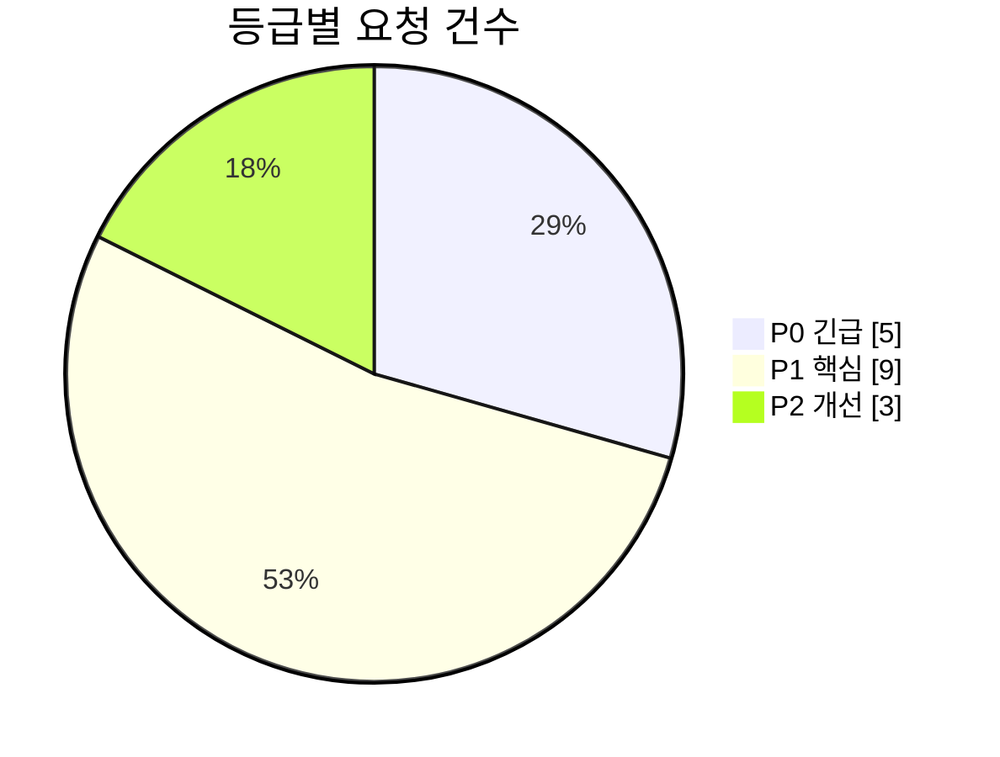
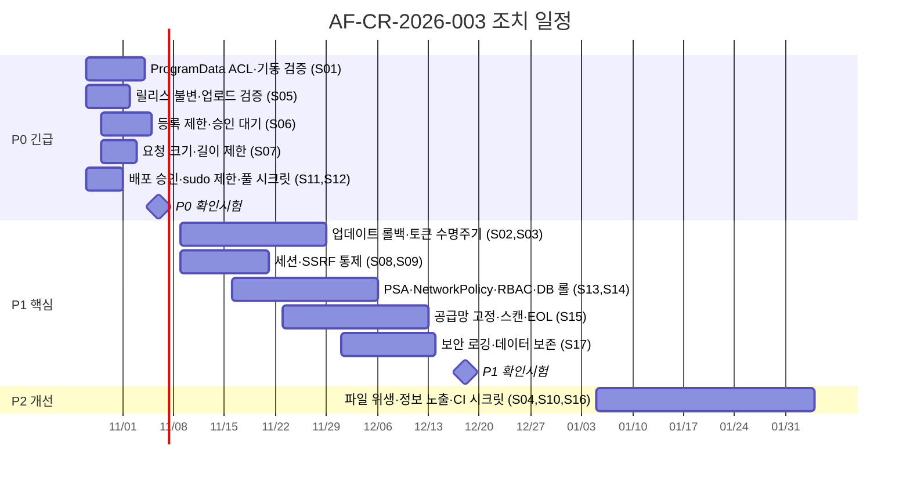

# 15. 수정요청서 (보안·웹 취약점)

| 항목 | 내용 |
|---|---|
| 문서번호 | AF-CR-2026-003 |
| 대상 시스템 | AssetFlow Agent 0.2.9 / Backend 0.1.0 / Frontend 0.2.0 / k3s·CI |
| 대상 버전 | 커밋 `836345a` |
| 요청일 | 2026-10-23 |
| 요청 근거 | [14 보안·웹 취약점 점검보고서 AF-VA-2026-001](14_보안웹취약점_점검보고서.md) |
| 선행 문서 | [07 수정요청서 AF-CR-2026-001](07_수정요청서.md) CR-001~017(보안 17건)은 **그대로 유효**하며 본 문서는 신규 발견 17건을 추가한다. 중복 조치는 07 번호로 회신 |
| 회신 양식 | [09 조치결과보고서 양식](09_조치결과보고서_양식.md) |

## 1. 요청 개요

소스 전수 보안 점검에서 신규 확인된 취약점 25건(V-01~V-25)을 조치 단위로 묶어 **17건의 수정요청(CR-S01~S17)** 으로 정리한다. 로컬 권한 상승(V-01), 릴리스 불변성(V-06), 등록 남용(V-03), 운영 배포 권한(V-15), 요청 제한(V-10)의 5건은 P0로 2주 내 조치를 요청한다.

| 구분 | P0 | P1 | P2 | 계 |
|---|---|---|---|---|
| E. Agent·엔드포인트 | 1 | 2 | 1 | 4 |
| W. 웹·API | 2 | 3 | 1 | 6 |
| K. 배포·Kubernetes·CI/CD | 2 | 3 | 1 | 6 |
| G. 거버넌스·로깅·개인정보 | 0 | 1 | 0 | 1 |
| **계** | **5** | **9** | **3** | **17** |

## 2. 등급·기한 기준

| 등급 | 정의 | 조치 기한 |
|---|---|---|
| P0 긴급 | 권한 상승·공급망 교체·운영 장악·서비스 거부로 직결 | 2026-11-06 (2주) |
| P1 핵심 | 보안 통제 공백, 복구 실패, 심층 방어 부재 | 2026-12-18 (8주) |
| P2 개선 | 정보 노출 축소, 위생, 장기 유지 | 2027-02-26 (분기) |

## 3. 요청 목록

### E. Agent·엔드포인트

| 번호 | 등급 | 취약점 | 요청 내용 | 근거 | 완료 기준 |
|---|---|---|---|---|---|
| CR-S01 | **P0** | V-01 | **ProgramData 선점 권한 상승 차단.** ① 설치 스크립트가 `%ProgramData%\AssetFlow`를 삭제 후 재생성하고 `icacls`로 상속 제거, `SYSTEM:(OI)(CI)F`, `Administrators:(OI)(CI)F`, `Users:(OI)(CI)R`(토큰 파일은 Users 접근 제거) 적용 ② 서비스 기동 시 폴더·`agent.json` 소유자가 SYSTEM/Administrators가 아니거나 Users 쓰기 ACE가 있으면 기동 거부·이벤트 로그 경고 ③ 트레이가 읽는 `ApiUrl`을 별도 공개 파일(`tray.json`)로 분리하고 토큰 파일은 사용자 비가독 ④ 기존 설치 PC 대상 ACL 교정 스크립트 배포. CR-001(코드서명)·CR-005(토큰 보호)와 통합 조치 | `AgentState.cs:9-24`, `install-service.bat:59,64`, `TrayApplication.cs:91` | 테스트 PC에서 일반 사용자 폴더 선점 → 설치 → `agent.json` 교체 시도 실패, 소유자 변조 시 서비스 기동 거부 로그 확인 |
| CR-S02 | P1 | V-02 | **업데이트 적용 후 헬스 확인·자동 롤백.** 새 바이너리 기동 후 N초(예: 120초) 내 하트비트 성공을 확인하지 못하면 `.bak`으로 복구·재기동, 결과(성공/롤백)를 서버 `agent_update_history`에 `UPDATE_FAILED` 이벤트로 보고. 서버는 실패율이 임계치(예: 5%) 초과 시 해당 릴리스 배포 자동 중지(CR-003 연계) | `UpdateService.cs` 스크립트, `AgentController.java:41` | 고의 손상 바이너리 배포 시 전 Agent가 이전 버전으로 복귀하고 서버에 실패 이벤트 기록 |
| CR-S03 | P1 | V-04 | **장치 토큰 수명주기.** 토큰 만료(90일)·갱신 엔드포인트(`POST /agents/token/renew`), 관리자 해지 API(`DELETE /admin/agents/{id}` → 토큰 무효·자산 RETIRED), `agent` 테이블에 `token_expires_at`, `revoked_at`, `last_registration_ip` 추가, 다른 /16 대역에서 재등록 시 알림(CR-004 연계) | `schema.sql:1`, `AgentAuth.java:3`, `AgentController.java:33` | 만료 토큰 401, 해지 장치의 하트비트 401, 재등록 알림 기록 |
| CR-S04 | P2 | V-05 | **설치·업데이트 파일 위생.** 임시 파일명 GUID, 다운로드 파일 ACL 확인, 업데이트 성공 후 `.bak` 삭제, `apply-update.cmd`를 실행 후 삭제 | `install-service.bat:8-9`, `UpdateService.cs` | 설치·업데이트 후 잔여 파일 없음 |

### W. 웹·API

| 번호 | 등급 | 취약점 | 요청 내용 | 근거 | 완료 기준 |
|---|---|---|---|---|---|
| CR-S05 | **P0** | V-06 | **릴리스 불변성·업로드 검증.** ① 동일 버전 재업로드 409(`ON CONFLICT DO UPDATE` 제거) ② 업로드 파일 MZ/PE 헤더·크기 상한(100MB)·버전이 현재 최신보다 큰지 검증 ③ 서버 측 Authenticode 서명 검증(허용 게시자 지문 고정) ④ `agent_release`에 `uploaded_by`, `uploaded_ip`, `uploaded_at` 기록 ⑤ 관리자 세션 + 릴리스 관리자 역할 + 업로드 토큰 3중 요구(CR-002) | `AgentUpdateController.java:48-66`, `SecurityConfig.java:6` | 재업로드 409, 비PE 파일 400, 미서명 파일 400, 업로드 기록 조회 가능 |
| CR-S06 | **P0** | V-03 | **등록 API 남용 방지.** ① nginx `limit_req`(등록 IP당 분당 5회, 로그인 분당 10회) ② 신규 장치는 `PENDING` 상태로 등록되어 관리자 승인 전 통계·목록에서 제외(또는 승인 자동화 규칙: 사내 IP 대역 + 도메인 가입) ③ 네임스페이스별 장치 상한·초과 시 알림 ④ 등록 토큰 만료(발급 후 30일)·다중 토큰(사이트별)·회전 API ⑤ 등록 실패 401 로깅 | `AgentController.java:21-36`, `nginx.conf:1`, `install-service.bat:20` | 분당 6회째 등록 429, 미승인 장비 통계 제외, 만료 토큰 401 |
| CR-S07 | **P0** | V-10, V-11 | **요청 크기·개수·길이 제한.** ① nginx 기본 `client_max_body_size 1m`, `/api/v1/admin/agent-releases`만 200m, `/api/v1/agents/inventory` 8m ② Spring `server.tomcat.max-swallow-size`, Jackson `StreamReadConstraints(maxStringLength 10k, maxNestingDepth 50)` ③ `Models.Inventory`·`Disk`·`Software`에 `@Size` 적용(hostname 255, name 500 등), `disks` 64개·`software` 2,000건 초과 시 422+사유 ④ DB 제약 위반을 422로 변환하는 `@ControllerAdvice` ⑤ Agent는 422 수신 시 해당 필드 절단 후 재전송·로그 | `nginx.conf:1`, `application.yml:22-23`, `AgentController.java:73-76`, `Models.java:11-13`, `schema.sql:2` | 9MB 인벤토리 413, 256자 모델명 422(500 아님), 수집 실패 PC가 대시보드에 "수집 오류"로 표시 |
| CR-S08 | P1 | V-07, V-09 | **세션·로그인 정책.** 유휴 30분·절대 12시간, `secure` 운영 프로파일 강제(`false`면 기동 거부), 동시 세션 1(새 로그인 시 기존 만료), 로그인 성공·실패·로그아웃 로그(사용자·IP·UA), `Login` 레코드 `@Size(max=64/128)`. CR-008(세션 고정)·CR-011(속도 제한)과 통합 | `application.yml:24-27`, `AuthController.java:3-4` | 31분 유휴 후 401, 두 번째 브라우저 로그인 시 첫 세션 만료, 실패 로그 확인 |
| CR-S09 | P1 | V-12 | **외부 기초자료 동기화 SSRF·자원 통제.** https 전용, 호스트 허용 목록(설정), 사설(10/8, 172.16/12, 192.168/16)·링크로컬(169.254/16)·루프백·`*.svc`·`*.cluster.local` 차단(리다이렉트 추적 후 재검사), 응답 10MB·15초 제한, API 키는 https에서만 전송, 동기화 실행 로그에 호출자 기록 | `SoftwarePolicySyncService.java:22-33` | 사설 IP URL 설정 시 기동 거부 또는 400, 10MB 초과 응답 중단 |
| CR-S10 | P2 | V-13, V-25 | **입력 범위·정보 노출 위생.** `AssetManagement` `@Digits(13,2)`·`@Size`, nginx `server_tokens off`, `Server`·`X-Powered-By` 제거, 공통 오류 응답(`{"error":"..."}`, 스택 미포함) 표준화. CR-014(보안 헤더)와 함께 | `AssetController.java:68-79`, `Models.java:14`, `nginx.conf:1` | 응답 헤더에 버전 없음, 범위 초과 입력 400 |

### K. 배포·Kubernetes·CI/CD

| 번호 | 등급 | 취약점 | 요청 내용 | 근거 | 완료 기준 |
|---|---|---|---|---|---|
| CR-S11 | **P0** | V-15 | **운영 배포 권한 통제.** ① `deploy` 잡에 `environment: production` + 필수 승인자 1인 ② `main` 브랜치 보호(PR 리뷰 1인·상태 검사·강제 push 금지) ③ 러너 계정 sudoers를 `/usr/local/bin/k3s ctr images pull *` 등 명시 명령으로 제한(`NOPASSWD` 범위 축소) ④ `actions/checkout`에 `persist-credentials: false` ⑤ `paths-ignore: ['docs/**']` ⑥ 중기: pull 기반 배포(Argo CD/Flux)로 러너의 운영 노드 상주 제거 | `deploy-k3s.yml:44-75` | 승인 없는 `main` push가 배포되지 않음, 러너 계정으로 `sudo -l` 시 제한 명령만 표시 |
| CR-S12 | **P0** | V-14 | **GHCR 풀 시크릿 영속화.** `read:packages` 전용 기계 계정 PAT(만료 1년·알림)를 GitHub Secret으로 등록해 `ghcr-pull` 생성에 사용. 또는 이미지를 내부 레지스트리로 미러. 노드 재부팅 복구 리허설 1회 수행 | `deploy-k3s.yml:52,60`, `backend.yaml:38,49` | 배포 1일 후 Pod 삭제·재생성 시 이미지 풀 성공 |
| CR-S13 | P1 | V-16 | **Pod 보안 컨텍스트·PSA.** 네임스페이스에 `pod-security.kubernetes.io/enforce: restricted`, 모든 컨테이너 `runAsNonRoot`, `allowPrivilegeEscalation:false`, `capabilities.drop:[ALL]`, `seccompProfile: RuntimeDefault`, `readOnlyRootFilesystem`(필요 경로 emptyDir); frontend는 `nginxinc/nginx-unprivileged`, postgres `runAsUser:70` | `deploy/k3s/*.yaml`, `namespace.yaml` | `kubectl get pods` 전부 Running, PSA 위반 경고 0 |
| CR-S14 | P1 | V-17, V-18, V-19 | **네트워크·RBAC·DB 최소 권한.** ① 기본 거부 NetworkPolicy + frontend→backend:8080, backend→postgres:5432, backend→kube-apiserver만 허용 ② frontend Service를 ClusterIP로 바꾸고 Ingress(TLS) 또는 노드 방화벽에서 30080 외부 차단을 문서화 ③ `pods`/`deployments`는 네임스페이스 Role, `nodes`/metrics만 ClusterRole ④ PostgreSQL 앱 롤 `assetflow_app`(DML만) 생성, 슈퍼유저 비밀번호 분리, 마이그레이션은 별도 계정(CR-033) | `postgres.yaml`, `frontend.yaml:7-9`, `rbac.yaml`, `config.yaml:8,12`, `deploy-k3s.yml:61` | 타 네임스페이스 Pod에서 postgres 접속 실패, SA로 타 네임스페이스 pods list 403, 앱 계정 `CREATE EXTENSION` 실패 |
| CR-S15 | P1 | V-21, V-22 | **공급망 고정·스캔·EOL 대응.** ① 베이스 이미지 `@sha256` 다이제스트 고정, Renovate로 갱신 ② GitHub Actions SHA 고정 ③ CI에 Trivy(이미지·fs, HIGH 이상 실패)·Dependabot(npm·maven·nuget·actions) ④ SBOM(CycloneDX) 산출·보관 ⑤ Spring Boot 지원 라인 상향, .NET 10 LTS 이전 계획(2026-11 전) | `Dockerfile`들, `deploy-k3s.yml:23-37,84`, `pom.xml`, `*.csproj`, `frontend/package.json` | CI에 스캔 단계 존재·통과, 부동 태그 0, EOL 계획 문서 |
| CR-S16 | P2 | V-20 | **CI 시크릿 취급.** `--from-literal` 대신 `envsubst`로 렌더링한 Secret 매니페스트를 stdin으로 적용하거나 Sealed Secrets/SOPS 도입, 러너 ephemeral 모드 | `deploy-k3s.yml:60-61` | 러너 프로세스 인수에 비밀값 없음 |

### G. 거버넌스·로깅·개인정보

| 번호 | 등급 | 취약점 | 요청 내용 | 근거 | 완료 기준 |
|---|---|---|---|---|---|
| CR-S17 | P1 | V-23, V-24 | **보안 이벤트 로깅·데이터 보존.** ① 구조화(JSON) 로그, 보안 이벤트 카테고리(로그인 성공/실패, 401/403, 릴리스 업로드, 정책 변경·삭제, 장치 등록·재등록·해지) WARN 이상 ② 로그 외부 수집·90일 보존 ③ 장치 해지 시 개인정보 필드(username, ip, mac) 익명화, 퇴역 후 1년 경과 자산·소프트웨어 행 삭제 배치 ④ 수집 항목 최소화 검토 결과 문서화. CR-013(감사 로그)과 역할 구분 | 전 컨트롤러, `application.yml`, `schema.sql` | 시험 이벤트 각각이 로그 수집기에서 조회됨, 해지 장치 개인정보 필드 null 확인 |

## 4. 07 수정요청서 보안 항목과의 관계

| 07 번호 | 본 문서 연계 | 비고 |
|---|---|---|
| CR-001 코드서명 | CR-S01, S02, S05의 근본 대책 | 07에서 P1이나 V-01 발견으로 **P0 상향 검토 요청** |
| CR-002 업로드 인증 | CR-S05 ⑤ | 함께 조치 |
| CR-003 단계적 배포 | CR-S02 | 함께 조치 |
| CR-004 재등록 덮어쓰기 | CR-S03, S06 | 함께 조치 |
| CR-005 agent.json 보호 | CR-S01 ③ | 함께 조치 |
| CR-006 RBAC | CR-S05 ⑤ 역할 요구 | 선행 |
| CR-008 세션 고정 / CR-011 속도 제한 | CR-S08, S06 ① | 함께 조치 |
| CR-013 감사 로그 | CR-S17 | 역할 구분(감사 vs 보안 이벤트) |
| CR-014 보안 헤더 / CR-016 IP | CR-S10, S06 | nginx 일괄 |
| CR-029 latest 이중 롤아웃 / CR-033 마이그레이션 | CR-S12, S14 ④ | 인프라 |

## 5. 조치 일정

## 6. 확인 시험 방법

| 구분 | 방법 | 통과 기준 |
|---|---|---|
| CR-S01 | 테스트 PC: 일반 사용자로 `C:\ProgramData\AssetFlow` 선점 → 관리자 설치 → 일반 사용자로 `agent.json` 삭제·재작성 시도; 소유자 변조 후 서비스 재시작 | 교체 실패(Access Denied), 변조 시 서비스 기동 거부 이벤트 |
| CR-S05 | 동일 버전 재업로드, 텍스트 파일 업로드, 미서명 exe 업로드, 토큰만으로 업로드 | 각각 409 / 400 / 400 / 401 |
| CR-S06 | 스크립트로 분당 20회 등록 시도, 승인 전 대시보드 총계 확인 | 6회째부터 429, 미승인 장비 미집계 |
| CR-S07 | 9MB 인벤토리, 300자 모델명, 100개 디스크 전송 | 413 / 422 / 422, 서버 500 없음 |
| CR-S08 | 유휴 31분 후 API 호출, 두 브라우저 로그인 | 401, 첫 세션 만료 |
| CR-S09 | `SOFTWARE_POLICY_SOURCE_URL=http://10.0.0.1/` 및 `https://kubernetes.default.svc/` 설정 후 `/sync` | 400 또는 기동 거부 |
| CR-S11, S12 | 승인 없이 `main` push; 배포 24시간 후 `kubectl delete pod` | 배포 보류, 재생성 Pod 이미지 풀 성공 |
| CR-S13, S14 | `kubectl auth can-i list pods -n kube-system --as=system:serviceaccount:assetflow:assetflow-monitor`; 임시 Pod에서 `psql postgres` 접속 | no, 연결 거부 |
| CR-S15 | CI 실행 로그에 Trivy 결과, 매니페스트·Dockerfile grep으로 부동 태그 검색 | HIGH 0 또는 예외 승인, 부동 태그 0 |
| CR-S17 | 로그인 실패 3회, 릴리스 업로드, 장치 해지 수행 후 로그 수집기 조회 | 이벤트 3종 모두 조회, 해지 장치 개인정보 필드 null |

## 7. 비고

- V-01은 조치 전 **재현 시험을 먼저** 수행해 영향 범위(기설치 PC 수)를 확정하고, 결과에 따라 ACL 교정 스크립트를 긴급 배포한다.
- CR-S11의 pull 기반 배포 전환은 P1~P2 기간에 별도 과제로 진행하되, P0 범위(승인자·브랜치 보호·sudo 제한)는 저장소·서버 설정만으로 즉시 가능하다.
- 본 문서의 완료 기준은 [09 조치결과보고서 양식](09_조치결과보고서_양식.md)의 "시험 방법·시험 결과" 란에 그대로 인용한다.

## 8. 확인

| 구분 | 소속/역할 | 성명 | 일자 | 서명 |
|---|---|---|---|---|
| 요청자 | 정보보안 | | 2026-10-23 | |
| 요청자 | 인프라 운영 | | 2026-10-23 | |
| 접수자 | 개발 | | | |
| 승인자 | | | | |
