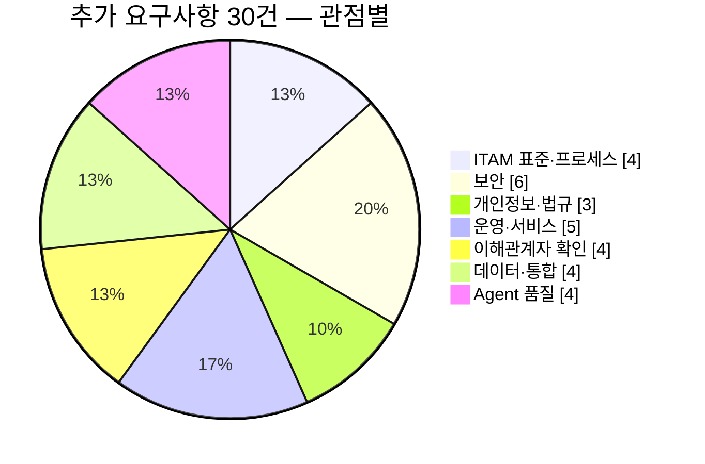

# 17. 추가 요구사항 검토서

| 항목 | 내용 |
|---|---|
| 문서번호 | AF-AR-2026-001 |
| 작성일 | 2026-10-23 |
| 대상 | AssetFlow Agent 0.2.11(작업 트리) / Backend 0.1.0 / Frontend 0.2.0 / k3s·CI — 기존 검토·요청 체계(06~08, 13~16) 전체 |
| 목적 | 기존 수정요청(CR-001~036, CR-U01~U24, CR-S01~S17)과 기능추가요청(FR-001~024)이 **다루지 않은** 기능·보안·법규·운영·이해관계자 요구를 7개 관점에서 식별한다. 기존 항목은 반복하지 않고 확장·선행 관계만 표시한다 |
| 관련 문서 | [02 ITAM 검토](02_IT자산관리_전문가_검토.md) · [03 보안 검토](03_보안전문가_검토.md) · [04 인프라 검토](04_인프라유지보수_검토.md) · [05 로드맵](05_개선기획_로드맵.md) · [07 수정요청서](07_수정요청서.md) · [08 기능추가요청서](08_기능추가요청서.md) · [14 취약점 점검보고서](14_보안웹취약점_점검보고서.md) · [15 보안 수정요청서](15_수정요청서_보안웹취약점.md) · [16 적용계획서](16_수정요청_적용계획서.md) · [Agent 삭제 방지 계획](windows-agent-removal-protection-plan.md) |
| 처리 | 각 AR은 접수 시 FR(기능) 또는 운영 문서 과제로 전환하고, 16 적용계획의 단계·WP를 변경하지 않는 범위에서 §5에 따라 편입한다 |

## 1. 검토 개요

기존 문서는 "현재 코드의 결함을 고치고(07·13·15) 자산관리 핵심 기능을 채우는(08)" 데 집중했다. 본 검토는 그 바깥을 본다. 공공기관·기업 ITAM이 감사·법규·운영 조직에 요구받는 사항, Agent가 실제 PC 환경(프록시·절전·노트북·비x64)에서 겪는 품질 문제, 경영진·부서장·감사인·임직원이 요구할 가능성이 높으나 아직 아무도 확인하지 않은 사항을 30건(AR-001~030)으로 정리했다. §5 이해관계자 항목은 가정이 아니라 **확인 필요 사항**으로 표기한다.

## 2. 항목 목록

| 번호 | 관점 | 제목 | 우선 | 선행·관련(CR/FR/WP) | 예상 규모 |
|---|---|---|---|---|---|
| AR-001 | ITAM | 자산 분류 체계·자산번호 채번 규칙 | P1 | FR-012 확장, WP-0(Flyway) | S |
| AR-002 | ITAM | 관리정보 필드 단위 변경 감사 추적(이전값·이후값) | P1 | CR-013·WP-6 확장, FR-003 선행 | M |
| AR-003 | ITAM | 기준정보 데이터 품질 규칙·예외 목록 | P2 | FR-001·FR-023 확장 | M |
| AR-004 | ITAM | ITAM 운영 규정·RACI·보고 주기 | P1 | CR-006(역할 5종) 선행, FR-023 관련 | S |
| AR-005 | 보안 | Agent 자기보호(서비스 DACL·승인된 제거) | P1 | CR-S01·WP-4 선행, WP-7(Agent 0.3.0) 확장 | L |
| AR-006 | 보안 | 서버 측 이상 징후 탐지(인벤토리 급변·동일 식별자 다수) | P1 | CR-S03·WP-8 확장, FR-005·FR-018 관련 | M |
| AR-007 | 보안 | 비밀 관리 체계(External Secrets·회전 자동화) | P2 | CR-007·CR-S16 확장, WP-3·WP-10 관련 | M |
| AR-008 | 보안 | 취약 SW 버전 CVE 매칭 | P3 | FR-006·FR-015 선행 (05 §2.4 언급, FR 미등록) | L |
| AR-009 | 보안 | 보안 기준선(CIS·공공기관 PC 보안점검) 수집 항목 확장 | P2 | FR-015·CR-020 확장, WP-9 관련 | M |
| AR-010 | 보안 | 침투시험 계획·취약점 신고 창구·보안 교육 | P1 | WP-6·WP-7·WP-10 완료 후, 14 §10 미수행 항목 | M |
| AR-011 | 개인정보 | 수집 항목별 법적 근거표·정보주체 권리 처리 절차 | P1 | FR-017 확장, CR-S17 ④ 관련 | S |
| AR-012 | 개인정보 | 로그·진단 파일 내 개인정보 마스킹 | P2 | CR-S17 ①·CR-034 확장 | S |
| AR-013 | 개인정보 | 위탁·국외이전 여부 확인 및 개인정보 영향평가(DPIA) | P1 | FR-017 선행, CR-S09 관련 | S |
| AR-014 | 운영 | 헬프데스크(ITSM) 티켓 ↔ 자산 연계 | P2 | FR-003·FR-009 확장, FR-018 관련 | M |
| AR-015 | 운영 | 임직원 셀프서비스(내 PC·보안 상태·SW 설치 요청) | P2 | CR-006(SSO)·FR-001 선행, FR-017 관련 | L |
| AR-016 | 운영 | 입사·퇴사(온보딩/오프보딩) 체크리스트 연동 | P2 | FR-001·FR-002·CR-S03 확장 | M |
| AR-017 | 운영 | SLA·운영 지표 정의와 운영 수준 합의 | P1 | FR-019 확장, 04 §6 SLO 초안 | S |
| AR-018 | 운영 | 접근성·다국어 정책 명문화(정기 점검 포함) | P2 | CR-U04·CR-U19 확장 | S |
| AR-019 | 이해관계자 | 경영 보고용 월간 요약(확인 필요) | P2 | FR-023 확장 | M |
| AR-020 | 이해관계자 | 부서별 자산 현황 열람 권한(행 단위 범위, 확인 필요) | P2 | CR-006·WP-6 확장, FR-001 선행 | M |
| AR-021 | 이해관계자 | 감사 대응 증적 패키지(확인 필요) | P2 | CR-013·FR-008·FR-023 확장 | M |
| AR-022 | 이해관계자 | 교체 주기 기반 수요 예측·예산 계획(확인 필요) | P3 | FR-013 확장 | M |
| AR-023 | 데이터 | ERP 구매·회계(고정자산) 연동 | P3 | FR-003·FR-013 확장 | L |
| AR-024 | 데이터 | 수집 범위 확장 우선순위(SNMP·프린터·MDM·비Windows) | P3 | FR-012 확장 (자동 수집) | L |
| AR-025 | 데이터 | 데이터 내보내기 표준(읽기 전용 API 토큰·웹훅·XLSX/JSON) | P2 | CR-U23·FR-018 확장 | M |
| AR-026 | 데이터 | 운영 이력 데이터 보존·아카이브 정책 | P2 | CR-S17 ③·CR-025 확장 | M |
| AR-027 | Agent | 호환성 매트릭스(Windows 빌드·ARM64·Server)·로케일 | P1 | CR-S15 ⑤ 선행, FR-022 관련 | M |
| AR-028 | Agent | 성능 예산(CPU·메모리·네트워크 상한)과 측정 | P1 | FR-021 확장, CR-S07 관련 | M |
| AR-029 | Agent | 프록시/PAC·TLS 검사 환경 지원 | P1 | FR-020 확장, WP-7 관련 | M |
| AR-030 | Agent | 절전·노트북 오프라인·섀시 구분 처리 | P1 | FR-020·FR-021·CR-U24 ③ 확장 | M |

**집계**: P1 13건 · P2 13건 · P3 4건 / S 8 · M 18 · L 4

## 3. 항목 상세

### 3.1 IT자산관리 표준·프로세스 (ISO/IEC 19770-1, ITIL 4)

#### AR-001 · 자산 분류 체계·자산번호 채번 규칙
- **배경**: `asset_tag`는 자유 입력(부분 UNIQUE 인덱스만, `schema.sql`), `category`는 기본값 `'COMPUTER'` 문자열이며 분류 마스터가 없다. FR-012는 분류별 속성 템플릿을 요구하지만 채번 규칙은 정하지 않는다.
- **요구**: 분류 코드 체계(대·중·소, 예: 정보통신기기>컴퓨터>노트북)와 자산번호 규칙(`{기관코드}-{분류}-{연도}-{일련}`) 서버 채번, 기존 물품관리 번호 승계 필드, 수동 번호 입력 시 형식 검증.
- **수용 기준**: 신규 자산 저장 시 번호 자동 부여, 형식 위반 400, 분류 코드 마스터로 집계 가능.

#### AR-002 · 관리정보 필드 단위 변경 감사 추적
- **배경**: `asset_management_history`는 `MANAGEMENT_UPDATED` 1종에 요약 문자열(`상태=, 담당=, 위치=, 다음 실사=`)만 저장하고(`AssetController.java` `management()`), 구매금액·보증·EOL 등 나머지 필드 변경은 추적되지 않으며 상세 화면은 최근 30건만 보여준다. CR-013 `audit_log`는 행위 단위이고 값 변경 이력은 범위 밖이다.
- **요구**: 필드별 이전값·이후값·변경자·사유를 저장하는 변경 이력(Flyway V3), 자산 상세 타임라인 전체 조회·내보내기, Agent 수집값 변경(serial·OS·사용자)도 동일 구조로 기록.
- **수용 기준**: 임의 필드 1개 변경 시 이전값·이후값이 이력에 남고, 1년 전 시점 값 재구성 가능.

#### AR-003 · 기준정보 데이터 품질 규칙·예외 목록
- **배경**: FR-023 KPI "관리정보 완결성"을 산출하려면 무엇이 완결인지 규칙이 필요하다. 현재는 필수 필드·형식·논리 검증(구매일 > 보증만료, 실사 주기 초과, serial 중복)이 없다.
- **요구**: 품질 규칙 테이블(필수·형식·범위·교차 검증), 일일 배치로 위반 목록·담당 부서 산출, 사유를 적은 예외 승인(기간 한정), 대시보드 품질 점수.
- **수용 기준**: 규칙 10종 이상 등록, 위반 목록 화면·내보내기, 예외 승인 건은 KPI 분모에서 제외.

#### AR-004 · ITAM 운영 규정·RACI·보고 주기
- **배경**: CR-006은 역할 5종(조회·자산담당·보안담당·릴리스관리자·시스템관리자)을 정의하지만 누가 어떤 프로세스(등록·지급·실사·폐기·라이선스·릴리스 승인)를 책임·승인·협의·통보받는지는 문서가 없다. 보고 주기(월간 현황, 분기 라이선스, 연 1회 재물조사)도 미정의다.
- **요구**: ITAM 운영 규정(목적·범위·용어·프로세스·RACI·보고 주기·예외 처리) 1부, 역할 매핑표(CR-006)와 상호 참조, ISO/IEC 19770-1 Tier 1~2 자가진단 체크리스트.
- **수용 기준**: 규정 승인·게시, RACI에 모든 FR 워크플로의 승인자 명시, 보고 캘린더가 FR-023 보고서 4종과 연결.

### 3.2 보안

#### AR-005 · Agent 자기보호(서비스 DACL·승인된 제거)
- **배경**: [삭제 방지 계획](windows-agent-removal-protection-plan.md) 단계 A~C가 이미 설계돼 있으나 CR/FR 어디에도 편입되지 않았다. CR-S01·WP-4는 파일 ACL까지만 다루고 **서비스 DACL(`SERVICE_STOP`·`DELETE` 제한)·서명 승인서 기반 제거·중앙 누락 탐지**는 범위 밖이다.
- **요구**: 계획서 단계 A(서비스 DACL·설정 분리)를 WP-7 Agent 0.3.0 범위에 편입, 단계 B(제거 승인서 API·감사)는 FR로 전환, 단계 C(중앙 탐지)는 AR-006과 통합. 본 문서는 계획서를 반복하지 않고 편입 위치만 정한다.
- **수용 기준**: 계획서 §5 시험 12항 통과, 승인 없는 제거 시도 감사 기록, 승인된 제거 후 토큰 폐기(CR-S03 연계).

#### AR-006 · 서버 측 이상 징후 탐지
- **배경**: `AgentController.java` `register()`·`inventory()`는 식별자 변화를 검사하지 않는다. 같은 `serial_no`/`device_uuid`가 여러 agent에 보고되거나, 한 자산의 serial·제조사·CPU가 갑자기 바뀌거나, BitLocker가 하루에 여러 번 켜졌다 꺼지는 경우를 탐지할 수단이 없다. CR-S03은 재등록 IP 대역 알림만, FR-005는 폐기 자산 활동만 다룬다.
- **요구**: 수집 시점 규칙 엔진 — 동일 식별자 다수 등록, 하드웨어 핵심 필드 급변, 보안 상태 플래핑, 동일 IP에서 N대 초과, 업무 시간 외 대량 등록. 탐지 건은 `security_event`로 저장해 FR-018 알림과 FR-004 병합 화면으로 연결.
- **수용 기준**: 시험 시나리오 5종 각각 1회 이벤트 생성, 1시간 중복 억제, 처리 상태(신규/확인/오탐) 관리.

#### AR-007 · 비밀 관리 체계
- **배경**: 등록·업데이트 토큰, DB·관리자 비밀번호가 `deploy/k3s/secret.example.yaml` 기반 수동 Secret과 CI `--from-literal`로 관리된다. CR-007은 기본값 차단, CR-S16은 CI 취급만 다루고 **저장소·회전·접근 감사**는 정의되지 않았다. 04 §5 Runbook의 "분기 교체"는 절차만 있다.
- **요구**: External Secrets Operator 또는 Sealed Secrets로 Git 외부 보관, 토큰별 회전 주기·무중단 교체 순서(등록 토큰 다중 유효 기간), 비밀 접근 로그, 코드서명 키(결정 ①)와 Ed25519 키의 보관·백업·폐기 절차.
- **수용 기준**: 평문 비밀이 Git·CI 로그·러너 프로세스 인수에 없음, 회전 리허설 1회, 키 폐기 절차 문서.

#### AR-008 · 취약 SW 버전 CVE 매칭
- **배경**: 05 §2.4 P3에 "취약 SW 버전(CVE) 매칭"이 있으나 FR-001~024에 없다. FR-006 카탈로그(제품·버전군 정규화)와 FR-015 패치 수준이 선행돼야 한다.
- **요구**: 카탈로그 제품을 CPE로 매핑, NVD·KISA 취약점 피드 일일 동기화(CR-S09 SSRF 통제 적용), 자산별 Critical/High CVE 수·EPSS, 조치 워크플로는 FR-009 재사용.
- **수용 기준**: 상위 50개 제품 CPE 매핑, CVSS 9.0 이상 보유 자산 목록·알림.

#### AR-009 · 보안 기준선 수집 항목 확장
- **배경**: `InventoryCollector.cs`는 BitLocker(C:만)·방화벽·Defender·TPM·SecureBoot를 수집한다. FR-015가 패치·EOL·로컬 관리자·화면 잠금을 추가하지만 CIS Windows Benchmark·공공기관 PC 보안점검 항목(RDP 허용, 공유 폴더, 게스트 계정, USB 저장장치 정책, 자동 업데이트 설정, 암호 정책, LLMNR/SMBv1)은 없다.
- **요구**: 기준선 항목 정의서(항목·수집 방법·판정·근거 기준) 작성 후 WP-9 이후 Agent 릴리스에서 수집, 항목별 가중치로 자산 보안 점수 산출, CR-032 판정 뷰에 통합.
- **수용 기준**: 정의서 20항목 이상, 판정 불가는 `Unknown`, 점수가 대시보드·상세에서 일치.

#### AR-010 · 침투시험 계획·취약점 신고 창구·보안 교육
- **배경**: 14 §10은 "동적 침투시험·운영 서버 설정 확인 미수행"을 한계로 명시한다. 외부 신고 창구(`security.txt`, 대응 SLA)와 관리자·개발자 보안 교육 계획도 없다.
- **요구**: WP-6·WP-7·WP-10 완료 후 외부 침투시험(웹·API·Agent 바이너리·k3s) 1회와 전사 확대 전 재시험, `/.well-known/security.txt`·신고 접수·72시간 초기 대응·공개 기준, 연 1회 보안 교육(릴리스 관리자는 공급망 보안 추가).
- **수용 기준**: 침투시험 보고서 High 이상 0건 또는 예외 승인, 신고 창구 운영 시작, 교육 이수 기록.

### 3.3 개인정보·법규 (개인정보보호법, ISMS-P, 공공기관 소프트웨어 관리 지침)

#### AR-011 · 수집 항목별 법적 근거표·정보주체 권리 처리 절차
- **배경**: FR-017은 고지문·파기·다운로드 사유를 요구하지만, `Models.Inventory`의 각 필드(사용자명·IP·MAC·호스트명·설치 SW·로그온 시각)에 대한 수집 목적·법적 근거(정당한 이익·법령·동의)·보유기간·접근 역할을 정리한 표가 없고, 임직원의 열람·정정·처리정지 요청을 누가 어떻게 처리하는지 절차가 없다.
- **요구**: 필드별 근거표(개인정보 처리방침 부속), 항목 추가 시 근거표 갱신을 PR 체크리스트에 포함, 열람·정정 요청 접수→10일 내 회신 절차와 AR-015 셀프 열람 연계.
- **수용 기준**: 근거표 승인, 수집 필드 변경 PR에 근거표 diff 첨부, 요청 처리 대장 운영.

#### AR-012 · 로그·진단 파일 내 개인정보 마스킹
- **배경**: Agent 0.2.11 `communication-YYYYMMDD.log`(30일 보관)와 서버 로그에 호스트명·사용자·IP가 평문으로 남을 수 있다. CR-S17 ①은 구조화 보안 로그, FR-017은 화면 마스킹을 다루지만 **로그 파일 자체의 마스킹·진단 번들 반출 규칙**은 없다.
- **요구**: 로그 포맷에서 사용자명·IP를 부분 마스킹(`DOMAIN\k***`, `10.0.x.x`) 또는 해시, 헬프데스크 반출용 "진단 번들" 생성 시 토큰·개인정보 제거, 서버 로그 수집기(Loki) 단계 마스킹 파이프라인.
- **수용 기준**: 샘플 로그 grep에 전체 사용자명·IP 0건, 진단 번들에 `DeviceToken` 문자열 없음.

#### AR-013 · 위탁·국외이전 여부 확인 및 개인정보 영향평가
- **배경**: 외부 기초자료 동기화(`SOFTWARE_POLICY_SOURCE_URL`, `application.yml`)는 수신 전용이나 API 키를 보내며, 운영 노드가 클라우드 리전에 있을 경우 소재지에 따라 국외이전 고지 의무가 생길 수 있다. 13 CR-U18의 고정 문구 "NODE OSAKA"는 실제 소재지인지 확인이 필요하다. 공공기관은 일정 규모 이상 개인정보파일에 영향평가 의무가 있다.
- **요구**: 운영 노드·백업 저장소(결정 ③)·로그 수집기 소재지 확인서, 외부 송신 데이터 목록(송신 없음 확인), 수탁자 현황표, 영향평가 대상 여부 판단서와 대상 시 평가 일정.
- **수용 기준**: 소재지·수탁자 확인서 승인, 영향평가 대상 판단 기록, 대상이면 FR-017 완료 전 평가 착수.

### 3.4 운영·서비스

#### AR-014 · 헬프데스크(ITSM) 티켓 ↔ 자산 연계
- **배경**: FR-003 `REPAIR` 전이와 FR-009 조치 워크플로는 내부 상태만 바꾼다. 장애 접수·수리 의뢰·SW 설치 요청이 사내 헬프데스크(ITSM)에서 처리된다면 티켓과 자산이 연결돼야 수리 이력·MTTR·재발 자산을 알 수 있다.
- **요구**: 자산 ID를 외래키로 갖는 티켓 참조(`asset_ticket`), 티켓 생성·종료 웹훅 수신(AR-025)으로 상태 전이 자동화, 자산 상세에 티켓 탭, 사용 중인 ITSM 도구는 확인 필요.
- **수용 기준**: 티켓 종료 시 `REPAIR→IN_USE` 자동 전이, 자산별 티켓 수·평균 처리 시간 조회.

#### AR-015 · 임직원 셀프서비스
- **배경**: 트레이(`TrayApplication.cs`)는 로컬 PC 요약만 보여준다. 임직원이 "내 보유 자산·보안 상태(BitLocker·패치)·수집 항목·설치 SW 요청·반납 신청"을 웹에서 확인·요청할 수단이 없어 전 요청이 관리자에게 몰린다.
- **요구**: SSO(CR-006, 결정 ②) 기반 임직원 역할, 내 자산 목록·보안 상태·조치 안내, SW 설치·반납·분실 신고 양식(FR-003·FR-009 워크플로 진입점), AR-011 열람 요청 연계.
- **수용 기준**: 임직원 계정으로 본인 자산만 조회, 타인 자산 403, 요청 3종 제출·상태 추적.

#### AR-016 · 입사·퇴사 체크리스트 연동
- **배경**: FR-001은 퇴사자 표시, FR-002는 지급·회수 이력, CR-S03은 토큰 해지를 각각 제공하지만 HR 이벤트가 이들을 자동으로 묶지 않는다. 퇴사 후 미회수 자산·유효 토큰이 남는 것이 가장 흔한 감사 지적이다.
- **요구**: HR 동기화의 입사·부서이동·퇴사 이벤트 → 작업 목록 자동 생성(지급 예정, 회수·토큰 해지·데이터 파기 예약), 퇴사일 D-7·D+7 알림(FR-018), 완료 증적 첨부.
- **수용 기준**: 퇴사 시험 이벤트 후 회수 작업·알림 생성, 회수 완료 시 토큰 해지·FR-017 파기 예약 자동 등록.

#### AR-017 · SLA·운영 지표 정의와 운영 수준 합의
- **배경**: 04 §6 SLO(가용성 99.5%, 신선도 95%, RPO/RTO)는 제안일 뿐 측정 방식·보고 주기·위반 시 조치가 합의되지 않았고, 서비스 데스크 항목(Agent 문제 PC 처리 기한, 계정 발급 시간, 보고서 요청 응답)이 없다.
- **요구**: 운영 수준 합의서(지표·산식·측정 원천(FR-019 메트릭)·보고 주기·위반 대응), Agent 장애 PC 처리 기한(예: 3영업일), 월간 운영 보고 양식.
- **수용 기준**: 합의서 승인, FR-019 대시보드에 SLO 패널, 월간 보고 1회 발행.

#### AR-018 · 접근성·다국어 정책 명문화
- **배경**: `frontend/index.html`은 `lang="ko"`, AG Grid `localeText`와 트레이 문구가 한국어 고정이다. CR-U04·U19는 개별 접근성 결함을 고치지만 "공공기관 웹 접근성 의무(KWCAG 2.2) 준수 범위·정기 점검·다국어 미지원 결정"은 어디에도 없다.
- **요구**: 접근성 정책(목표 수준 AA, 분기 axe·수동 점검, 신규 화면 체크리스트), 다국어는 "한국어 단일" 결정을 명시하고 문자열 외부화만 선행(향후 영어 확장 대비), 날짜·숫자 포맷 로케일 설정화.
- **수용 기준**: 정책 문서 승인, CI 접근성 검사(16 §8-2 Playwright) 지속, 하드코딩 UI 문자열 0건.

### 3.5 사용자·이해관계자 요청사항 (확인 필요 사항)

#### AR-019 · 경영 보고용 월간 요약 (확인 필요)
- **배경**: FR-023 표준 보고서 4종은 실무용이다. 경영진이 요구할 가능성이 높은 1페이지 요약(자산 총량·증감, 보안 준수율 추이, 라이선스 리스크 금액, 교체 예산)은 수신자·주기가 **확인되지 않았다**.
- **요구**: 수신자·주기·지표 확인 후 월간 요약 PDF 자동 생성·배포(FR-018 메일), 전월 대비 변동 강조, 경영 KPI 3~5개 고정.
- **수용 기준**: 이해관계자 인터뷰 기록, 확정 시 월 1회 자동 발송.

#### AR-020 · 부서별 자산 현황 열람 권한 (확인 필요)
- **배경**: 03 §4는 "RBAC + 부서 범위 제한(Row-level)"을 조치로 적었으나 CR-006·WP-6 범위는 역할 5종뿐이다. 부서장·부서 총무가 자기 부서 자산만 열람·확인하는 요구가 있는지 **확인이 필요**하다.
- **요구**: 확인 시 조직 마스터(FR-001) 기준 범위 제한을 API 공통 필터로 구현, 내보내기·상세·대시보드 모두 적용, 범위 밖 접근 감사 로그.
- **수용 기준**: 부서 역할 계정으로 타 부서 자산 0건 조회, 대시보드 총계가 범위 내 합계와 일치.

#### AR-021 · 감사 대응 증적 패키지 (확인 필요)
- **배경**: 내부감사·외부(국정감사·저작권 점검·ISMS-P 심사) 대응 시 감사인이 요구하는 증적(자산대장 스냅샷, 변경 이력, 접근기록 점검 결과, 라이선스 증빙, 폐기 증명서, 실사 결과)을 매번 수작업으로 모으게 된다. 요구 증적 목록은 감사 부서 **확인이 필요**하다.
- **요구**: 증적 목록 확정 후 "감사 패키지 생성"(기간·범위 지정 → ZIP: 보고서 PDF·CSV·해시 목록·생성자 서명), 생성 행위 감사 로그, 지정일 기준 재현(FR-008 스냅샷 재사용).
- **수용 기준**: 증적 8종 이상 1회 생성, 해시 목록으로 무결성 검증 가능.

#### AR-022 · 교체 주기 기반 수요 예측·예산 계획 (확인 필요)
- **배경**: FR-013은 내용연수·감가상각 뷰까지다. 예산 부서가 "내년 교체 대상 수·금액"을 요구하는지, 교체 기준(내용연수 경과·EOL OS·성능 하한)이 무엇인지 **확인이 필요**하다.
- **요구**: 교체 규칙(내용연수, OS EOL, 사양 하한) 설정, 연도별 교체 대상 수·추정 금액(최근 구매가 평균), 부서별 배분 시나리오, XLSX 출력.
- **수용 기준**: 규칙 변경 시 즉시 재계산, 3개년 전망표 출력.

### 3.6 데이터·통합

#### AR-023 · ERP 구매·회계(고정자산) 연동
- **배경**: FR-003 `요청→발주→재고` 전이와 FR-013 계약·감가상각은 AssetFlow 내부 입력을 전제로 한다. 구매 발주·검수·고정자산 등록이 ERP에서 이뤄진다면 이중 입력과 금액 불일치가 생긴다. ERP 종류·연동 방식은 확인 필요.
- **요구**: 발주·검수 데이터 수신(파일 또는 API)으로 자산 초안 자동 생성, 고정자산 번호↔자산번호(AR-001) 매핑, 월 1회 금액·수량 대사 보고서.
- **수용 기준**: 검수 1건 수신 시 `IN_STOCK` 자산 생성, 대사 불일치 목록 출력.

#### AR-024 · 수집 범위 확장 우선순위
- **배경**: Agent는 Windows 전용(`AssetFlow.Agent.csproj` `net8.0-windows`, WinForms, WMI)이며 FR-012는 비Agent 자산의 **수동** 등록이다. 네트워크 장비(SNMP), 프린터, 모바일(MDM), macOS/Linux, 서버/VM(하이퍼바이저 API)의 자동 수집 여부와 순서가 결정되지 않았다(결정 ⑧).
- **요구**: 보유 대수·관리 공백·연동 난이도로 우선순위 평가표 작성, 1순위는 기존 MDM/NAC/SNMP 도구 데이터 가져오기(수집기 신규 개발보다 우선), macOS/Linux Agent는 수요 확인 전 착수하지 않음.
- **수용 기준**: 평가표 승인, 1순위 연동 PoC 1종.

#### AR-025 · 데이터 내보내기 표준
- **배경**: 내보내기는 고정 컬럼 CSV 1종(`AssetController.java` `export()`)이고 모든 API는 관리자 세션 전용이라 다른 시스템(CMDB·SIEM·BI)이 데이터를 가져갈 방법이 없다. FR-018 웹훅은 알림 발신 전용이다.
- **요구**: 읽기 전용 API 토큰(범위·만료·IP 제한, 감사 로그), 페이지네이션 JSON API, 이벤트 웹훅(자산 생성·상태 전이·보안 이벤트) 서명 포함, XLSX 내보내기(CR-U23 확장), OpenAPI 명세 공개.
- **수용 기준**: 토큰으로 자산 전체 페이지 조회, 웹훅 서명 검증 예제, 명세와 응답 일치.

#### AR-026 · 운영 이력 데이터 보존·아카이브 정책
- **배경**: `asset_management_history`, `agent_update_history`, `system_inspection_log`, `software_policy_sync_log`, Spring Session 테이블이 무기한 누적된다. CR-S17 ③은 퇴역 자산 개인정보 삭제만, CR-025는 백업만 다루고 운영 이력의 보존 기간·아카이브·파티셔닝은 없다(결정 ⑮).
- **요구**: 테이블별 보존 기간표(예: 점검 로그 2년, 업데이트 이력 3년, 세션 만료 즉시), 월 파티션·아카이브 CronJob(오브젝트 스토리지, 암호화), 복구 절차, AR-002 변경 이력은 자산 폐기 후 5년 보존.
- **수용 기준**: 보존표 승인, 아카이브 배치 1회 실행·복원 검증, DB 크기 추이가 FR-019 대시보드에 표시.

### 3.7 Agent 품질

#### AR-027 · 호환성 매트릭스·로케일
- **배경**: 빌드는 `win-x64` 단일(`AssetFlow.Agent.csproj`), Windows 10은 2025-10-14 지원 종료(ESU 여부 미확인), Windows Server·ARM64(Surface·Snapdragon PC) 지원 여부가 정해지지 않았다. `Win32_OperatingSystem.Caption`은 OS 언어별로 달라 영문·한글 Windows가 섞이면 `os_name` 집계가 갈라지고, `install_date`는 `VARCHAR(20)` 원문 저장이라 로케일 포맷 차이가 그대로 들어간다. 삭제 방지 계획서도 "관리 대상 Windows 빌드/CPU 확정"을 미결로 남겼다.
- **요구**: 지원 매트릭스(OS·빌드·아키텍처·언어·.NET 런타임, 결정 ⑬) 문서와 CI 시험 VM 목록, ARM64 빌드 추가 여부, `os_name` 정규화(SKU·빌드 기준), `install_date` 날짜형 변환, 영문·일문 Windows 시험.
- **수용 기준**: 매트릭스 승인, 매트릭스 전 조합에서 설치·수집·업데이트 시험 통과, 영문 Windows의 `os_name`이 한글 Windows와 동일 키로 집계.

#### AR-028 · 성능 예산과 측정
- **배경**: `Worker.cs` 수집 루프는 WMI 전체 조회와 레지스트리 열거를 매시간 수행하며 CPU·메모리·네트워크 상한이 정의돼 있지 않다. `http.Timeout`은 5분(`AgentClient.cs`), 인벤토리 크기 상한은 CR-S07에서 서버 측만 정한다. FR-021이 `collectMs`를 보고하지만 기준값이 없으면 판정할 수 없다.
- **요구**: 예산(수집 중 CPU 평균 5%·1분 이내, 상주 메모리 80MB, PC당 월 트래픽 상한, WMI 단일 쿼리 30초 타임아웃), 저사양 PC(2코어·4GB) 기준 측정 리포트, 초과 시 수집 주기 자동 연장(백프레셔), 서버 측 `collectMs` p95 경보.
- **수용 기준**: 측정 리포트 예산 내, 초과 모의 시 주기 연장 로그, FR-019 대시보드 p95 패널.

#### AR-029 · 프록시/PAC·TLS 검사 환경 지원
- **배경**: `AgentOptions`(`AgentState.cs`)에 프록시 설정이 없고 `Program.cs`는 기본 `HttpClient`를 쓴다. LocalSystem 서비스는 사용자 IE/PAC 설정을 따르지 않아 프록시 필수 망에서는 등록·하트비트가 전부 실패한다. TLS 검사(SSL 인스펙션) 프록시 환경에서는 기업 루트 CA를 신뢰해야 하며, 이때 WP-7 서명 매니페스트 검증이 TLS 신뢰와 독립적으로 동작해야 한다.
- **요구**: 설정 항목(`Proxy`, `ProxyUseDefault`, `PacUrl`, 바이패스 목록)과 WinHTTP 시스템 프록시 폴백, 인증 프록시(NTLM/Kerberos 서비스 계정) 지원 여부 결정, 루트 CA 신뢰 전제 문서화, 연결 진단 명령(`--diagnose`)으로 프록시·TLS·DNS 결과 출력.
- **수용 기준**: 프록시 필수 망 시험에서 등록·수집·업데이트 성공, TLS 검사 환경에서 서명 검증이 TLS와 별개로 통과.

#### AR-030 · 절전·노트북 오프라인·섀시 구분 처리
- **배경**: `Worker.cs`는 `Task.Delay` 고정 주기라 절전 복귀 직후 즉시 보고하지 않고, 온라인 판정은 15분 하트비트 기준(`AssetController.java` `dashboard()`)이라 노트북 사용자는 뚜껑을 덮을 때마다 "오프라인"이 된다. `InventoryCollector.cs`는 `Win32_SystemEnclosure.ChassisTypes`·배터리를 수집하지 않아 노트북·데스크톱·VM을 구분할 수 없고, FR-020 오프라인 큐·FR-021 상태 확장에도 이 구분이 없다.
- **요구**: 섀시 유형·배터리 유무·VM 여부 수집, 절전 복귀(`PowerModeChanged`)·네트워크 복구 시 즉시 하트비트, 온라인 KPI를 "오늘 1회 이상 보고"와 "15분 내 보고"로 분리(CR-U24 ③ 확장), 노트북은 장기 미접속 기준 7일→14일 등 유형별 임계값.
- **수용 기준**: 노트북 절전 1시간 후 복귀 시 1분 내 하트비트, 유형별 온라인·미접속 집계 분리, VM 자산 별도 필터.

## 4. 기존 요청과의 관계

| AR | 관련 CR/FR/WP | 관계 | 비고 |
|---|---|---|---|
| AR-001 | FR-012, WP-0 | 확장 | 분류 마스터·채번은 FR-012 템플릿보다 먼저 필요 |
| AR-002 | CR-013, WP-6, FR-003 | 확장·선행 | `audit_log`(행위)와 분리된 값 변경 이력. FR-003 승인 이력의 저장 구조로 재사용 |
| AR-003 | FR-001, FR-023 | 확장 | 완결성 KPI 산식의 근거 |
| AR-004 | CR-006, FR-023 | 선행 | 역할 5종에 프로세스 책임을 부여 |
| AR-005 | CR-S01, WP-4, WP-7 | 확장 | 삭제 방지 계획 단계 A~C의 편입. 코드 중복 없음 |
| AR-006 | CR-S03, WP-8, FR-005, FR-018 | 확장 | 재등록 알림·폐기 자산 경보를 규칙 엔진으로 일반화 |
| AR-007 | CR-007, CR-S16, WP-3, WP-10 | 확장 | 기동 검증·CI 취급 이후의 저장·회전 |
| AR-008 | FR-006, FR-015 | 선행 필요 | 05 P3 항목의 FR 등록 |
| AR-009 | FR-015, CR-020, WP-9 | 확장 | 수집 항목을 기준선 정의서로 관리 |
| AR-010 | WP-6, WP-7, WP-10 | 후행 | 14 §10 한계 해소. 확대 배포 승인(16 §8-4) 전 재시험 |
| AR-011 | FR-017, CR-S17 ④ | 확장 | 고지문의 근거 자료 |
| AR-012 | CR-S17 ①, CR-034 | 확장 | 보안 로그 형식 결정 시 마스킹 규칙 포함 |
| AR-013 | FR-017, CR-S09, 결정 ③ | 선행 | 백업 저장소 소재지 결정과 함께 확인 |
| AR-014 | FR-003, FR-009, FR-018 | 확장 | ITSM 도구 확인 후 착수 |
| AR-015 | CR-006, FR-001, FR-017 | 선행 필요 | SSO·조직 마스터 없이는 불가 |
| AR-016 | FR-001, FR-002, CR-S03 | 확장 | 세 기능을 HR 이벤트로 연결 |
| AR-017 | FR-019 | 확장 | 메트릭 원천은 FR-019 |
| AR-018 | CR-U04, CR-U19 | 확장 | 개별 결함 시정을 정책·정기 점검으로 |
| AR-019 | FR-023 | 확장 | 확인 후 FR-023 보고서에 추가 |
| AR-020 | CR-006, WP-6, FR-001 | 확장 | 03 §4 "부서 범위 제한"의 구현 요청 |
| AR-021 | CR-013, FR-008, FR-023 | 확장 | 기존 산출물을 패키지로 묶음 |
| AR-022 | FR-013 | 확장 | 내용연수 데이터 재사용 |
| AR-023 | FR-003, FR-013 | 확장 | ERP 확인 전 착수 금지 |
| AR-024 | FR-012 | 확장 | 수동 등록 → 자동 수집 |
| AR-025 | CR-U23, FR-018 | 확장 | 내보내기 2종과 알림 웹훅을 통합 API로 |
| AR-026 | CR-S17 ③, CR-025 | 확장 | 개인정보 파기 외 운영 이력 전체 |
| AR-027 | CR-S15 ⑤, FR-022 | 선행 | .NET 10 이전·MSI 시험 범위의 기준 |
| AR-028 | FR-021, CR-S07 | 확장 | `collectMs` 판정 기준 |
| AR-029 | FR-020, WP-7 | 확장 | 오프라인 큐와 함께 Agent 0.3.0 |
| AR-030 | FR-020, FR-021, CR-U24 ③ | 확장 | 온라인 산식 통일의 후속 |

## 5. 로드맵 반영안

16 적용계획의 단계·날짜·WP 구성은 그대로 두고, 각 AR을 "문서·결정만 필요한 것"과 "개발이 필요한 것"으로 나눠 편입한다. 개발 항목은 해당 단계의 확인시험 이후 착수하며 P0 기한(11/06)에는 영향을 주지 않는다.

| 단계(16 기준) | 편입 AR | 방식 |
|---|---|---|
| 0단계 수습·기반 (10/27~10/30) | AR-013(소재지·수탁자 확인), AR-027(매트릭스 초안) | 문서·확인만. 결정 ⑫⑬ 입력 |
| 1단계 P0 (~11/06) 병행 | AR-004(규정·RACI 초안), AR-011(근거표), AR-017(합의서 초안), AR-019~022(이해관계자 인터뷰) | 개발 없음. WP-0~5와 병행하는 문서 작업 |
| 2단계 P1 (~12/18 · ~01/29) | AR-001(Flyway V3, WP-8과 동일 릴리스), AR-002(WP-6 `audit_log`와 동시 설계), AR-005 단계 A·AR-029·AR-030(Agent 0.3.0, 결정 ⑩), AR-006(WP-8 식별자 재설계와 함께), AR-028(FR-021 `collectMs` 기준값), AR-010(WP-6·7·10 완료 후 1월 침투시험) | WP-6·7·8 범위에 소폭 추가. Agent 0.3.0 범위 확대는 결정 ⑩ |
| 3단계 P2 (~02/26 · ~04/30) | AR-003, AR-007, AR-009, AR-012, AR-014, AR-015, AR-016, AR-018, AR-020, AR-021, AR-025, AR-026, AR-005 단계 B·C, AR-019·022(확인된 경우) | FR-006~023(08 P2)과 같은 시기. 신규 FR 번호(FR-025~) 부여 |
| 이후 (2027-05~) | AR-008, AR-023, AR-024 | 08 P3(FR-012~014·024)와 함께. 결정 ⑧ 결과에 따라 범위 확정 |

## 6. 결정 필요 사항

16 §7의 ①~⑦에 이어 번호를 매긴다.

8. **⑧ 비Windows·비PC 자산 수집 방식** — macOS/Linux Agent 개발 / MDM·NAC·SNMP 도구 데이터 가져오기 / FR-012 수동 등록 유지. 권고: 가져오기 우선, Agent 개발은 수요 확인 후 (AR-024).
9. **⑨ 자산번호 체계** — 신규 채번 규칙 도입 / 기존 물품관리 번호 승계. 채번 규칙 소유 부서 지정 (AR-001).
10. **⑩ Agent 0.3.0 범위** — WP-7·8·9에 AR-005 단계 A(서비스 DACL)·AR-029(프록시)·AR-030(절전) 포함 / 0.3.1로 분리. 권고: 프록시·절전은 0.3.0(현장 장애 직결), 서비스 DACL은 0.3.1 (AR-005·029·030).
11. **⑪ 침투시험 수행 주체·시점** — 외부 전문업체 / 내부. 시점은 WP-6·7·10 완료 후(2027-01) 1회 + 확대 배포 전 재시험 (AR-010).
12. **⑫ 개인정보 영향평가 대상 여부·운영 노드 소재지** — 기관 개인정보보호 담당 부서 판단. 국외 소재 시 처리방침 고지 추가 (AR-013).
13. **⑬ 지원 OS 범위** — Windows 10 ESU 적용 PC 지원 여부, Windows Server 지원 여부, ARM64 빌드 추가 여부 (AR-027).
14. **⑭ 임직원 셀프서비스·경영 보고 수요** — SSO 도입(결정 ②) 전제. 수신자·주기·지표는 인터뷰로 확정 (AR-015·019).
15. **⑮ 운영 이력 보존 기간** — 감사 로그 1년(CR-013)·보안 로그 90일(CR-S17) 외 점검 로그·업데이트 이력·변경 이력(AR-002) 보존 연수와 아카이브 저장소(결정 ③과 동일 여부) (AR-026).

## 7. 확인

| 구분 | 소속/역할 | 성명 | 일자 | 서명 |
|---|---|---|---|---|
| 검토자 | IT자산관리 | | 2026-10-23 | |
| 검토자 | 정보보안 | | 2026-10-23 | |
| 검토자 | 개인정보보호 | | 2026-10-23 | |
| 검토자 | 인프라 운영 | | 2026-10-23 | |
| 접수자 | 기획/개발 | | | |
| 승인자 | | | | |
