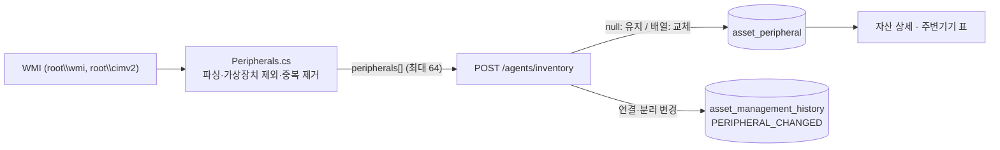

# 21. 주변기기(모니터·키보드·마우스)·USB 장치 수집 기능 검토·시험 보고서

| 항목 | 내용 |
|---|---|
| 문서번호 | AF-FR-2026-002 |
| 요청 | Windows Agent가 PC에 연결된 모니터·마우스·키보드 정보를 수집하도록 기능 개선 → 검토·분석·시험 후 버전업·운영 배포 |
| 작성일 | 2026-11-23 |
| 대상 버전 | 1차: Agent **0.2.13**, Backend **0.2.1**, Frontend **0.3.1** / 2차(§6): Agent **0.2.14**, Backend **0.2.2**, Frontend **0.3.2** / 3차(§7): Agent **0.2.15**, Backend **0.2.3** |
| 산출물 | 0.2.13 SHA-256 `343ef31a…91c7`, 0.2.14 SHA-256 `1939c932…9e4e`, **0.2.15 SHA-256 `aa48e7e4996a2c46e9c983a23448c4e1a7d3938bfe9b679221fdbb35a0b6c171`** (`agent/release/AssetFlow.Agent.exe`), Flyway `V3__asset_peripheral.sql`, `V4__asset_usb_device.sql`, `V5__reset_usb_peripheral_first_reports.sql` |

## 1. 검토 (요구사항·ITAM 관점)

| 관점 | 판단 |
|---|---|
| 자산관리 가치 | 모니터는 단가가 높고 이동이 잦은 별도 자산이다. **모니터 시리얼로 "어느 PC에 연결돼 있는가"**를 추적할 수 있어 실사·분실 확인에 직접 쓰인다. 키보드·마우스는 소모품 성격이지만 USB/블루투스·제조사 현황과 비인가 장치 파악에 유용하다. |
| 개인정보·보안 | 장치 **메타데이터만** 수집한다(이름·제조사·모델 코드·시리얼·연결 방식). 키 입력, 포인터 이동, 화면 내용은 수집하지 않는다(README 보안 원칙 유지). 신규 권한·포트·원격 실행 없음. |
| 하위 호환 | 운영 PC 4대는 Agent 0.2.11이다. 구버전은 `peripherals` 필드를 보내지 않으므로 서버는 **필드가 없으면 기존 목록을 건드리지 않는다**. 화면은 "Agent 0.2.13 이상으로 업데이트되면 수집됩니다"로 안내한다. |
| 범위 제외 | 모니터 해상도(서비스는 세션 0에서 실행돼 사용자 화면 배치를 정확히 알 수 없음), 프린터·USB 저장장치(별도 정책 필요), 모니터를 독립 자산으로 등록·배정하는 기능(FR 후속 과제) |

## 2. 분석 (수집 방식)

| 장치 | WMI 소스 | 수집 항목 | 비고 |
|---|---|---|---|
| 모니터 | `root\wmi` `WmiMonitorID` | 제조사 코드(EDID 3자 → 이름 매핑), 제품 코드, 시리얼, 모델명, 제조연도 | `Active=false`(과거 연결) 제외. 시리얼 `0`·`0000`은 EDID 자리표시자라 null |
| | `WmiMonitorBasicDisplayParams` | 가로·세로 cm → 대각선 인치 | TV·프로젝터는 0 → null |
| | `WmiMonitorConnectionParams` | 연결 방식(HDMI·DisplayPort·DVI·VGA·내장) | 노트북 패널(eDP/LVDS/내장) = `Internal` |
| 키보드 | `Win32_Keyboard` | 이름, PNP ID → VID/PID·연결 방식 | |
| 마우스 | `Win32_PointingDevice` | 동일 | 터치패드 포함 |
| 공통 | `Win32_PnPEntity.GetDeviceProperties` | HID 제품 문자열(`DEVPKEY_Device_BusReportedDeviceDesc`, 없으면 부모 USB 노드) | "HID Keyboard Device" 같은 일반 명칭 대신 "MX Keys" 등 실제 제품명 |
| 공통 | `Win32_SystemEnclosure.ChassisTypes` | 노트북 여부 | ACPI(i8042) 장치: 노트북=`Internal`, 데스크톱=`PS/2` |

설계 결정:

- **가상 장치 제외**: `TERMINPUT_BUS\`·`ROOT\RDP_*`(원격 데스크톱), `VMBUS\`(Hyper-V), `SWD\`, VMware·VirtualBox. RDP로 접속할 때마다 키보드·마우스가 생겼다 사라지는 오탐을 막는다.
- **중복 제거**: 키보드 한 대가 HID 컬렉션 2~3개로 보이므로 `종류+VID+PID` 단위로 1건(VID가 없으면 PNP ID 단위). 일반 명칭보다 구체 명칭을 남긴다.
- **실패 처리**: 예기치 않은 WMI 오류 시 `peripherals=null`을 보내 서버가 기존 목록을 유지한다(부분 수집으로 "분리" 이력이 잘못 쌓이는 것 방지). 모니터 클래스가 없는 헤드리스 서버·VM은 "모니터 0대"로 처리한다. 주변기기 수집 실패는 인벤토리 전송을 막지 않는다.
- **최초 확인 시각**: 목록은 매번 교체하되, 같은 장치(모니터는 종류+제조사+모델+시리얼, 시리얼이 없으면 이름)가 계속 연결돼 있으면 `first_seen_at`을 유지한다.
- **변경 이력**: 두 번째 보고부터 연결·분리를 관리 이력(`changed_by=agent`)에 기록한다. 최초 보고(0.2.13 업데이트 직후)는 이력을 남기지 않는다.

## 3. 변경 내역

| 구성 | 파일 | 내용 |
|---|---|---|
| Agent | `agent/Peripherals.cs` (신규) | WMI 비의존 파싱 규칙(EDID 문자 디코딩, 인치, 연결 방식, VID/PID, 가상 장치, 중복 제거) — Linux에서 단위 시험 가능 |
| | `agent/PeripheralCollector.cs` (신규) | WMI 조회 |
| | `Models.cs`, `InventoryCollector.cs`, csproj | `PeripheralInfo`, `Inventory.Peripherals`, 버전 0.2.13 |
| Backend | `V3__asset_peripheral.sql` | `asset_peripheral` 테이블(유형 CHECK, asset 삭제 시 CASCADE, 시리얼 인덱스), `asset.peripherals_collected_at` |
| | `Models.java` | `Peripheral` 검증(유형 `MONITOR|KEYBOARD|MOUSE`, 길이, 연도 1990~2100, 인치 0~999.9, 최대 64건 → 위반 시 422) |
| | `AgentController.java` | 주변기기 동기화·최초 확인 유지·변경 이력 |
| | `AssetController.java` | 상세 응답 `peripherals`, 검색 API에 주변기기 이름·시리얼 포함 |
| Frontend | `src.jsx` | 자산 상세 요약·하드웨어 탭의 "주변기기" 표(구분·장치명·제조사·모델 코드·시리얼·연결·크기/제조연도·최초 확인) |

## 4. 시험 결과

| 구분 | 시험 | 결과 |
|---|---|---|
| Agent 단위 | `agent-tests` 콘솔 시험 4묶음(기존 3 + 주변기기 30여 단언: EDID 디코딩, 시리얼 자리표시자, 인치, 연결 방식, USB·BT Classic·BLE VID/PID, ACPI 노트북/데스크톱, I2C 터치패드, RDP·Hyper-V 제외, 중복 제거, 64건 상한, camelCase JSON 계약) | **통과** |
| Agent 빌드 | `dotnet build`·`publish -r win-x64` 단일 파일(경고 0, PE 헤더·FileVersion 0.2.13.0 확인) | **통과** |
| Backend 단위 | JUnit 20건(신규 `AgentControllerTest` 5건: 구버전 무변경, 최초 보고 이력 없음, 모니터 교체 이력·최초 확인 유지, 이력 2000자 절삭, 시리얼 기준 식별) | **통과** |
| DB 마이그레이션 | **운영 DB 덤프 복제본**(PostgreSQL 16)에 Flyway V3 적용 | **성공** (v2 → v3) |
| API 종단 간 | 실제 Agent 직렬화 JSON으로: ① 구버전 페이로드 202·행 0 ② 최초 보고 4건·이력 0 ③ 동일 재보고 이력 0·최초 확인 4/4 유지 ④ 모니터 교체 시 "연결/분리" 이력 1건 ⑤ 수집 후 구버전 페이로드는 4건 유지 ⑥ 잘못된 유형 422 ⑦ 65건 이상 422 ⑧ 토큰 없음 401 ⑨ 상세 응답·모니터 시리얼 검색 | **통과** |
| Frontend | Vite 빌드, Playwright 회귀 25/25(신규: 하드웨어 탭 주변기기 표·건수·연결 라벨·크기/연도) | **통과** |

**미시험(위험)**: 실제 Windows PC에서 WMI 조회는 이 환경(Linux aarch64)에서 실행할 수 없었다. 모든 WMI 호출은 예외를 흡수하고 실패 시 `null`(서버 기존값 유지)이므로 최악의 경우 "주변기기 미수집"에 그치며 인벤토리·하트비트·업데이트에는 영향이 없다. 배포 후 운영 PC 1대에서 아래를 확인한다.

## 5. 배포·확인 절차

1. `main` 푸시 → CI 시험 게이트 → Backend·Frontend 이미지 → k3s 롤링 배포(Flyway V3 자동 적용).
2. 관리 화면 **Agent 배포**에서 `0.2.13` 등록 → 운영 PC가 5분 주기 업데이트 확인에서 자동 교체.
3. 확인: `agent_update_history`에 `0.2.11 → 0.2.13`, 자산 상세 하드웨어 탭 주변기기 표, PC의 `%ProgramData%\AssetFlow\logs\agent-*.log`에 인벤토리 성공.
4. **0.2.12 변경분 동반 적용 주의**: 운영 PC는 0.2.11이므로 이번 업데이트로 0.2.12의 DPAPI 토큰·ProgramData ACL 검증이 함께 적용된다(CR-A13). 업데이트 스크립트가 시작 전에 소유자를 SYSTEM으로 교정한다. 업데이트 후 15분 내 하트비트가 끊긴 PC가 있으면 해당 PC에서 `scripts\fix-acl.ps1` 실행 또는 재설치한다.
5. 롤백: Agent는 이전 버전을 상위 번호로 재빌드해 등록(릴리스 버전 불변 정책). 서버는 이전 이미지 태그로 롤백해도 V3 테이블은 무해하다(구 코드는 참조하지 않음).

## 6. 2차: USB 장치(현재·과거 연결) 수집 + 0.2.13 결함 수정 (2026-11-23)

### 6.1 0.2.13 운영 결과와 결함

운영 PC `DESKTOP-KJH`가 0.2.13으로 자동 업데이트되어 0.2.12 변경분(로그온 사용자 `DESKTOP-KJH\KJH`, DPAPI·ACL)은 정상 동작했으나 **주변기기는 `null`(수집 실패)** 로 보고됐다. 원인은 `Win32_Keyboard` 클래스에 없는 `Manufacturer` 속성을 WQL로 선택해 쿼리 전체가 `InvalidQuery`로 실패한 것이다(마우스 클래스에만 존재). 설계대로 서버는 기존 값을 유지해 데이터 손상은 없었다. 0.2.14에서 클래스별 WQL로 분리했고, 수집 실패 사유(예외 형식·코드만, 메시지·경로 제외)를 `collectionErrors`로 서버에 보고해 상세 화면에 표시한다 — 원격 PC 로그를 볼 수 없는 문제를 해소.

### 6.2 검토·분석

| 항목 | 내용 |
|---|---|
| 수집 방식 | **SetupAPI** `SetupDiGetClassDevs("USB", DIGCF_ALLCLASSES)` — `DIGCF_PRESENT` 없이 열거해 **현재 연결 + 과거 연결(비활성) 장치**를 모두 얻는다. 레지스트리 `Enum\USB`를 직접 읽는 방식은 속성 저장 형식이 OS 버전마다 달라 배제 |
| 시각 | 장치 속성 `DEVPKEY_Device_FirstInstallDate`(최초 설치), `LastArrivalDate`(최근 연결), `LastRemovalDate`(최근 분리) — Windows 8 이상 |
| 이름 | `USBSTOR` 열거자의 FriendlyName(저장장치) → FriendlyName → 버스 보고 제품명 → INF 설명 → 인터페이스 이름 순, "USB Composite Device" 같은 일반 명칭은 후순위 |
| 분류 | 저장장치·휴대기기(MTP)·카메라·프린터·네트워크·스마트카드·오디오·시리얼·블루투스·입력장치·기타. 복합 장치(웹캠=카메라+오디오)는 인터페이스(`MI_xx`)를 부모 장치로 합치고 우선순위가 높은 분류 채택. 허브·루트 허브 제외 |
| 과거 기록의 한계 | Windows "Plug and Play Cleanup" 작업이 오래 연결되지 않은 장치(일반적으로 30일)를 지운다. 그래서 **서버는 장치 인스턴스 ID 기준 upsert로 누적하고 삭제하지 않는다** — 이후 보고에 없으면 `present=false`로 남는다 |
| 보안 이벤트 | USB를 이미 보고한 자산에서 **처음 보는 저장장치·휴대기기**가 나타나면 관리 이력 `USB_DEVICE_FIRST_SEEN` 기록(최초 수집 시에는 기록하지 않아 이력 폭주 방지) |
| 개인정보 | 장치 메타데이터(이름·제조사·VID/PID·시리얼·연결 시각)만. 저장장치 안의 파일명·내용은 수집하지 않음 |
| 상한 | 장치 300건(현재 연결 우선, 최근 연결 순) — 초과 시 422 |

### 6.3 변경 내역

| 구성 | 내용 |
|---|---|
| Agent 0.2.14 | `UsbDevices.cs`(파싱·분류·병합 규칙), `UsbCollector.cs`(SetupAPI P/Invoke), `PeripheralCollector.cs` WQL 수정, `Inventory.UsbDevices`·`CollectionErrors`, 통신 로그 `INVENTORY_ACK`에 주변기기·USB 건수와 오류 |
| Backend 0.2.2 | Flyway `V4__asset_usb_device`(`UNIQUE(asset_id, device_id)`, 시리얼 인덱스), `asset.usb_collected_at`·`collection_errors`, 누적 upsert(`RETURNING xmax=0`로 신규 판별), 상세 응답 `usbDevices`, 검색 API에 USB 이름·시리얼 포함, Dockerfile jar 이름 버전 독립화 |
| Frontend 0.3.2 | 자산 상세 "USB 장치" 표(상태 연결됨/과거 연결, 분류, 장치명, 제조사, VID:PID, 시리얼, 최근 연결·분리, 최초 설치), 수집 실패 사유 알림 |

### 6.4 시험 결과

| 구분 | 결과 |
|---|---|
| Agent 콘솔 시험 5묶음(신규 USB: INF 설명 정리, DEVPROP 문자열·FILETIME, 인스턴스 ID·USBSTOR 시리얼, 분류 10종, 허브 제외, 복합 장치 병합, 과거 USB 메모리 이름·시각, 휴대폰 MTP, 정렬, 300건 상한, JSON 계약, 오류 메모에 메시지 미포함) | **통과** |
| Agent `win-x64` 빌드·publish(경고 0, FileVersion 0.2.14.0) | **통과** |
| Backend JUnit 23건(신규 3: upsert·미삭제·신규 저장장치 이력, 최초 보고 이력 없음·구버전 무변경, 오류 저장) | **통과** |
| 운영 DB 복제본(V3 상태)에 Flyway V4 적용 | **성공** |
| API 종단 간: 구버전 무변경 / 최초 보고 이력 0 / 새 USB 메모리 이력 1 / PC 기록 정리 후에도 서버 보관 / 수집 실패 시 기존 값 유지·사유 저장·복구 시 해제 / 잘못된 분류·301건 422 / USB 시리얼 검색 | **통과** |
| Playwright 회귀 26/26(신규: USB 표 연결됨·과거 연결) | **통과** |

**미시험(위험)**: SetupAPI 호출은 실제 Windows에서 실행하지 못했다. 장치 단위 예외는 건너뛰고, 전체 실패 시 `null`+사유 보고로 서버 값이 유지되며 인벤토리 다른 항목에는 영향이 없다. 배포 후 `DESKTOP-KJH`의 보고(주변기기·USB 건수, `collection_errors`)로 확인한다.

## 7. 3차: 운영 실데이터 기반 보정 — Agent 0.2.15 / Backend 0.2.3 (2026-11-23)

### 7.1 0.2.14 운영 결과 (DESKTOP-KJH)

수집 오류 없이 **모니터 2대**(LG 32" HDMI 2014년, AOC Q3279WG5B 33.4" HDMI 2018년 S/N GPUJCHA057271), 키보드·마우스, **USB 129건**(현재 연결 3, 과거 연결: 삼성 갤럭시 탭·휴대폰, SanDisk·ADATA USB 메모리, TOSHIBA 라벨 프린터, CSR 블루투스 동글 등, 최초 설치·최근 연결/분리 시각 포함)이 수집됐다. 실데이터로 확인된 보정 사항:

| 관찰 | 원인 | 0.2.15 조치 |
|---|---|---|
| 삼성 기기 1회 연결이 4행(SAMSUNG_Android·Modem·Galaxy Tab·ADB Interface)으로 분리 | 삼성 버스 드라이버(`dg_ssudbus`)가 기능을 `MI_xx`가 아닌 형식으로 열거 | 장치 트리 **부모(`DEVPKEY_Device_Parent`, 비연결 장치는 `LastKnownParent`)** 기준으로 최상위 USB 장치에 병합. 휴대기기는 MTP 기능명("Galaxy Tab A11+")을 장치명으로 사용 |
| 키보드 "알 수 없는 키보드", 마우스 "HID-compliant mouse" | 한국어 Windows 일반 명칭, HID 노드에 제품 문자열 없음 | 같은 VID/PID의 USB 제품명으로 보강("Wired Keyboard 600", "USB Gaming Mouse"). 한국어 일반 명칭 목록 추가 |
| 마우스·프린터 제조사 "Microsoft" | INF 제공자(클래스 드라이버) 값 | VID가 Microsoft(045E)가 아니면 무시, USB 제조사·VID 매핑 사용 |
| 게이밍 마우스가 키보드로도 표시 | 매크로 키용 키보드 HID 컬렉션 | 같은 VID/PID 마우스가 있고 이름에 "mouse"가 있으면 키보드 항목 제외 |
| LG 모니터 S/N `16843009`, 프린터 S/N `____________` | EDID 자리표시자(0x01010101), 미설정 값 | 시리얼 자리표시자로 판정해 null |
| "Wired Keyboard ࠶00" | 장치가 보고한 문자열의 상위 바이트 손상(U+0836 = '6') | ASCII 이름 속 U+0100~U+0FFF 문자는 하위 바이트로 복원(한글 등은 유지) |
| "Unknown USB Device (Device Descriptor Request Failed)" VID 0000 | 열거 실패 장치 | 제외 |

### 7.2 서버 데이터 보정

`V5__reset_usb_peripheral_first_reports.sql`: 0.2.14가 저장한 USB 129행·주변기기 5행(DESKTOP-KJH 1대분, 관련 관리 이력 0건)을 비우고 수집 시각을 초기화한다. 0.2.15 보고와 장치 키가 달라 가짜 "연결/분리" 이력이 생기는 것을 막고, 다음 보고를 최초 수집으로 처리한다. USB 과거 기록은 PC에 남아 있어 손실이 없다.

### 7.3 시험

| 구분 | 결과 |
|---|---|
| Agent 콘솔 시험 6묶음(신규: 운영 사례 — 삼성 버스 드라이버 병합, 열거 실패 제외, 자리표시자, 손상 문자 복원, 한국어 일반 명칭, USB 기반 보강, 게이밍 마우스 키보드 제외) | **통과** |
| Agent `win-x64` publish(FileVersion 0.2.15.0) | **통과** |
| Backend JUnit 23건 | **통과** |
| 운영 DB 복제본에 V5 적용(USB 129→0, 주변기기 5→0, 자산 4건 유지), 삼성 사례 페이로드 2회 보고 → 휴대기기 1행·이력 0건 | **통과** |

### 7.4 운영 배포 중 발견·조치한 CI 문제

| 문제 | 조치 |
|---|---|
| Backend Dockerfile이 `assetflow-api-0.2.0.jar` 이름을 고정 → pom 버전 변경 시 이미지 빌드 실패 | 빌드 단계에서 버전 무관하게 `app.jar`로 복사 |
| Frontend 이미지(arm64)를 x64 러너의 QEMU 에뮬레이션으로 빌드하다 `npm ci`가 30분 이상 정지(2회 연속) | 빌드 단계를 `--platform=${BUILDPLATFORM:-linux/arm64}`로 러너 네이티브 실행(정적 파일은 플랫폼 무관), 최종 nginx 단계는 복사만 수행. buildx 교차 빌드·레거시 빌더 모두 로컬 검증 |
