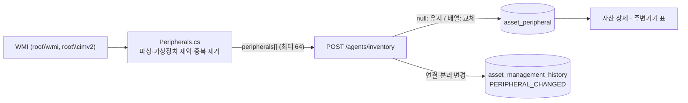

# 21. 주변기기(모니터·키보드·마우스) 수집 기능 검토·시험 보고서

| 항목 | 내용 |
|---|---|
| 문서번호 | AF-FR-2026-002 |
| 요청 | Windows Agent가 PC에 연결된 모니터·마우스·키보드 정보를 수집하도록 기능 개선 → 검토·분석·시험 후 버전업·운영 배포 |
| 작성일 | 2026-11-23 |
| 대상 버전 | Agent 0.2.12 → **0.2.13**, Backend 0.2.0 → **0.2.1**, Frontend 0.3.0 → **0.3.1** |
| 산출물 | `agent/release/AssetFlow.Agent.exe` (SHA-256 `343ef31a2806c90d4043d7f890e6076ccfffa78acf258755d1b51d475be091c7`), Flyway `V3__asset_peripheral.sql` |

## 1. 검토 (요구사항·ITAM 관점)

| 관점 | 판단 |
|---|---|
| 자산관리 가치 | 모니터는 단가가 높고 이동이 잦은 별도 자산이다. **모니터 시리얼로 "어느 PC에 연결돼 있는가"**를 추적할 수 있어 실사·분실 확인에 직접 쓰인다. 키보드·마우스는 소모품 성격이지만 USB/블루투스·제조사 현황과 비인가 장치 파악에 유용하다. |
| 개인정보·보안 | 장치 **메타데이터만** 수집한다(이름·제조사·모델 코드·시리얼·연결 방식). 키 입력, 포인터 이동, 화면 내용은 수집하지 않는다(README 보안 원칙 유지). 신규 권한·포트·원격 실행 없음. |
| 하위 호환 | 운영 PC 4대는 Agent 0.2.11이다. 구버전은 `peripherals` 필드를 보내지 않으므로 서버는 **필드가 없으면 기존 목록을 건드리지 않는다**. 화면은 "Agent 0.2.13 이상으로 업데이트되면 수집됩니다"로 안내한다. |
| 범위 제외 | 모니터 해상도(서비스는 세션 0에서 실행돼 사용자 화면 배치를 정확히 알 수 없음), 프린터·USB 저장장치(별도 정책 필요), 모니터를 독립 자산으로 등록·배정하는 기능(FR 후속 과제) |

## 2. 분석 (수집 방식)

| 장치 | WMI 소스 | 수집 항목 | 비고 |
|---|---|---|---|
| 모니터 | `root\wmi` `WmiMonitorID` | 제조사 코드(EDID 3자 → 이름 매핑), 제품 코드, 시리얼, 모델명, 제조연도 | `Active=false`(과거 연결) 제외. 시리얼 `0`·`0000`은 EDID 자리표시자라 null |
| | `WmiMonitorBasicDisplayParams` | 가로·세로 cm → 대각선 인치 | TV·프로젝터는 0 → null |
| | `WmiMonitorConnectionParams` | 연결 방식(HDMI·DisplayPort·DVI·VGA·내장) | 노트북 패널(eDP/LVDS/내장) = `Internal` |
| 키보드 | `Win32_Keyboard` | 이름, PNP ID → VID/PID·연결 방식 | |
| 마우스 | `Win32_PointingDevice` | 동일 | 터치패드 포함 |
| 공통 | `Win32_PnPEntity.GetDeviceProperties` | HID 제품 문자열(`DEVPKEY_Device_BusReportedDeviceDesc`, 없으면 부모 USB 노드) | "HID Keyboard Device" 같은 일반 명칭 대신 "MX Keys" 등 실제 제품명 |
| 공통 | `Win32_SystemEnclosure.ChassisTypes` | 노트북 여부 | ACPI(i8042) 장치: 노트북=`Internal`, 데스크톱=`PS/2` |

설계 결정:

- **가상 장치 제외**: `TERMINPUT_BUS\`·`ROOT\RDP_*`(원격 데스크톱), `VMBUS\`(Hyper-V), `SWD\`, VMware·VirtualBox. RDP로 접속할 때마다 키보드·마우스가 생겼다 사라지는 오탐을 막는다.
- **중복 제거**: 키보드 한 대가 HID 컬렉션 2~3개로 보이므로 `종류+VID+PID` 단위로 1건(VID가 없으면 PNP ID 단위). 일반 명칭보다 구체 명칭을 남긴다.
- **실패 처리**: 예기치 않은 WMI 오류 시 `peripherals=null`을 보내 서버가 기존 목록을 유지한다(부분 수집으로 "분리" 이력이 잘못 쌓이는 것 방지). 모니터 클래스가 없는 헤드리스 서버·VM은 "모니터 0대"로 처리한다. 주변기기 수집 실패는 인벤토리 전송을 막지 않는다.
- **최초 확인 시각**: 목록은 매번 교체하되, 같은 장치(모니터는 종류+제조사+모델+시리얼, 시리얼이 없으면 이름)가 계속 연결돼 있으면 `first_seen_at`을 유지한다.
- **변경 이력**: 두 번째 보고부터 연결·분리를 관리 이력(`changed_by=agent`)에 기록한다. 최초 보고(0.2.13 업데이트 직후)는 이력을 남기지 않는다.

## 3. 변경 내역

| 구성 | 파일 | 내용 |
|---|---|---|
| Agent | `agent/Peripherals.cs` (신규) | WMI 비의존 파싱 규칙(EDID 문자 디코딩, 인치, 연결 방식, VID/PID, 가상 장치, 중복 제거) — Linux에서 단위 시험 가능 |
| | `agent/PeripheralCollector.cs` (신규) | WMI 조회 |
| | `Models.cs`, `InventoryCollector.cs`, csproj | `PeripheralInfo`, `Inventory.Peripherals`, 버전 0.2.13 |
| Backend | `V3__asset_peripheral.sql` | `asset_peripheral` 테이블(유형 CHECK, asset 삭제 시 CASCADE, 시리얼 인덱스), `asset.peripherals_collected_at` |
| | `Models.java` | `Peripheral` 검증(유형 `MONITOR|KEYBOARD|MOUSE`, 길이, 연도 1990~2100, 인치 0~999.9, 최대 64건 → 위반 시 422) |
| | `AgentController.java` | 주변기기 동기화·최초 확인 유지·변경 이력 |
| | `AssetController.java` | 상세 응답 `peripherals`, 검색 API에 주변기기 이름·시리얼 포함 |
| Frontend | `src.jsx` | 자산 상세 요약·하드웨어 탭의 "주변기기" 표(구분·장치명·제조사·모델 코드·시리얼·연결·크기/제조연도·최초 확인) |

## 4. 시험 결과

| 구분 | 시험 | 결과 |
|---|---|---|
| Agent 단위 | `agent-tests` 콘솔 시험 4묶음(기존 3 + 주변기기 30여 단언: EDID 디코딩, 시리얼 자리표시자, 인치, 연결 방식, USB·BT Classic·BLE VID/PID, ACPI 노트북/데스크톱, I2C 터치패드, RDP·Hyper-V 제외, 중복 제거, 64건 상한, camelCase JSON 계약) | **통과** |
| Agent 빌드 | `dotnet build`·`publish -r win-x64` 단일 파일(경고 0, PE 헤더·FileVersion 0.2.13.0 확인) | **통과** |
| Backend 단위 | JUnit 20건(신규 `AgentControllerTest` 5건: 구버전 무변경, 최초 보고 이력 없음, 모니터 교체 이력·최초 확인 유지, 이력 2000자 절삭, 시리얼 기준 식별) | **통과** |
| DB 마이그레이션 | **운영 DB 덤프 복제본**(PostgreSQL 16)에 Flyway V3 적용 | **성공** (v2 → v3) |
| API 종단 간 | 실제 Agent 직렬화 JSON으로: ① 구버전 페이로드 202·행 0 ② 최초 보고 4건·이력 0 ③ 동일 재보고 이력 0·최초 확인 4/4 유지 ④ 모니터 교체 시 "연결/분리" 이력 1건 ⑤ 수집 후 구버전 페이로드는 4건 유지 ⑥ 잘못된 유형 422 ⑦ 65건 이상 422 ⑧ 토큰 없음 401 ⑨ 상세 응답·모니터 시리얼 검색 | **통과** |
| Frontend | Vite 빌드, Playwright 회귀 25/25(신규: 하드웨어 탭 주변기기 표·건수·연결 라벨·크기/연도) | **통과** |

**미시험(위험)**: 실제 Windows PC에서 WMI 조회는 이 환경(Linux aarch64)에서 실행할 수 없었다. 모든 WMI 호출은 예외를 흡수하고 실패 시 `null`(서버 기존값 유지)이므로 최악의 경우 "주변기기 미수집"에 그치며 인벤토리·하트비트·업데이트에는 영향이 없다. 배포 후 운영 PC 1대에서 아래를 확인한다.

## 5. 배포·확인 절차

1. `main` 푸시 → CI 시험 게이트 → Backend·Frontend 이미지 → k3s 롤링 배포(Flyway V3 자동 적용).
2. 관리 화면 **Agent 배포**에서 `0.2.13` 등록 → 운영 PC가 5분 주기 업데이트 확인에서 자동 교체.
3. 확인: `agent_update_history`에 `0.2.11 → 0.2.13`, 자산 상세 하드웨어 탭 주변기기 표, PC의 `%ProgramData%\AssetFlow\logs\agent-*.log`에 인벤토리 성공.
4. **0.2.12 변경분 동반 적용 주의**: 운영 PC는 0.2.11이므로 이번 업데이트로 0.2.12의 DPAPI 토큰·ProgramData ACL 검증이 함께 적용된다(CR-A13). 업데이트 스크립트가 시작 전에 소유자를 SYSTEM으로 교정한다. 업데이트 후 15분 내 하트비트가 끊긴 PC가 있으면 해당 PC에서 `scripts\fix-acl.ps1` 실행 또는 재설치한다.
5. 롤백: Agent는 이전 버전을 상위 번호로 재빌드해 등록(릴리스 버전 불변 정책). 서버는 이전 이미지 태그로 롤백해도 V3 테이블은 무해하다(구 코드는 참조하지 않음).
