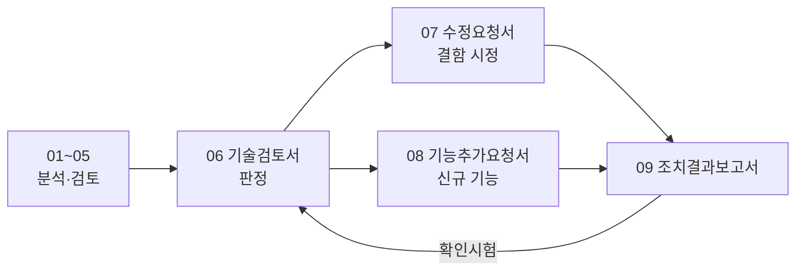

# AssetFlow IT 자산관리 소스 분석·기획 검토 문서

> 작성일: 2026-10-23 · 대상: `assets/` (AssetFlow Agent 0.2.9 / Backend / Frontend / k3s)
> HTML 버전은 같은 폴더의 `*.html`을 브라우저로 열면 Mermaid 다이어그램이 라이트 모드로 표시됩니다(`index.html`에서 시작).

### A. 분석·검토 (작업 문서)

| No | 문서 | 관점 | 주요 내용 |
|---|---|---|---|
| 01 | [현황분석](01_현황분석.md) | 공통 | 아키텍처, Agent 흐름, ERD, API, 성숙도, 코드 품질 |
| 02 | [IT자산관리 전문가 검토](02_IT자산관리_전문가_검토.md) | ITAM/SAM | 식별키·사용자명 결함, 생애주기, 마스터 데이터, 라이선스, 실사, KPI |
| 03 | [보안전문가 검토](03_보안전문가_검토.md) | 보안 | 업데이트 채널 위협, 취약점 22건, 개인정보, ISMS-P 매핑 |
| 04 | [인프라유지보수 검토](04_인프라유지보수_검토.md) | 운영 | SPOF, 백업, 스케줄 중복, 성능·용량, CI/CD, 관측성, Runbook, SLO |
| 05 | [개선기획 로드맵](05_개선기획_로드맵.md) | 통합 | 우선순위 백로그(P0~P3), 일정, To-Be 아키텍처, 즉시 적용 코드 |

### B. 공식 문서 (결재·회신용)

| No | 문서 | 문서번호 | 용도 |
|---|---|---|---|
| 06 | [기술검토서](06_기술검토서.md) | AF-TR-2026-001 | 검토 범위·방법·영역별 평가·종합 판정(조건부 운영)·선결 조건 |
| 07 | [수정요청서](07_수정요청서.md) | AF-CR-2026-001 | 기존 결함·취약점 시정 36건(CR-001~036), 등급·기한·완료 기준 |
| 08 | [기능추가요청서](08_기능추가요청서.md) | AF-FR-2026-001 | 신규 기능 24건(FR-001~024), 우선순위·선행관계·수용 기준 |
| 09 | [조치결과보고서 양식](09_조치결과보고서_양식.md) | AF-RR-2026-___ | 개발 측 건별 조치 회신·검토자 판정 양식 |



## 핵심 결론 (요약)

| 구분 | 가장 중요한 발견 | 조치 |
|---|---|---|
| 보안 | 릴리스 업로드가 관리자 로그인 없이 토큰만으로 가능하고(`SecurityConfig.java:6`), Agent는 서버가 준 SHA-256만 확인 → 서버/토큰 유출 시 **전 PC에 SYSTEM 권한 코드 배포** 가능 | 업로드 경로 인증 강화(즉시), 코드서명·서명 매니페스트 검증(1분기) |
| 자산관리 | 사용자명이 항상 `SYSTEM`(`InventoryCollector.cs:25`), PC 이름 변경 시 중복 자산 생성(`AgentClient.cs:29`) | 로그온 사용자 수집, 식별키 재설계·중복 병합 |
| 인프라 | DB 백업 없음, 2개 Pod에서 스케줄 중복 실행, 헬스체크·점검이 DB를 실측하지 않음, 핵심 인덱스 누락 | 백업 CronJob·복구 리허설, ShedLock, Actuator, 인덱스 |

## 문서 재생성

MD를 수정한 뒤 HTML을 다시 만들려면 저장소 루트(`assets/`)에서:

```bash
node docs/build-html.mjs
```
