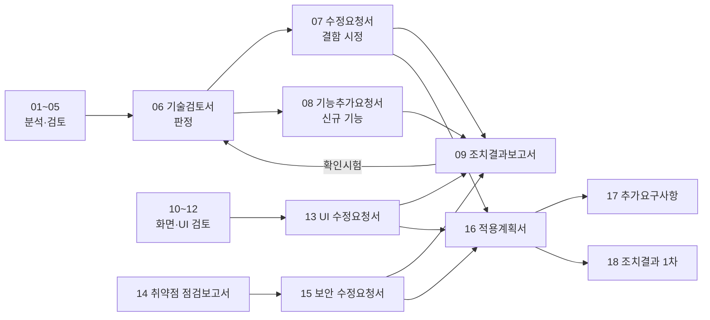

# AssetFlow IT 자산관리 소스 분석·기획 검토 문서

> 작성일: 2026-10-23 · 대상: `assets/` (AssetFlow Agent 0.2.9 / Backend / Frontend / k3s)
> HTML 버전은 같은 폴더의 `*.html`을 브라우저로 열면 Mermaid 다이어그램이 라이트 모드로 표시됩니다(`index.html`에서 시작).

### A. 분석·검토 (작업 문서)

| No | 문서 | 관점 | 주요 내용 |
|---|---|---|---|
| 01 | [현황분석](01_현황분석.md) | 공통 | 아키텍처, Agent 흐름, ERD, API, 성숙도, 코드 품질 |
| 02 | [IT자산관리 전문가 검토](02_IT자산관리_전문가_검토.md) | ITAM/SAM | 식별키·사용자명 결함, 생애주기, 마스터 데이터, 라이선스, 실사, KPI |
| 03 | [보안전문가 검토](03_보안전문가_검토.md) | 보안 | 업데이트 채널 위협, 취약점 22건, 개인정보, ISMS-P 매핑 |
| 04 | [인프라유지보수 검토](04_인프라유지보수_검토.md) | 운영 | SPOF, 백업, 스케줄 중복, 성능·용량, CI/CD, 관측성, Runbook, SLO |
| 05 | [개선기획 로드맵](05_개선기획_로드맵.md) | 통합 | 우선순위 백로그(P0~P3), 일정, To-Be 아키텍처, 즉시 적용 코드 |

### B. 공식 문서 (결재·회신용)

| No | 문서 | 문서번호 | 용도 |
|---|---|---|---|
| 06 | [기술검토서](06_기술검토서.md) | AF-TR-2026-001 | 검토 범위·방법·영역별 평가·종합 판정(조건부 운영)·선결 조건 |
| 07 | [수정요청서](07_수정요청서.md) | AF-CR-2026-001 | 기존 결함·취약점 시정 36건(CR-001~036), 등급·기한·완료 기준 |
| 08 | [기능추가요청서](08_기능추가요청서.md) | AF-FR-2026-001 | 신규 기능 24건(FR-001~024), 우선순위·선행관계·수용 기준 |
| 09 | [조치결과보고서 양식](09_조치결과보고서_양식.md) | AF-RR-2026-___ | 개발 측 건별 조치 회신·검토자 판정 양식 |

### C. 화면·UI 재검토 (2차, 2026-10-23)

소스를 빌드해 헤드리스 브라우저로 그리드 컬럼 옵션(▾) 메뉴를 실행 검증하고, 화면 대비·글자 크기를 실측한 결과.

| No | 문서 | 관점 | 주요 내용 |
|---|---|---|---|
| 10 | [디자인 전문가 UI 검토](10_디자인전문가_UI검토.md) | 디자인 | 5중 적층 디자인 시스템, 대비 미달 24종, 12px 미만 151건, 헤더 메뉴 UX, 반응형, 고정 상태 문구 |
| 11 | [웹 전문가 프런트엔드 검토](11_웹전문가_프런트엔드검토.md) | 웹 | 컬럼 메뉴 시나리오 16개 실측(결함 8·미흡 3), 접근성, 번들 1.5MB, 외부 CDN, CSS 구조, 즉시 적용 패치 |
| 12 | [IT자산관리 전문가 화면 검토](12_IT자산관리전문가_화면검토.md) | ITAM | 결합 컬럼의 필터·정렬 불가, 500건 상한, API 미노출 필드, 내보내기 불일치, KPI 산식, 권장 컬럼 명세 21개 |
| 13 | [수정요청서 (화면·UI)](13_수정요청서_UI.md) | 공식 (AF-CR-2026-002) | CR-U01~U24 (P0 6 / P1 14 / P2 4), 기한·완료 기준·확인 시험 방법 |

### D. 보안·웹 취약점 전수 점검 (3차, 2026-10-23)

백엔드·Agent·프런트·배포·CI 소스 전수를 OWASP Top 10·ASVS·CIS k8s 기준으로 점검. 03/07의 보안 17건 외 **신규 25건(V-01~V-25)** 식별.

| No | 문서 | 문서번호 | 주요 내용 |
|---|---|---|---|
| 14 | [보안·웹 취약점 점검보고서](14_보안웹취약점_점검보고서.md) | AF-VA-2026-001 | ProgramData 선점 로컬 권한 상승(Critical), 등록 남용, 릴리스 덮어쓰기, 운영 러너 root, 요청 무제한, k8s 보안 컨텍스트·NetworkPolicy·RBAC·DB 슈퍼유저, 공급망, OWASP 매핑, 안전 확인 항목 |
| 15 | [수정요청서 (보안·웹 취약점)](15_수정요청서_보안웹취약점.md) | AF-CR-2026-003 | CR-S01~S17 (P0 5 / P1 9 / P2 3), 07 보안 항목과의 연계, 확인 시험 방법 |

### E. 적용 계획·추가 검토·조치 회신 (2026-10-23)

| No | 문서 | 문서번호 | 주요 내용 |
|---|---|---|---|
| 16 | [수정요청 적용계획서](16_수정요청_적용계획서.md) | AF-IP-2026-001 | 07·13·15 총 77건의 현재 소스 대조(미조치 58·부분 14·완료 5), 운영 회귀 발견, 작업 묶음 WP-0~12, 단계별 일정, 결정 필요 사항 ①~⑦ |
| 17 | [추가요구사항 검토서](17_추가요구사항_검토서.md) | AF-AR-2026-001 | ITAM 표준·보안·개인정보·운영·이해관계자·데이터 통합·Agent 품질 7개 관점의 추가 항목 AR-001~030, 로드맵 반영안, 결정 사항 ⑧~ |
| 18 | [조치결과보고서 1차](18_조치결과보고서_1차.md) | AF-RR-2026-001 | 1차 반영분(0단계·P0 일부) 건별 조치 내역·시험 결과·미조치 사유 |
| 19 | [전문가 검토 프롬프트](19_전문가_검토_프롬프트.md) | — | ITAM·보안·인프라·QA 4역할 패널로 검토→기획→분석→테스팅을 시키는 재사용 프롬프트와 단계별 축약판 |



## 핵심 결론 (요약)

| 구분 | 가장 중요한 발견 | 조치 |
|---|---|---|
| 보안 | 릴리스 업로드가 관리자 로그인 없이 토큰만으로 가능하고(`SecurityConfig.java:6`), Agent는 서버가 준 SHA-256만 확인 → 서버/토큰 유출 시 **전 PC에 SYSTEM 권한 코드 배포** 가능 | 업로드 경로 인증 강화(즉시), 코드서명·서명 매니페스트 검증(1분기) |
| 자산관리 | 사용자명이 항상 `SYSTEM`(`InventoryCollector.cs:25`), PC 이름 변경 시 중복 자산 생성(`AgentClient.cs:29`) | 로그온 사용자 수집, 식별키 재설계·중복 병합 |
| 인프라 | DB 백업 없음, 2개 Pod에서 스케줄 중복 실행, 헬스체크·점검이 DB를 실측하지 않음, 핵심 인덱스 누락 | 백업 CronJob·복구 리허설, ShedLock, Actuator, 인덱스 |
| 보안 (3차 전수) | 일반 사용자가 `C:\ProgramData\AssetFlow`를 선점하면 설치 후 `agent.json`을 교체해 SYSTEM 서비스가 공격자 실행 파일을 업데이트로 받게 할 수 있음(V-01). 등록 토큰 1개로 가짜 장비 무제한 등록(V-03), 릴리스 버전 덮어쓰기(V-06), 운영 노드 러너 root 배포(V-15) | 설치 ACL·기동 검증(CR-S01), 릴리스 불변(CR-S05), 등록 승인·속도 제한(CR-S06), 배포 승인·sudo 제한(CR-S11) |
| 화면·UI (2차) | 컬럼 메뉴에 필터 진입점 없음·뷰포트 넘침, 보조 텍스트 대비 2.5~4.3:1, 모바일 내비 불가, 결합 컬럼으로 생애주기·부서 필터 불가 | CR-U01~U24 |

## 문서 재생성

MD를 수정한 뒤 HTML을 다시 만들려면 저장소 루트(`assets/`)에서:

```bash
node docs/build-html.mjs
```
